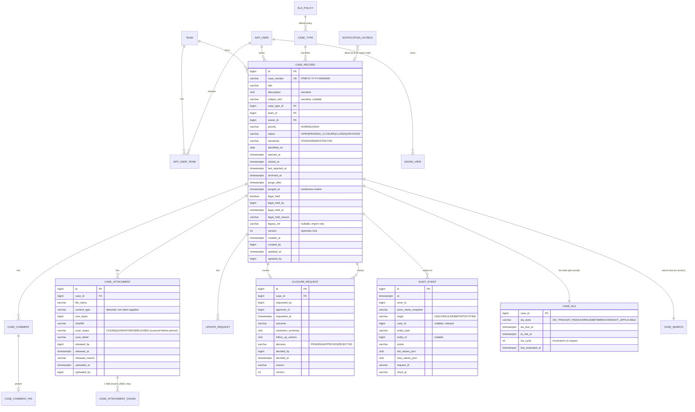
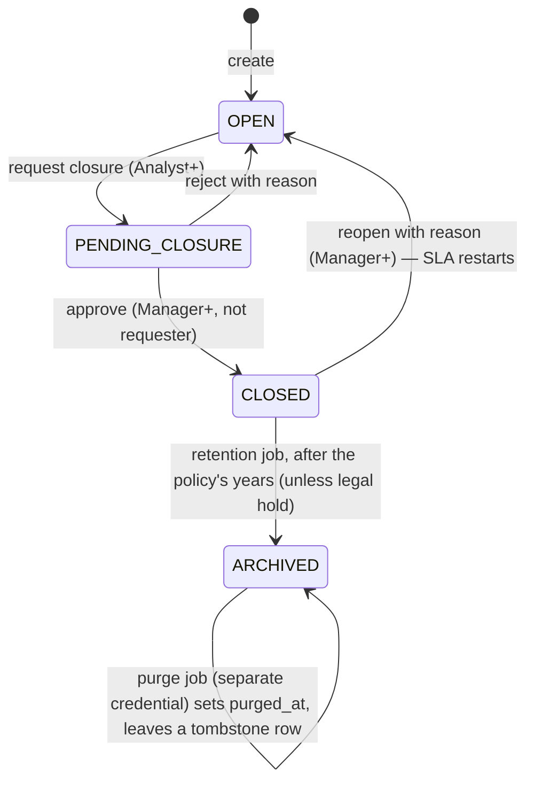
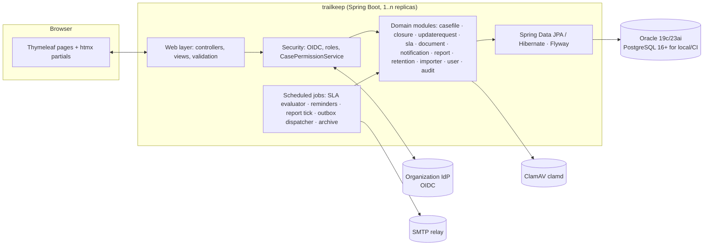

# Trailkeep — Full Build Plan

_Open-source compliance case tracker. Java · Oracle (PostgreSQL for local/CI) · modern server-rendered UI · Section 508 conformant · zero-finding security posture · Apache-2.0._
_Version 0.5 — 2026-11-03 — status: PLAN, no code yet. v0.3–v0.5 apply the audit decisions in `IMPLEMENTATION_PLAN.md` Part A (three independent review rounds, 62 findings); where the two disagree, the implementation plan wins._

---

## 0. One-paragraph summary

Trailkeep is a **small, opinionated compliance case tracker**: a case has an owner, a type, an age, comments, attachments, and exactly one approval moment (closure). It adds the three things the legacy tracker it replaces never had and its users explicitly asked for — **SLA-driven automatic alerts, an automated aging report, and real search** — and it keeps the one thing they actually used: **emailing a person from inside the system** (to request an update, or to ask management to approve closure). Everything else in the original blueprint (configurable workflow engine, multi-step approval chains, parties/entities, document versioning and annotation, drag-and-drop dashboards, integrations hub) is deliberately **out of v1**. It is a Spring Boot modular monolith on Java 21 LTS, JPA/Flyway on Oracle with PostgreSQL parity enforced by tests, Thymeleaf + htmx UI built to **WCAG 2.1 AA / Section 508**, SSO via the deploying organization's identity provider, and a public CI pipeline where SAST, SCA, secrets, container, accessibility and DAST scans are **build-breaking from the first commit**, so "no findings" is a maintained state rather than a cleanup project at the end. The project is **public and Apache-2.0 licensed**; anything organization-specific (data, identity configuration, import mappings) lives outside the repository.

---

## 1. Where the requirements came from, and what changed

### 1.1 Inputs

| Source | What it gave us |
|---|---|
| Original blueprint ("Assumptions & UI Conventions" + 15 click-by-click flows + error states + shortcuts + role visibility + label-mapping table + 7 discovery questions) | A generic, full-featured GRC case-management shape: wizard intake, parties/entities, tasks with blocking flags, documents with versions/annotations, multi-step approvals, SLA ladders, escalations, saved views, custom dashboards, integrations, retention admin. |
| Feedback from a long-time user of the legacy tracker | The legacy tool was **much simpler**. No true workflow. No SLA rules. It tracked the **age of the records** but did **no flagging or alerting**. They used the **email-from-the-system** feature to ask someone for an update and to **email management when requesting closure**; IT would attach the logged comment "and that would be that." They **want**: automatic alerts, an automated **aging report based on SLAs**, and search. |
| Sponsor constraints | Java; Oracle back end with PostgreSQL for local testing; modern UI; simple to use; security and permissions suited to sensitive content; scale back per the user feedback; **Section 508 conformance**; code must pass static **and** dynamic compliance scanning with no findings; **public, fully open-source project**; the legacy tool is not named anywhere in the plan or code. |
| Assumed deployment context (to confirm in Phase 0) | Regulated data (HIPAA-class), FISMA / FedRAMP-aligned hosting, RHEL / OpenShift. |

### 1.2 Scoping decisions — the blueprint vs. v1

| Blueprint capability | v1 decision | Why |
|---|---|---|
| Sign-in via SSO | **Keep** | Non-negotiable in regulated environments; also removes password handling from our attack surface entirely. |
| Dashboard with KPIs, My Cases, Open Cases, New Case button | **Keep, fixed layout** | Fixed, role-aware dashboard. No drag-and-drop widget builder. |
| New Case intake wizard (5 steps) | **Simplify → one page** | One form, sensible defaults, required fields marked. A wizard for ~8 fields adds clicks, not clarity. |
| Parties & Entities step | **Drop** (free-text "Subject / involved parties" field instead) | Legacy had none; a structured party model is a project in itself. Schema leaves room to add later. |
| Case Overview, Edit, Save | **Keep** | |
| Assign Investigator / Team | **Simplify → Owner + Team** | One owner, one team. No team-member lists on the case. |
| Submit for Review / In Review state | **Drop** | Collapses into the single closure approval. |
| Tasks & Workflow (blocking tasks, stage ladder Initial Assessment → Investigation → Remediation → Closure, automations) | **Drop** | Users: "there is not true workflow built into it." Replaced by an optional, non-enforced **checklist** on the case (v1.1 candidate). |
| Advance Stage dropdown | **Drop** | Status is now `Open → Pending Closure → Closed` (+ `Reopened` as an event, not a state). |
| Notes / internal comments, pin/edit/delete | **Keep, simplified** | Comments are append-only (no edit/delete; a correction is a new comment). Pin kept. This is also what makes the comment trail usable as evidence. |
| Documents: upload, virus scan, verified/quarantined badge | **Keep** | Required for sensitive attachments. |
| Documents: annotate, version history, link-to-task | **Drop** | Re-upload is the version. |
| Request Approval with selectable approval workflow, multiple approvers | **Simplify → Request Closure** | Exactly one approval type, one approver (the case's team manager by default, overridable). Approve → Closed; Reject → back to Open with a required reason. This *is* the legacy "email management when requesting closure" flow, done in-app with an email. |
| Escalations: automatic Overdue + manual Escalate with levels | **Keep automatic; drop manual levels** | Automatic At-Risk / Overdue flags and emails are the headline new feature. Manual escalation becomes "Request Update" to any user (the legacy email-someone feature). |
| Search, filters, saved views, bulk actions | **Keep search + filters + saved views; drop bulk update; keep bulk export** | Users asked for search. Bulk status changes bypass the approval model, so they are out. |
| Reports: SLA Compliance, Case Aging, Policy Violations; export PDF/CSV/Excel | **Keep Aging + SLA Compliance + Open-by-Owner; CSV + print-ready accessible HTML (tagged PDF is v1.1); scheduled email of Aging report** | The automated aging report is explicitly requested. "Policy Violations" is undefined, deferred. |
| Custom dashboards (drag widgets, share) | **Drop** | |
| Close Case with blocking-task check, closure modal (Outcome, Resolution Summary, Follow-ups) | **Keep closure modal; no blocking tasks** | Outcome + Resolution Summary are required on the closure request so the approver sees them. |
| Reopen with reason | **Keep** (Manager/Admin) | |
| Subscribe / notification center / email-vs-in-app toggle | **Simplify → email only + in-app "my alerts" list** | Owners and approvers are notified by rule; explicit per-case subscribe is v1.1. |
| Audit & History tab | **Keep, strengthen** | Append-only, every create/update/state change/view-of-restricted-case, with before/after values. |
| Admin: Users & Roles | **Keep, read-mostly** | Roles come from IdP groups; admin screen shows effective roles and allows team assignment and a local disable flag. |
| Admin: Workflows, Case Types & Forms schema editor, Integrations | **Drop Workflows + Forms editor + Integrations; keep Case Types (name, default SLA, active flag)** | |
| Admin: SLA Policies | **Keep, simplified** | SLA = target days + at-risk threshold per case type (optionally per priority). No "ladders." |
| Admin: Retention | **Keep as retention years per case type + archive and purge jobs with legal hold** | Compliance requirement. |
| Error states (disabled Save with tooltip, server-side error banner, quarantine with Request Release, concurrent-edit conflict, API timeout toast) | **Keep all** | Cheap and they make the app feel finished. |
| Keyboard shortcuts | **Keep `/` and `N` (single-key shortcuts are user-disableable, per WCAG 2.1.4); drop wizard Alt-arrows** | |
| Role-based visibility | **Keep** | Implemented as a permission matrix (§3), not per-screen conditionals. |

### 1.3 Improvements over both the legacy tool and the blueprint

1. **Age becomes actionable.** Every case shows an SLA clock (`On Track / At Risk / Overdue`), the dashboard groups by it, and the system emails people instead of waiting for someone to look.
2. **Closure is a real, auditable gate** — one click to request, one click to approve, reason required to reject, all logged — while still producing the email management is used to receiving.
3. **"Email someone from the system" survives** as *Request Update*, and the request is tracked on the case (who, when, answered or not), so unanswered requests show up on the aging report.
4. **Restricted cases.** A sensitivity flag hides a case from everyone except its owner, its team's managers, and compliance admins — including from search results and reports — and every view of a restricted case is audited.
5. **Search that works** across case number, title, description and comments (subject is deliberately excluded, §8.4), with filters that persist as saved views.
6. **Evidence-grade history**: append-only comments and audit, immutable attachments, retention with legal hold.
7. **Usable by everyone**: one-page intake, two-click closure, mobile-friendly layout, full keyboard and screen-reader operation, Section 508 conformance report shipped with every release.
8. **Open source**: any regulated organization can deploy, audit, and extend it; the security and accessibility evidence is public.

---

## 2. Goals and non-goals

**Goals (v1):**
- Replace a legacy compliance log for day-to-day tracking with zero loss of history (generic import in scope, §15).
- Ship SLA alerts, the automated aging report, and search.
- Conform to **Section 508 (WCAG 2.1 AA)** and publish an Accessibility Conformance Report with each release.
- Pass SAST, SCA, DAST, secrets, and container scans with **zero open findings** at every release.
- Be operable by a two-person team: one deployable, one database, one scheduled-job runner, standard logs/metrics.
- Be a well-governed public open-source project (Apache-2.0, DCO, security policy, reproducible releases).

**Non-goals (v1):**
- Configurable workflow / BPM engine, forms designer, integrations marketplace.
- Mobile app, offline mode, any JSON API. The UI is server-rendered HTML; exports are plain HTTP endpoints returning CSV or HTML. A public API is a v1.1+ decision.
- Replacing document management (attachments are case evidence, not a DMS).
- Hosting or operating the service for anyone; Trailkeep is software, not a SaaS.

---

## 3. Users, roles, permissions, sensitivity

### 3.1 Roles (global roles come from IdP groups; team roles are managed in the app; the app never stores passwords)

| Role | Who | Summary |
|---|---|---|
| **Reader** | Auditors, leadership | Read non-restricted cases in their team(s); run reports. |
| **Analyst** | Compliance/IT staff who work cases | Create, edit, comment, attach, request update, request closure on cases in their team(s). |
| **Manager** | Team leads / management | Analyst + approve/reject closure, reopen, reassign, see restricted cases in their team(s), receive escalations and aging report. |
| **Compliance Admin** | Compliance office | Manager across all teams + manage case types, SLA policies, retention, legal hold, release quarantined files. |
| **System Admin** | IT | User/team admin, system health. No case content: a System Admin cannot hold any team role, Reader included (separation of duties). |

### 3.2 Permission matrix (enforced server-side by `CasePermissionService` and `CaseScope`; the UI only hides what the server already denies)

| Action | Reader | Analyst | Manager | Compliance Admin | System Admin |
|---|:-:|:-:|:-:|:-:|:-:|
| View standard case (own team) | ✓ | ✓ | ✓ | ✓ | – |
| View restricted case | – | owner only | ✓ (own team) | ✓ | – |
| Create case | – | ✓ | ✓ | ✓ | – |
| Edit case fields (while Open) | – | ✓ | ✓ | ✓ | – |
| Add comment / attachment | – | ✓ | ✓ | ✓ | – |
| Mark case restricted / unrestricted | – | ✓ (own cases, restrict only) | ✓ | ✓ | – |
| Request update (email a user) | – | ✓ | ✓ | ✓ | – |
| Request closure | – | ✓ | ✓ | ✓ | – |
| Approve / reject closure | – | – | ✓ | ✓ | – |
| Reopen | – | – | ✓ | ✓ | – |
| Reassign owner / team | – | own cases | ✓ | ✓ | – |
| Download attachment | ✓ | ✓ | ✓ | ✓ | – |
| Release quarantined attachment | – | – | – | ✓ | – |
| Run reports / export | ✓ (own team) | ✓ (own team) | ✓ (own team) | ✓ (all) | – |
| Manage case types, SLA policies, retention, legal hold | – | – | – | ✓ | – |
| View audit across all cases (audit export) | – | – | – | ✓ | – |
| Manage users, teams and team roles | – | – | – | – | ✓ (may not hold team roles) |
| System health, scheduler, scan engine, import runs | – | – | – | ✓ | ✓ |

A user's authority is the set of their **team roles** (Reader/Analyst/Manager per team) plus **global roles** (Compliance Admin, System Admin), so every decision is a function of (user, case); `hasRole()` alone cannot express any row above. One `CasePermissionService` implements the matrix as a decision table (team role × relationship to the case × status × action) that is tested exhaustively from a CSV which is the single source of truth for this section.

Edge rules: an approver cannot approve their own closure request, and the same person cannot be both owner and approver on a case. The approver list is the team's Managers minus the requester minus the owner; if that leaves nobody, Compliance Admins approve. A Manager+ may reassign the approver of a pending request (for example when the approver leaves). Escalations go to the owner, or to the owner and all of the team's Managers, as the SLA policy's `ESCALATE_TO` says. **The owner must hold Analyst or Manager in the case's team** (a service invariant, also a row in the matrix test; a Reader could not work their own case). **Reassignment is blocked while a closure request is pending**; cancel the request first. Only the owner or a Manager+ may mark a case restricted, and the actor must still be able to read it afterwards. A Manager may reassign a restricted case away from themselves. Reader and Analyst reports exclude restricted rows automatically. A disabled owner's or approver's items are flagged on the aging report and the team's dashboard until a Manager reassigns them. **A user holding System Admin cannot hold team roles** (so the account that manages roles cannot grant itself case access); team-role changes are audited. When IdP claims add System Admin to a user who already holds team roles, the global role is **not applied**, the conflict is audited and listed on the System screen, and another System Admin removes the team roles first (login itself is not refused). Disabling a user deletes all of that user's sessions and refuses their next login.

### 3.3 Sensitivity model

- `sensitivity ∈ {STANDARD, RESTRICTED}` on the case; attachments and comments inherit.
- Restricted cases are enforced by an **exported access contract**, `CaseScope`, defined in the `shared` module (so Phase 1 code can use it) and implemented for principals by `casefile`: for a principal it yields a JPA predicate of readable case ids and an `assertReadable(principal, caseNumber)` check. Every repository on a case-rooted table, in whichever module it lives (cases, comments, attachments, update requests, closure requests, SLA rows, search rows, audit), is annotated `@CaseRooted`, **extends Spring Data's `Repository` rather than `JpaRepository`, and exposes only custom-fragment methods that apply `scope.toPredicate()`** — there are no inherited `findById`/`findAll` methods and no derived queries to bypass the scope; single-entity loads are `findOne(scope, caseNumber)` followed by the readability assertion. These repositories may be injected only into classes annotated `@CaseAccessPath` — all enforced by ArchUnit. Native-SQL search returns candidate ids that the scope filters. Scheduled jobs use `CaseScope.system()`; Compliance Admins' audit export uses `CaseScope.all(principal)`, which also reaches audit events with no case (logins, admin changes). **A case the principal may not read answers 404, exactly like a case that does not exist**, so sequential case numbers cannot be used to enumerate restricted or other-team cases; 403 is reserved for a denied action on a readable case. A reflection-driven test enumerates every `@CaseRooted` repository method and proves a non-permitted principal gets the same result as for an absent case. Detail: `IMPLEMENTATION_PLAN.md` A.1 #6.
- Every read of a restricted case (page view or attachment download) writes an `AUDIT: VIEW_RESTRICTED` event.
- Field-level: the case `subject` and `description` may contain PHI/PII. They are never written to application logs, never included in email bodies (emails carry case number, title, due date and a link; the title is required to be non-sensitive by policy and the intake form says so), and are redacted in CSV exports unless the exporting user is Manager+ and ticks "include details" (audited).

---

## 4. Functional scope — screens and click-by-click flows (v1)

Navigation: left nav **Dashboard · Cases · Reports · Admin** (role-dependent), top bar **Search (`/`) · Alerts · User menu**. Breadcrumbs on detail pages. Skip-to-content link is the first focusable element on every page.

### 4.1 Sign in & landing
1. Open URL → redirected to the organization's IdP (OIDC; SAML2 is v1.1) → back to Dashboard.
2. Dashboard: KPI tiles (**Open · At Risk · Overdue · Pending my approval**), "My cases" list, "Needs attention" list (overdue + unanswered update requests), **New Case** button (`N`).

### 4.2 Create a case (one page)
Fields: Case Type\*, Title\* (hint: "no sensitive details in the title"), Priority (Normal/High), Date Identified\*, Team\* (defaulted from user), Owner (defaulted to me), Subject / involved parties, Description\*, Sensitivity (Standard/Restricted), Attachments (optional, drag-drop **or** file-chooser button).
Save disabled until required fields are valid; inline errors tied to fields and summarized at the top; `Ctrl+S` saves. On save: case number assigned from a database sequence (configurable prefix ≤ 8 chars, e.g. `CASE-2026-000123`; the year is the opening year, the number never resets, and **gaps are possible** — the help text says so), SLA row initialised from the case type's policy, toast (also announced to assistive tech), navigate to case page. The case number is the only identifier used in URLs.

### 4.3 Case page
Header: number, title, status chip, **SLA chip** ("12 days left" / "At Risk — 3 days left" / "Overdue 6 days"), owner, team, sensitivity badge. Chips carry icon + text, never color alone.
Primary actions (right): **Edit · Request Update · Request Closure · ⋯ More** (Reassign [not while a closure request is pending], Mark Restricted, Reassign approver [Manager+, while pending], Reopen [Manager+], Print view).
Tabs: **Overview · Comments · Attachments · History** (ARIA tabs pattern, arrow-key navigation).

- **Edit**: fields become editable; Save/Cancel; optimistic-locking conflict → "This case was updated by _name_ at _time_" with **Reload** (Force Save is **not** offered — v1 keeps the simpler, safer rule).
- **Comments**: text box with minimal formatting (bold/italic/lists via Markdown subset, rendered through the sanitizer into a `SafeHtml` value) → **Post**. Pin via ⋯ (stored in `CASE_COMMENT_PIN`, so the comment table itself stays insert-only). No edit/delete.
- **Attachments**: **Upload** → progress (with text percentage) → the file is scanned **before** it is stored → badge `Verified` or `Quarantined` (an infected file is kept as evidence but can never be downloaded or previewed; a Compliance Admin may **Release** it with a reason, audited). Allowed types and max size shown; if the scanner is unavailable the upload is refused with "try again", never stored unscanned.
- **Request Update**: modal → pick user (accessible combobox listing only users who can read this case; the server re-checks) → message → **Send**. Emails the user with a link; case shows "Update requested from _X_ on _date_ — awaiting" until that user posts a comment (auto-resolves) or anyone clicks "Mark answered".
- **Request Closure**: modal → Outcome\* (dropdown per case type: Resolved / No Action Required / Transferred / Duplicate), Resolution Summary\*, Follow-up Actions (optional), Approver (list = the team's Managers minus the requester; Compliance Admins if that list is empty) → **Send**. Status → `Pending Closure`; approver emailed with summary + link.
- **Approve / Reject** (approver sees buttons on the case and on the dashboard "Pending my approval"): Approve → `Closed`, closure fields locked, retention clock starts. Reject → reason\* → back to `Open`, requester emailed, "Requires Changes" badge until the next comment.
- **Reopen** (Manager+) → reason\* → `Open`; SLA restarts from reopen date.
- **History**: chronological, filterable (field changes old→new, comments, attachments, emails sent, state changes, restricted views), each with who/when/origin (UI / scheduler / import).

### 4.4 Cases list, search, saved views
- Global search box → results across number, title, description and comments (not subject; restricted cases excluded unless permitted; archived excluded unless the filter says otherwise). Result count announced.
- Filter drawer: Status, SLA state, Case Type, Team, Owner, Priority, Date Identified range, Sensitivity (if permitted), "Has unanswered update request".
- **Save View** → name → appears in the left nav under Cases; **Export CSV** of the current list (details redacted per §3.3).
- Row click (and Enter on the focused row) opens the case; multi-select enables **Export** only. Table has sortable headers with `aria-sort`, a caption, and a non-virtualized fallback at 400 % zoom.

### 4.5 Reports
- **Aging report** (the one that goes out automatically): open cases bucketed `0–30 · 31–60 · 61–90 · 90+ days` and by SLA state, grouped by team and owner, with a list of overdue cases and unanswered update requests. Run on demand; scheduled weekly (configurable) to Managers (own team) and Compliance Admins (all).
- **SLA compliance**: cases closed in period, % within SLA, average age, by type/team.
- **Open by owner**: workload view.
- All: parameters (date range, team, type), table first, then an optional bar chart that is a visual duplicate of the table (the table is the accessible source of truth), **Export CSV**, and a print-ready accessible HTML view of the same report (tagged PDF export is v1.1, §10.3).

### 4.6 Admin
- **Case Types**: name, description, default SLA policy, allowed outcomes, active flag.
- **SLA Policies**: name, target days, at-risk threshold (%, default 80), reminder cadence after overdue (days), escalation recipient rule (owner / owner+manager).
- **Teams & Users**: teams (name); users are created from the IdP on first login (upsert of id, name, email) and their **global** roles come from IdP group claims; **team roles** (Reader/Analyst/Manager per team) are owned here and set by System Admins; a user can be disabled locally.
- **Retention**: per case type, `RETENTION_YEARS` after closure the retention job sets a case to **Archived** (read-only, hidden from default lists and search, not reopenable; Manager+ can include archived cases with a filter) and stamps `PURGE_AFTER = archived + grace days`. After that, the **purge job** (a separate `CronJob` with its own database credential) deletes comments, attachments, search text, update and closure requests, and turns the case row into a tombstone (sets `PURGED_AT`; number, type, team, dates and title kept; description and subject cleared); audit events and the alert ledger are retained. **Legal hold** (who, when, why) stops both clocks. The purge job logs counts only.
- **Email wording**: templates are fixed Thymeleaf files shipped with the application (multipart: plain text + simple HTML); organizations change wording through `messages_*.properties` overrides and can "send me a test" from the System screen. A database-backed template editor is v1.1 and, when it comes, uses non-evaluating `{{key}}` substitution over an allow-listed map — never a template engine — to rule out server-side template injection.
- **System** (System Admin): health, scheduler status, scan engine status, last import run.

### 4.7 Alerts (email + in-app list)
| Trigger | Recipient | Timing |
|---|---|---|
| Case assigned to you | owner | immediate |
| Update requested from you | requested user | immediate; reminder every N days while unanswered |
| At Risk (≥ threshold % of SLA elapsed) | owner | once |
| Overdue | owner + team manager | at breach, then every N days per policy |
| Closure requested | approver | immediate; reminder after 3 days |
| Closure approved / rejected / reopened | owner (+ requester) | immediate |
| Weekly aging report | managers, compliance admins | scheduled |
Emails never contain description/subject text; always a deep link; sending goes through an **outbox table** so every email is recorded and retried.

### 4.8 Error states and edge cases (carried over from the blueprint)
- Save disabled until valid; tooltip and an inline text list of missing fields (not tooltip-only).
- Server-side authorization failure on a readable case → banner "You don't have permission to _action_; contact your team manager" (no stack traces). A case the user may not read, or a wrong URL, shows the same generic **404** page — never a 403 that would confirm the case exists.
- Upload failures → inline error; virus hit → `Quarantined` badge + Compliance Admin **Release** path.
- Concurrent edits → Reload only.
- Session about to expire → warning dialog two minutes before, with **Stay signed in** (WCAG 2.2.1).
- Scheduler outage → System screen shows last-run times; a health check fails if the SLA evaluator has not run in > 2× its interval.

---

## 5. Domain model

### 5.1 Entities (ERD)



Supporting tables: `APP_USER` (external_id from IdP, display name, email, disabled flag, last_login), `APP_USER_TEAM` (user, team, role_in_team ∈ READER/ANALYST/MANAGER), `APP_USER_GLOBAL_ROLE` (`COMPLIANCE_ADMIN`, `SYSTEM_ADMIN`), `CASE_TYPE` (incl. retention years), `CASE_TYPE_OUTCOME`, `SLA_POLICY` (incl. sla anchor), `CASE_COMMENT` (insert-only; author_id nullable + author_name_snapshot for imported comments), `CASE_COMMENT_PIN`, `CASE_SEARCH` (case_id PK, search_text, updated_at — no version; maintained atomically; subject excluded), `CASE_ATTACHMENT_CHUNK` (attachment_id, seq, chunk — 1 MiB rows read and written only by a JDBC DAO), `UPDATE_REQUEST` (requested_by, requested_from, message, requested_at, last_reminded_at, answered_at, answered_by, answered_by_comment_id), `NOTIFICATION_OUTBOX` (recipient, subject, body_text, body_html, status ∈ PENDING/SENDING/SENT/FAILED, locked_until, attempts, next_attempt_at, sent_at, template_id, case_id nullable, report_run_id), `ALERT_LEDGER` (case_id, alert_type, sla_cycle, period_key — unique), `USER_ALERT` (in-app list), `REPORT_SCHEDULE` (report_type, team_id, cron, next_run_at), `REPORT_RUN` (report_type, params_json, rendered_at, format, content), `JOB_RUN` (job name, last success — cluster truth for health), `IMPORT_RUN` (started/finished, source hash, rows read/written, status), `SAVED_VIEW` (owner, name, filter_json bound to the typed filter record), `SPRING_SESSION` + `SPRING_SESSION_ATTRIBUTES` (vendor schemas shipped as migrations), `OIDC_SESSION` (sid → session id, for back-channel logout), `SHEDLOCK`. Case numbers come from the sequence `SEQ_CASE_NUMBER`; there is no allocator table. Every closed-set column has a `CHECK` constraint (`AUDIT_EVENT.ENTITY_TYPE`/`ACTION` are open sets by design).

### 5.2 Case state machine



SLA state lives in the job-owned side table `CASE_SLA`, never on the case row: the `casefile` service initialises it on create, the evaluator recomputes it every 15 minutes, the `closure` service finalises it, and reopen starts a new cycle; the History tab records each transition. Archived cases are read-only and terminal except for purge.

---

## 6. SLA engine, alerts, aging report — design

- **Policy**: `sla_anchor` (IDENTIFIED_ON | OPENED_AT), `target_days`, `at_risk_pct` (default 80), `overdue_reminder_days` (default 7), `escalate_to` (OWNER | OWNER_AND_MANAGERS). v1 counts calendar days; business-day calendars are v1.1 (§19 Q6 confirms the need).
- **One anchor rule.** On create, the clock starts at the policy's anchor: `identified_on` at end of day in `app.timezone` (default, so back-dated items are honest about their age) or `opened_at`. On reopen, the anchor is the reopen instant and `SLA_CYCLE` increments. `sla_due_at = anchor + target_days`; `at_risk_at = anchor + target_days × at_risk_pct`.
- **State lives in `CASE_SLA`** (`CASE_ID PK, SLA_STATE, SLA_DUE_AT, AT_RISK_AT, SLA_CYCLE, LAST_EVALUATED_AT`), a side table without `@Version`, written by the `casefile`, `sla` and `closure` services and never by the case entity; the evaluator never touches the case row, so users mid-edit never see a conflict caused by it. Imported closed cases carry `NOT_APPLICABLE` with null due dates (a `CHECK` ties the two together).
- **Evaluator job** (every 15 min; ShedLock `lockAtMostFor=14m`, `lockAtLeastFor=1m`, `usingDbTime()`): selects candidate ids via `CASE_SLA (SLA_STATE, SLA_DUE_AT)` and `(SLA_STATE, AT_RISK_AT)`, processes them in id-ordered chunks of 500 with one transaction per chunk, writes transitions with a bulk update, and records history + `ALERT_LEDGER` rows + outbox rows in the same chunk transaction. `Pending Closure` does not pause the clock (closure latency is part of age — surfaced on the aging report as "awaiting approval N days"). The evaluator's health is a **cluster-level** indicator (last success in `JOB_RUN`), exported as a metric and kept out of the Kubernetes probe groups so the replica that did not win the lock is never restarted for it; the scheduler pool has 4 threads so a long run never starves the dispatcher.
- **Reminders tick** (hourly, ShedLock): update-request reminders (`app.reminders.update-request-days`, default 3), pending-closure reminders (`app.reminders.closure-days`, default 3) and overdue repeats (`SLA_POLICY.OVERDUE_REMINDER_DAYS`), all through the ledger and the outbox.
- **Closure**: `SLA_STATE` finalizes to `MET` or `BREACHED` for compliance reporting. **Reopen** increments `SLA_CYCLE`, so "At Risk once" is once per cycle.
- **Aging report delivery** (weekly, configurable per team): an hourly tick over `REPORT_SCHEDULE.NEXT_RUN_AT` (not dynamic `@Scheduled`) renders the same report the UI shows into a `REPORT_RUN` row (HTML + CSV in v1; tagged PDF in v1.1) and enqueues outbox rows referencing it for Managers (own team) and Compliance Admins (all). Report content follows the §3.3 redaction rules; the first cycle after go-live can be limited to Compliance Admins.
- **Outbox dispatcher** (every minute, any replica): native SQL in `OutboxJdbcDao` — a JPA `PESSIMISTIC_WRITE` with a row limit is not safe on Oracle, where `FETCH FIRST … FOR UPDATE` is illegal and Hibernate's follow-on locking returns rows it failed to lock. Two steps: (1) select up to 50 candidate ids (`STATUS='PENDING' AND NEXT_ATTEMPT_AT <= :now ORDER BY ID`, no lock); (2) `SELECT … WHERE ID IN (:ids) AND STATUS='PENDING' FOR UPDATE SKIP LOCKED` and process **only** the rows step 2 returns, setting `SENDING` + `LOCKED_UNTIL`, then **commit before any SMTP I/O**; send; mark `SENT` or `FAILED` (exponential backoff, max 10 attempts, then flagged on the System screen) in a new transaction. A reaper returns `SENDING` rows past `LOCKED_UNTIL` to `PENDING`. Index `(STATUS, NEXT_ATTEMPT_AT)`. Delivery is **at-least-once**: a crash between a successful SMTP send and the `SENT` update lets the reaper re-send that one message; the test asserts that two concurrent dispatchers never process the same row at the same time and that the normal path sends exactly once, on **both** vendors. The dispatcher is the **only** component that talks to SMTP.
- **Idempotency**: `ALERT_LEDGER (CASE_ID, ALERT_TYPE, SLA_CYCLE, PERIOD_KEY)` with a unique constraint prevents duplicate alerts across restarts and replicas.

---

## 7. Architecture and technology

### 7.1 Shape



One deployable. Modular monolith with **ArchUnit-enforced** package boundaries (modules talk through service interfaces and domain events, never through each other's repositories). This keeps the scan surface, the ops surface, and the mental model small; if a module ever needs to be split out, the seams already exist.

### 7.2 Stack (pin exact versions at kickoff to the then-current GA; every dependency must be Apache-2.0-compatible, §11.2)

| Layer | Choice | License | Rationale |
|---|---|---|---|
| Runtime | **Java 21 LTS** (Temurin or Red Hat build of OpenJDK) | GPLv2+CPE | Broad vendor/Oracle JDBC support; virtual threads available. Java 25 LTS acceptable. |
| Framework | **Spring Boot, current 4.x line** (Spring Framework 7, Spring Security 7, Hibernate ORM 7, Jackson 3, JSpecify null-safety). No 3.x compatibility: the starters, test slices and Jackson package moved in 4.0 and 3.5 is out of OSS support. Starters by their 4.x names (`spring-boot-starter-webmvc`, `spring-boot-starter-security-oauth2-client`, per-technology test starters). | Apache-2.0 (Hibernate ORM 7 is Apache-2.0) | Current supported line; Security 7 defaults are what the scanners expect. If an approved-software list lags, the organization runs the published artifact under a documented exception. |
| Build | **Maven** + wrapper, `maven-enforcer` (banned deps, convergence, Java version), `com.mycila:license-maven-plugin` (SPDX headers), `org.codehaus.mojo:license-maven-plugin` (third-party report + allow-list) | Apache-2.0 | Deterministic; license gates built in. |
| Persistence | **Spring Data JPA + Hibernate**, **Flyway Community** with the `flyway-database-oracle` plugin — **Liquibase (Apache-2.0) is the pre-approved fallback** if Phase 0 shows Community does not cover the organization's Oracle version; SQL files stay tool-neutral. **HikariCP**. | Apache-2.0 | Portable across Oracle/PG with the rules in §8. |
| Oracle driver | `com.oracle.database.jdbc:ojdbc17` | Oracle Free Use Terms and Conditions — the driver is redistributed inside the published container image under those terms and recorded in `NOTICE` | Maven Central, Java 17+ build. |
| PG driver | `org.postgresql:postgresql` | BSD-2 | |
| Scheduling | Spring `@Scheduled` + **ShedLock** (JDBC provider) | Apache-2.0 | DB-backed lock works identically on both DBs; no Quartz tables/ops. |
| UI | **Thymeleaf + htmx + Bootstrap 5 CSS only** (no Bootstrap JS, no Popper; WCAG-checked theme tokens), one vendored `app.js` built on native `<dialog>` and WAI-ARIA APG patterns, no bundler | Apache-2.0 / 0BSD / MIT | Server-rendered: smallest attack surface, strict CSP without `unsafe-inline`, no npm dependency tree in the SCA report, vetted components, "modern" feel via htmx partial swaps. JavaScript is required (intranet tool). See §7.3. |
| Markdown | `commonmark-java` + **OWASP Java HTML Sanitizer** on output | BSD-2 / Apache-2.0 | Comments with safe formatting. |
| File type detection | **Apache Tika** (core only) | Apache-2.0 | Content-type from magic bytes, not from the client. |
| Antivirus | **ClamAV** (`clamd`) via a small TCP client | GPLv2 (separate process over the network; not linked) | Standard, on-prem, no data leaves the network. |
| Reports (v1) | Accessible **HTML report view with print stylesheet + CSV** | — | Hand-tagging PDF/UA with PDFBox is a multi-week subsystem; v1 ships the formats that are accessible by construction. |
| PDF export (v1.1) | `openhtmltopdf` maintained fork (`io.github.openhtmltopdf`), PDF/UA mode, over PDFBox; **veraPDF** CLI gate in CI | LGPL-2.1 (dynamically linked; the one LGPL runtime dependency, recorded in NOTICE) / veraPDF is a build tool, not shipped | The accessible HTML renders once into tagged PDF; veraPDF proves conformance or the export is withheld. |
| CSV | **Apache Commons CSV** (with formula-injection escaping) | Apache-2.0 | |
| Email | Spring Mail (Jakarta Mail) → SMTP relay; Thymeleaf text + HTML templates | EPL-2.0/GPL-CPE (Jakarta Mail) | |
| Auth | Spring Security **OAuth2 client (OIDC)** in v1; the SAML2 module is a v1.1 option | Apache-2.0 | Global roles = IdP group claims → mapping table; team roles managed in the app. |
| Observability | Micrometer → Prometheus; JSON logs (Logback + logstash encoder); Actuator on a separate management port | Apache-2.0 / EPL-1.0 (Logback, taken under EPL) | |
| Tests | JUnit 5, AssertJ, Mockito, **Testcontainers** (PostgreSQL + `gvenzl/oracle-xe:21-slim` + `gvenzl/oracle-free:23-slim`), **Playwright for Java** + **axe-core**, **ArchUnit**, JaCoCo, optional PIT | EPL-2.0 / Apache-2.0 / MIT / MPL-2.0 (axe-core, test-only) | |
| Container | Red Hat **UBI 9 OpenJDK 21 runtime** image, non-root, read-only FS | UBI EULA (freely redistributable) | Matches RHEL/OpenShift; passes typical container benchmarks. |

### 7.3 UI choice — tradeoffs considered

| Option | Pros | Cons | Verdict |
|---|---|---|---|
| **Thymeleaf + htmx + Bootstrap CSS** | Pure Java build; strict CSP achievable; tiny JS surface we own; fewest SCA findings; SSR fast on intranet; real HTML and real forms give assistive technology the most to work with | Less "app-like" for very dynamic screens; team must learn htmx idioms (small); the handful of interactive components (dialog, combobox, tabs, toast) are ours to make accessible | **Chosen** |
| React/Angular SPA + REST API | Richest interactivity; familiar to front-end devs | Hundreds of npm transitive deps = constant SCA churn; CSP harder; two build toolchains; CORS/token handling adds DAST surface; accessibility of custom components is on us | Rejected for v1 |
| Vaadin Flow | 100 % Java, polished components with ARIA built in | Heavy client bundle; commercial add-ons for some features; still ships npm deps; harder to CSP; larger container | Viable alternative if the team strongly prefers pure Java components |

### 7.4 Repository layout

```
trailkeep/
├─ pom.xml                      # single module; packages enforce boundaries
├─ src/main/java/.../trailkeep/
│  ├─ TrailkeepApplication.java
│  ├─ shared/        (ids, clock, events, exceptions; access contract: CaseScope, @CaseRooted, @CaseAccessPath)
│  ├─ security/      (OIDC config, sessions, role mapping, CasePermissionService, nonce filter, headers/CSP)
│  ├─ audit/         (AuditEvent, AuditRecorder, read-only repo)
│  ├─ user/          (AppUser, Team, membership, admin screens)
│  ├─ casefile/      (CaseRecord, numbering, comments, create/edit/search, views)
│  ├─ closure/       (ClosureRequest, approve/reject/reopen)
│  ├─ updaterequest/ (UpdateRequest, nudges)
│  ├─ sla/           (SlaPolicy, evaluator, state transitions)
│  ├─ document/      (Attachment, upload, Tika, ClamAV client, quarantine/release)
│  ├─ notification/  (templates, outbox, dispatcher)
│  ├─ report/        (aging, SLA compliance, workload; accessible HTML + CSV; REPORT_RUN)
│  ├─ retention/     (policies, legal hold, purge job)
│  ├─ importer/      (generic CSV + mapping-file importer, reconciliation)
│  └─ web/           (controllers, htmx fragments, error handling)
├─ src/main/resources/
│  ├─ db/migration/common/        V1__…sql (portable DDL)
│  ├─ db/migration/oracle/        vendor-specific only
│  ├─ db/migration/postgresql/    vendor-specific only
│  ├─ templates/ (Thymeleaf) · static/ (css, htmx.min.js, app.js) · messages.properties
│  └─ application.yml + application-{local,test,oracle-test,prod,purge,importer}.yml
├─ src/test/java/...  (unit, slice, Testcontainers IT, ArchUnit, Playwright E2E + axe)
├─ compose.yaml       (postgres, mailpit, keycloak, clamav; optional oracle-free profile)
├─ deploy/            (kustomize base for OpenShift: Deployment, Route, NetworkPolicy, SCC, CronJob/Job; Helm is v1.1)
├─ security/          (threat model, scanner config, suppressions.xml with justifications, SBOM)
├─ accessibility/     (ACR/VPAT, test scripts, manual test logs per release)
├─ .github/           (workflows, CODEOWNERS, issue/PR templates, dependabot.yml, SECURITY.md)
├─ adr/              (MADR-format decision records, 0001–0010 with the first code PR)
├─ CONTEXT.md · BUILD_PLAN.md · IMPLEMENTATION_PLAN.md · README.md · CONTRIBUTING.md · CODE_OF_CONDUCT.md
├─ LICENSE (Apache-2.0) · NOTICE · THIRD-PARTY.txt (generated) · CHANGELOG.md
```

---

## 8. Oracle + PostgreSQL portability rules (enforced by CI, not by memory)

1. **Every integration test runs on PostgreSQL in every build, and on an Oracle matrix — `gvenzl/oracle-xe:21-slim` (the closest public image to a 19c target: no native `BOOLEAN`, same string-size limits) and `gvenzl/oracle-free:23-slim` — on every `main` build, nightly and on release tags.** Oracle is not run on fork pull requests only because image pull and start-up add minutes per job; it needs no secrets. A schema or query that passes PG and fails Oracle blocks the next merge. The deploying organization additionally runs the suite against its real Oracle version in Phase 1.
2. **DDL lives in `db/migration/common` using a portable subset expressed through placeholders**: `${id}` → `NUMBER(19,0)` / `BIGINT`; `${bool}` → `NUMBER(1,0)` / `BOOLEAN`; `${clob}` → `CLOB` / `TEXT`; `${bytes}` → `BLOB` / `BYTEA`; `${tstz}` → `TIMESTAMP WITH TIME ZONE` on both. `VARCHAR(n)` with the Oracle session set to `NLS_LENGTH_SEMANTICS=CHAR` via the migration tool's `initSql`; because Oracle's 4000-**byte** `VARCHAR2` limit still applies under CHAR semantics (4 bytes per character worst case), no `VARCHAR` column is wider than **1000** and anything longer is `${clob}`. Sequences via `@SequenceGenerator` (`allocationSize` 50, both DBs); no vendor functions in JPQL; no `LIMIT`/`ROWNUM` by hand (use `Pageable`).
   **Hibernate mapping rules (ArchUnit-enforced):** no `@Lob` anywhere — Hibernate maps `@Lob String`/`byte[]` to PostgreSQL large objects (`oid`), not `TEXT`/`BYTEA`. Long text is `@Column(length = Length.LONG32)` (→ `CLOB` / `TEXT`). Binary content is never a JPA field; it lives in `CASE_ATTACHMENT_CHUNK` as 1 MiB rows and is streamed through a JDBC DAO — PostgreSQL's driver materialises a whole `BYTEA` on read, so chunking is what bounds heap on both vendors. Booleans are plain `boolean` with `hibernate.type.preferred_boolean_jdbc_type=BIT`; the dialect is fixed with `jakarta.persistence.database-product-name`, `database-major-version` and `database-minor-version` (versioned dialect classes no longer exist in Hibernate 7); these override what Hibernate detects from the connection, so DDL expectations such as `BOOLEAN` and fetch-first syntax do not change when a 23ai server is connected. A Testcontainers test runs `hibernate.hbm2ddl.auto=validate` against the migrated schema on PostgreSQL in every build and on the Oracle matrix on `main`; because `validate` checks only column presence and type family, a **metadata-diff test** (JPA metamodel vs. `DatabaseMetaData`: nullability and lengths) runs alongside it.
3. **Identifier discipline**: ≤ 30 characters (a convention; Oracle 12.2+ allows 128), upper-snake, no reserved words on either vendor (`USER`, `COMMENT`, `DATE`, `SIZE`, `TO`…) — hence `APP_USER`, `CASE_RECORD`, `CASE_COMMENT`, `RECIPIENT`. A unit test over the migration scripts checks identifier length, reserved words, and ANSI types Oracle lacks (`BIGINT`, `BOOLEAN` outside placeholders).
4. **Search**: behind a `SearchGateway` interface. v1 ships `CASE_SEARCH (CASE_ID PK, SEARCH_TEXT ${clob}, UPDATED_AT)` — a 1:1 side table with no `@Version` (so a colleague's comment never fails your Save) maintained **atomically** in the writer's transaction: comments append with `UPDATE … SET SEARCH_TEXT = SEARCH_TEXT || :fragment` where the fragment is **bound as a CLOB / character stream** (a plain string bind over 4000 bytes inside an Oracle expression fails with ORA-01461; both drivers accept the stream bind), and a title/description edit rebuilds after `SELECT … FOR UPDATE` on the `CASE_SEARCH` row, so concurrent writers cannot lose each other's text. Comment bodies are capped at 20 000 characters. **Subject is excluded; description is included** — it is readable by exactly the same principals under the same grants and encryption, and search without it would be useless. A portable `LIKE` adapter returns candidate ids that `CaseScope` filters. `LIKE '%term%'` is a scan on both vendors; the stated expectation is "fine at ~50k cases, measured at the 50k seed; not fine at 500k comments". Vendor adapters (PostgreSQL `pg_trgm` + `ILIKE`; Oracle Text `CONTAINS`) are v1.1 behind the same interface in the vendor migration folders. Embedded Lucene is ruled out: it does not work across replicas without shared storage.
5. **Time**: all timestamps stored as `TIMESTAMP WITH TIME ZONE` in UTC; the app renders in the organization's configured zone.
6. **Locking**: `@Version` optimistic locking on every user-edited aggregate; state written by background jobs (`CASE_SLA`, `CASE_SEARCH`) lives in side tables without `@Version` so jobs never conflict with editors. `SELECT … FOR UPDATE SKIP LOCKED` is used only by the outbox dispatcher, as native SQL in a two-step claim (§6) because a row-limited JPA lock is unsafe on Oracle; `SELECT … FOR UPDATE` on a single `CASE_SEARCH` row guards search-text rebuilds. **Case numbers come from one database sequence and may have gaps** (stated in the UI help); no hot row, no lock.
7. **Database users and grants**: `TRAILKEEP_OWNER` (DDL, used only by the migration tool at deploy), `TRAILKEEP_APP` (runtime), `TRAILKEEP_PURGE` (used only by the retention `CronJob`, a separate pod running the same image with the `purge` profile). Grants are a matrix (table × SELECT/INSERT/UPDATE/DELETE × user) in the **vendor** migration folders (`oracle/R__grants.sql`, `postgresql/R__grants.sql`, since sequence grants differ) with `${app_user}`/`${purge_user}` placeholders. The app user has **no UPDATE or DELETE** on `CASE_COMMENT`, `AUDIT_EVENT` and `ALERT_LEDGER`; it may DELETE from `CASE_COMMENT_PIN`, `SAVED_VIEW`, `USER_ALERT`, `SPRING_SESSION*`, `OIDC_SESSION`, `SHEDLOCK` and importer staging tables; trimming sent `NOTIFICATION_OUTBOX`/`REPORT_RUN` rows and every deletion of case data belong to `TRAILKEEP_PURGE`. `hibernate.default_schema` (Oracle `CURRENT_SCHEMA`, PostgreSQL `search_path`) is set explicitly because the app user does not own the objects.
8. **Oracle specifics handled once**: Hikari `connectionInitSql` for session time zone, `oracle.jdbc.fanEnabled=false`, LOB prefetch, TLS (`tcps`) with the wallet or JKS trust store mounted as a secret.

---

## 9. Security design (what makes "sensitive" real)

Mapped loosely to OWASP ASVS 4.0 L2 and NIST 800-53 families; a deploying organization's control catalog should be cross-walked in Phase 0.

| Area | Control |
|---|---|
| **Identity (IA)** | SSO only (OIDC in v1; SAML2 in v1.1). No local accounts, no password fields, no "forgot password." Sessions: Spring Session JDBC with the vendor schemas shipped as migrations, the vendor `JdbcIndexedSessionRepositoryCustomizer`, **JSON attribute serialization** with Spring Security's Jackson mixins (no JDK serialization); **authorities are not persisted** — permissions are rebuilt per request from the database, so a role change or a disable takes effect on the next request. RP-initiated logout via `OidcClientInitiatedLogoutSuccessHandler` (the ID token comes from the shared `OidcUser` principal, so no authorized-client store is needed). Back-channel logout via a **custom `JdbcOidcSessionRegistry`** over `OIDC_SESSION (SID, SESSION_ID, PRINCIPAL, AUTHORITIES_JSON)` — the last column keeps the CSRF header captured at login, because `OidcBackChannelLogoutHandler` ends a session by POSTing the app's own `/logout` with that header and the session cookie (configured as `SESSION`, Spring Session's name, not `JSESSIONID`) to the pod's loopback address; a daily cleanup drops registry rows whose session has expired. 30-min idle with a 2-minute accessible warning; 8-h absolute lifetime enforced by a filter from a login-time attribute. Disabling a user deletes their sessions and refuses their next login. Step-up re-authentication for admin actions is **cut for scope** in v1 (the mechanism exists: an authorization-request customizer adding `max_age` plus an `auth_time` check); admin actions are audited instead. |
| **Authorization (AC)** | Method security (`@PreAuthorize("isAuthenticated()")`) at the web edge; all case decisions in `CasePermissionService` + `CaseScope` (§3.3); unreadable cases answer 404; object-level checks on attachment download (no IDOR: attachment URL is case-number-scoped and checked against the case through the scope); separation-of-duties rules in §3.2; deny-by-default URL rules; sort/filter parameters parsed into allow-listed enums. |
| **Audit (AU)** | Append-only `AUDIT_EVENT` written synchronously in the same transaction as the change (rollback test); DB grants forbid `UPDATE/DELETE` for the app user; old/new values come from a service-layer snapshot diff with a **redaction policy** (`description`/`subject` stored as HMAC-SHA-256 with a server-side key + length, never text — a plain hash of a short subject is dictionary-reversible); `CASE_ID` on every case-rooted event so the History tab and restricted filtering work; restricted-case views (once per full page view) and downloads logged; audit export for Compliance Admins. One `InstantSource` bean (UTC) is the application clock, NTP on pods; database time is used only by ShedLock. |
| **Input validation (SI)** | Jakarta Bean Validation on all DTOs; allow-lists for enums; sizes everywhere; Markdown rendered then sanitized (OWASP sanitizer policy: formatting only, no links to javascript:, no images); file uploads: multipart to a temp file on an `emptyDir`, Tika-detected type must be in the allow-list (PDF, OOXML and OLE2 containers for DOCX/XLSX/PPTX/MSG, PNG/JPG, TXT/CSV, EML) cross-checked against the extension, max 25 MB, **synchronous ClamAV scan of the temp file before anything is persisted** (clamd unavailable ⇒ upload refused; an infected file is persisted as `QUARANTINED`, retained as evidence, never downloadable until a Compliance Admin releases it with a reason; nothing is ever stored unscanned), served with `Content-Disposition: attachment`, `X-Content-Type-Options: nosniff`, never inline except PNG/JPG re-encoded server-side. CSV export cells starting with `= + - @` are prefixed to defeat formula injection. |
| **Injection** | Only JPA/JPQL/Criteria with bound parameters; a Semgrep rule fails the build on string-concatenated queries or `createNativeQuery` with non-constant SQL; Thymeleaf escapes by default; `th:utext` is banned by Semgrep, and the only unescaped path is the custom `tk:safe` attribute, which accepts solely the `SafeHtml` type the sanitizer produces. Admin-editable templates are not rendered by a template engine (v1 has none; v1.1 uses non-evaluating `{{key}}` substitution). |
| **Browser security** | Exact **CSP**: `default-src 'self'; script-src 'self' 'nonce-{n}'; style-src 'self'; img-src 'self' data:; object-src 'none'; base-uri 'self'; form-action 'self'; frame-ancestors 'none'`. A per-request nonce filter sets the header and exposes `${cspNonce}` to Thymeleaf (`th:attr="nonce=${cspNonce}"` on every script tag) — Spring Security does not generate nonces. htmx fixed config via the `htmx-config` meta tag (its presence is tested): `allowEval=false`, `allowScriptTags=false`, `selfRequestsOnly=true`, `includeIndicatorStyles=false` (htmx would otherwise inject a `<style>` element that violates `style-src 'self'`; the indicator CSS ships in `app.css`), `historyCacheSize=0` and `refreshOnHistoryMiss=true` (no page snapshots with case text in `localStorage`); `hx-on*` and `hx-vals="js:…"` banned by Semgrep. No Bootstrap JS/Popper (they set inline styles that a strict `style-src` blocks); interactive behaviour lives in `app.js`. HSTS; `Referrer-Policy: same-origin`; cookies `Secure; HttpOnly; SameSite=Lax`; CSRF tokens on all state-changing requests including htmx (`hx-headers`); on 401/403 for an `HX-Request`, the entry point/denied handler answer with `HX-Redirect` instead of swapping a login page into a fragment; no CORS (same-origin only). |
| **Secrets (SC)** | None in the repo or image. DB credentials, SMTP credentials, OIDC client secret, Oracle wallet mounted from the platform's secret store. `gitleaks` in pre-commit and CI; GitHub secret scanning + push protection on the public repo. |
| **Transport** | TLS everywhere: edge → app (route/ingress), app → Oracle (`tcps`), app → SMTP (STARTTLS required), app → clamd (network policy; mTLS optional). |
| **Data at rest** | Oracle TDE / PG volume encryption (platform responsibility, documented); attachment hashes recorded; backups per organization policy. |
| **Logging** | Structured JSON (the encoder escapes control characters, so log injection needs no separate rule); never log description/subject/attachment names of restricted cases; user ids not emails; request id on every line. |
| **Errors** | Generic error pages; `server.error.include-*` all off; exceptions mapped centrally. |
| **Availability** | Rate limit on search and upload per user (Bucket4j); request size limits; DB pool sizing; scheduler lock. |
| **Supply chain** | Enforcer bans known-bad artifacts; Dependabot weekly; **CycloneDX SBOM** published per release; images signed (cosign/Sigstore keyless from GitHub Actions); base image digest pinned; Actions pinned by commit SHA; SLSA build provenance attached to releases. |
| **Separation of duties** | System Admin ≠ case access; approver ≠ requester; retention purge runs as a **separate Kubernetes `CronJob`** (same image, `purge` profile, `TRAILKEEP_PURGE` credential) so the web pods never hold a credential that can delete case data; purge skips anything under legal hold. |
| **Privacy** | Data-minimizing emails; export redaction; retention with legal hold; a "where is PHI" data map in `security/DATA_MAP.md`. |

A lightweight **threat model** (STRIDE over the §7.1 diagram) is a Phase 1 deliverable and is re-checked at each phase gate.

---

## 10. Accessibility — Section 508 conformance program

Section 508 (36 CFR Part 1194, 2017 Refresh) incorporates **WCAG 2.0 Level A and AA** by reference and adds software requirements (Chapter 5: interoperability with assistive technology, respect for platform accessibility settings) and electronic-document requirements for anything the system produces (reports, emails, PDFs). Trailkeep targets **WCAG 2.1 AA** (a superset, and what the Trusted Tester process evaluates) and checks the WCAG 2.2 AA additions where they apply. Accessibility is a **release gate** with the same standing as security scanning.

### 10.1 Design and engineering rules (applied to every screen)

| Area | Rule |
|---|---|
| Structure | Semantic HTML first; one `h1` per page, headings in order; landmarks (`header`, `nav`, `main`, `footer`); skip-to-content link first in tab order; page `<title>` reflects the case/number. |
| Keyboard | Every action reachable and operable by keyboard; visible focus indicator with ≥ 3:1 contrast; no keyboard traps; logical tab order; single-key shortcuts (`/`, `N`) can be turned off or remapped in user preferences (WCAG 2.1.4). |
| Forms | Every input has a programmatic label; required fields marked in text (not only `*` or color); errors tied to the field with `aria-describedby` and summarized in a focusable error region; `autocomplete` attributes where applicable. |
| Dynamic updates (htmx) | After a partial swap, focus moves to the updated region's heading or a polite `aria-live` region announces the result ("Comment posted", "12 cases found"); loading indicators have text equivalents; no content auto-refreshes under the user's focus. |
| Dialogs | Native `<dialog>` everywhere (one helper in `app.js`): `aria-modal`, focus trapped, `Esc` closes, focus returns to the invoking control. No Bootstrap modal. |
| Color and status | Contrast ≥ 4.5:1 text, ≥ 3:1 UI components and focus rings; status chips are icon + text (+ visually hidden text where needed); SLA state never conveyed by color alone; respects `prefers-reduced-motion`, `prefers-color-scheme`, and Windows High Contrast / forced-colors mode. |
| Tables | `<caption>`, `<th scope>`, sortable headers expose `aria-sort`, pagination and row-selection controls labelled; data tables are the accessible source for any chart. |
| Zoom and reflow | Usable at 200 % zoom and 400 % reflow (320 px CSS width) without horizontal scrolling for primary content (WCAG 1.4.10); text spacing override safe (1.4.12). |
| Time limits | Session-expiry warning with extend (2.2.1); no other time limits. |
| Media and motion | No audio/video in v1; no animation beyond reduced-motion-safe transitions. |
| Target size | Interactive targets ≥ 24 × 24 CSS px (2.2 AA 2.5.8). |
| Language | `lang` on `html`; UI strings externalized (`messages.properties`) so translations keep accessibility semantics. |
| Documents the system produces | Emails are multipart with a plain-text part and simple, linear HTML; CSV is plain data; reports are accessible HTML with a print stylesheet. **v1 ships no PDF.** In v1.1, PDF exports are tagged (PDF/UA-1, ISO 14289) by rendering the same accessible HTML through `openhtmltopdf`: document title, language, heading structure, table structure, no untagged content, verified by veraPDF in CI; if a conformant PDF cannot be produced for a report, the export is withheld rather than shipped non-conformant. |

### 10.2 Testing and evidence

| Level | What | When |
|---|---|---|
| Automated | **axe-core** via Playwright on every page and every major UI state (empty, populated, error, dialog open) — **0 violations** of WCAG 2.x A/AA rules; HTML validity (Nu validator); veraPDF on every generated PDF | Every PR (build-breaking) |
| Manual, per sprint | Keyboard-only pass of new screens; screen reader smoke test (NVDA + Firefox) | Definition of done for each story |
| Manual, per phase gate | Full pass with **NVDA + Firefox**, **JAWS + Chrome**, **VoiceOver + Safari (macOS and iOS)**; 200 %/400 % zoom; Windows High Contrast; color-blindness simulation | Phases 2–6 |
| Formal conformance | Test against the **DHS Trusted Tester v5** process (or the deploying organization's equivalent) for every WCAG 2.1 A/AA criterion plus 508 Chapter 5 software criteria | Phase 6, then each major release |
| Report | **Accessibility Conformance Report (ACR)** on the **ITI VPAT 2.5 (508 edition or INT)** template, published in `accessibility/` and in the release evidence pack; open issues labelled `a11y` with a conformance-impact field; any "Partially Supports" has a remediation ticket and date | Each release |
| Governance | Named accessibility owner; `a11y` label blocks release at severity ≥ serious; accessibility acceptance criteria written into every user story; third-party components (Bootstrap, htmx) reviewed against the rules above before adoption | Ongoing |

### 10.3 Known hard spots and how we avoid them
- **Charts** — the table is primary; the chart is decorative-plus-summary (`aria-describedby` to a text summary).
- **Typeahead / combobox** (user picker) — implement the WAI-ARIA APG combobox pattern; test with all three screen readers before adopting any library.
- **Drag-and-drop upload** — always paired with a standard file input button.
- **htmx partials** — a single `swapped` event handler manages focus/announcements centrally so no page forgets.
- **Tagged PDF (v1.1)** — hand-tagging with PDFBox's structure-tree API is weeks of work and veraPDF is unforgiving, so reports are rendered once as accessible HTML and converted with `openhtmltopdf` in PDF/UA mode; veraPDF in CI gates every generated file.
- **JavaScript is required** — stated plainly; the app is an intranet tool and the interactive components (dialog, combobox, tabs, toast, session warning) are ours, built to the WAI-ARIA APG patterns and tested with three screen readers. "Accessible by default" is not claimed; a vetted component list is.

---

## 11. Open source — licensing and project governance

### 11.1 License
**Apache License 2.0** for all original code and documentation. Rationale: explicit patent grant, universally accepted in enterprise and government procurement, compatible with the entire chosen stack, and permits private forks for organization-specific configuration without obligations beyond attribution. Files: `LICENSE` (verbatim text), `NOTICE` (copyright + third-party notice), SPDX header `// SPDX-License-Identifier: Apache-2.0` in every source file, enforced by `license-maven-plugin` `check` in the build.

### 11.2 Dependency license policy (enforced)
- Allowed in the shipped artifact: Apache-2.0, MIT, BSD-2/3, 0BSD, ISC, EPL-1.0/2.0, MPL-2.0 (file-level copyleft, unmodified), CDDL/EPL-with-Classpath-Exception for Jakarta APIs, Oracle FUTC for the JDBC driver, LGPL only as a dynamically linked runtime library with an explicit entry in `NOTICE` (v1: none; v1.1: `openhtmltopdf`). Logback is dual EPL-1.0/LGPL and is taken under EPL.
- **Banned** in the shipped artifact: GPL (any), AGPL, SSPL, BUSL, Commons Clause, "source-available" and commercial licenses. `maven-enforcer` + `org.codehaus.mojo:license-maven-plugin` fail the build on an unknown or banned license; the allow-list lives in `security/licenses-allowed.txt`. `com.mycila:license-maven-plugin` checks the SPDX header on every source file.
- Build/test-only tools (veraPDF, axe-core, Testcontainers images, ClamAV) are not shipped and are listed as such in `THIRD-PARTY.txt`.
- The Oracle JDBC driver is fetched by Maven under Oracle's Free Use Terms and Conditions, is never committed to the repository, and **is redistributed inside the published container image** under those terms; the image labels and `NOTICE` say so.

### 11.3 Contribution model
- **Developer Certificate of Origin** (`git commit -s`) enforced by a DCO check; no CLA.
- `CONTRIBUTING.md` (how to build, test, scan, write accessible UI, portable SQL), `CODE_OF_CONDUCT.md` (Contributor Covenant 2.1), issue and PR templates with the security/accessibility checklist, `CODEOWNERS`.
- Conventional commits, semantic versioning, `CHANGELOG.md` (Keep a Changelog), signed tags, GitHub Releases with SBOM + provenance + evidence pack attached.
- Branch rules on `main`: pull request required, all required checks green, linear history, no force-push or deletion; Actions pinned by SHA with least-privilege `GITHUB_TOKEN`. While the project has a single maintainer, GitHub requires zero approving reviews (a maintainer cannot approve their own PR); the review obligation is met by an independent review pass on every PR (a separate reviewing session, on a different model from the author when AI-assisted) whose findings are recorded in the PR before merge.

### 11.4 Security policy for a public project
- `SECURITY.md`: report privately via GitHub Private Vulnerability Reporting; acknowledgement in 3 business days, fix target 90 days or coordinated disclosure; CVE requested through GitHub as CNA; security advisories published with each fix release.
- GitHub secret scanning + push protection, Dependabot alerts + weekly updates, **CodeQL** (free for public repos) alongside the §12 toolchain, **OpenSSF Scorecard** workflow with badge, and the **OpenSSF Best Practices** badge targeted at "passing" by v1.0.

### 11.5 What "public" means for content
- No organization data, hostnames, stakeholder names, or identity-provider details ever enter the repository, issues, or discussions. Seed data is synthetic.
- Organization-specific pieces are **configuration**, not code: IdP client settings, role-group mapping, SMTP relay, case types/SLA policies (seedable via YAML), and the **legacy import mapping file** (§15). Each deploying organization keeps these in its own private configuration repository.
- Trademark: "Trailkeep" was chosen after a clearance search found no conflicting software or trademark use; the name is used as a project name and no registration is claimed in `NOTICE`. A deploying organization may rename the UI via `app.branding.*` properties.

---

## 12. Compliance scanning — the zero-findings strategy

**Principle:** scanners are quality gates that *break the build* from the very first commit, not a report run before release. Because fork pull requests receive no secrets, required checks are split into **fork-safe** (compile, unit, PostgreSQL IT, CodeQL, Semgrep, SpotBugs/FindSecBugs, license check, axe, gitleaks) and **main / maintainer branches** (SonarCloud, Dependency-Check with an NVD key, Oracle IT, container scans), with the authenticated ZAP scan and the performance run nightly and on release tags. The placement table in `IMPLEMENTATION_PLAN.md` Part G is the single source of truth. Findings are either fixed or formally suppressed with a written justification that a maintainer with the security role approves; the suppression file is itself reviewed in PRs and suppressions expire. "Zero findings" is then a property we maintain, not a milestone we chase. Because the repository is public, the evidence is public too.

### 12.1 Toolchain (free for public repositories; a deploying organization's scanner-of-record runs the same artifacts)

| Stage | Tool | Gate |
|---|---|---|
| Pre-commit (advisory — cannot be enforced on a public repo; CI is the gate) | `gitleaks`, `spotless` (formatting), `checkstyle`, SPDX header check | Block commit locally |
| Compile | `-Xlint:all,-processing -Werror`, Error Prone + NullAway | 0 warnings |
| SAST | **CodeQL** (Java, security-extended queries), **SpotBugs + FindSecBugs**, **Semgrep** (Java + Spring + custom rules), **SonarCloud** with Security Hotspots review required | 0 High/Critical; 0 unreviewed hotspots; Sonar quality gate A on security/reliability; coverage ≥ 80 % |
| SCA | **OWASP Dependency-Check** (NVD + OSS Index), `maven-enforcer` bans, **CycloneDX** SBOM, **Trivy** on the SBOM, Dependabot | 0 CVSS ≥ 7 unsuppressed; medium requires a dated justification; suppressions expire in 90 days |
| License | `org.codehaus.mojo:license-maven-plugin` against `security/licenses-allowed.txt`; `com.mycila:license-maven-plugin` header check | 0 unknown/banned; 0 missing headers |
| Container | **Trivy** / Grype on the final image; Dockle for config (non-root, read-only FS) | 0 High/Critical |
| IaC | `kube-linter` / Checkov on `deploy/` | 0 High |
| Accessibility | **axe-core** (Playwright) on every page state; Nu HTML validator; **veraPDF** on generated PDFs (v1.1) | 0 WCAG A/AA violations; 0 PDF/UA errors — axe is one gate, not the proof (§10.2) |
| DAST | **OWASP ZAP** authenticated full scan + API scan against an ephemeral stack, nightly and on release tags (Playwright logs in to the dev realm and hands the session to ZAP). An unauthenticated baseline against an SSO-only app only scans a redirect, so it is not run. | 0 Medium+ |
| E2E security tests | Playwright suites that assert CSP headers, CSRF rejection, **404 (not 403) for cross-team and restricted cases**, no restricted leak in search/export, upload rejection of disguised executables, forwarded-header spoofing ignored | Must pass |
| Project hygiene | **OpenSSF Scorecard** | Score ≥ 8 by v1.0; no regression on PRs |
| Deploying organization's scanner-of-record (e.g. Fortify / Checkmarx / Veracode / Prisma) | Run on the released artifacts in that organization's pipeline | Phase 0 obtains its policy so it can be mirrored locally |

### 12.2 Practices that prevent the common findings in the first place
- Spring Security defaults left **on** (CSRF, headers, session fixation); any `.disable()` fails a Semgrep rule.
- No reflection-based serialization of user input (no Jackson polymorphic typing, no Java serialization, no XML parsing from users).
- No `Runtime.exec`, no `ScriptEngine`, no dynamic class loading.
- All dependencies declared with versions in `<dependencyManagement>`; transitive conflicts resolved explicitly; `maven-enforcer` `requireUpperBoundDeps`.
- Logback config without JNDI features; Log4j excluded entirely by enforcer.
- Actuator on a separate port, only `health`/`info`/`prometheus`, bound to the pod network.
- Test credentials only in `compose.yaml` and clearly fake (Keycloak dev realm).
- PR template checklist: scrub, authz test added, audit event added, migration portable, accessibility criteria met, SPDX header present.

### 12.3 Release evidence pack (generated by CI, attached to each GitHub Release)
SBOM (CycloneDX JSON) · SAST/SCA/DAST reports (HTML + SARIF) · suppressions with justifications · license report (`THIRD-PARTY.txt`) · test and coverage report · Oracle + PG integration test results · **Accessibility Conformance Report (VPAT 2.5)** + axe/veraPDF results · image digest + Sigstore signature + SLSA provenance · Flyway schema version.

---

## 13. Testing strategy

| Level | What | Tooling |
|---|---|---|
| Unit | Domain rules: SLA math, state transitions, permission matrix (CSV-driven, exhaustive), redaction, CSV escaping, migration lint (identifier length, reserved words, banned types) | JUnit 5, AssertJ — Surefire, `*Test` |
| Architecture | Spring Modulith `ApplicationModules.verify()`; ArchUnit: repositories package-private, no entity in `web`, no `@Lob`, `@CaseRooted` repositories extend `Repository` and are injected only into `@CaseAccessPath` classes; Semgrep: `th:utext` (allow-listing `tk:safe`), `.disable()` on Spring Security, `hx-on*`, string-built queries. Every rule has a negative test. | Spring Modulith, ArchUnit, Semgrep |
| Slice | Controllers with MockMvc (authz per role × action matrix auto-generated from §3.2), JPA repositories with Testcontainers PG | Spring Boot test slices |
| Integration | Full app + PG (every PR) and + the Oracle matrix, xe 21 and free 23 (`main`, nightly, release): migrations + `validate` + metadata-diff, queries, query-count assertions on the hottest pages, scheduler, outbox (two instances, exactly-once on the normal path), ClamAV, Keycloak, two app instances sharing sessions and honouring back-channel logout | Testcontainers (`@ServiceConnection`) — Failsafe, `*IT` |
| E2E | Golden paths: create → request update → request closure → approve; reject path; reopen; restricted-case invisibility across users; export redaction; upload quarantine | Playwright for Java |
| Accessibility | axe-core on every page/state; keyboard-only scripted journeys; veraPDF on exports; manual AT passes per §10.2 | Playwright + axe-core, veraPDF, manual |
| Security E2E | §12.1 row | Playwright + ZAP |
| Performance | 50k cases / 500k comments seeded; list p95 < 500 ms; `LIKE` search p95 < 1 s at 50k cases (if the 500k-comment seed pushes it past that, the v1.1 vendor adapters are pulled forward); aging report < 30 s | k6 against the ephemeral stack, nightly |
| Import | Dry-run harness: sample export → staging → reconcile counts/checksums → report | Importer module + fixtures |
| Mutation (optional) | Domain packages only | PIT |

Coverage gate 80 % line / 70 % branch overall, 90 % line in `sla`, `closure`, `security`, measured per package by JaCoCo. Conventions (naming, fixtures, page objects, PR size) are in `IMPLEMENTATION_PLAN.md` Part B.

---

## 14. Local development

```
./mvnw verify                          # unit + PG integration + scans (fast profile)
docker compose up -d                   # postgres:16, mailpit, keycloak (dev realm), clamav
./mvnw spring-boot:run -Dspring-boot.run.profiles=local
# Oracle parity locally when needed:
docker compose --profile oracle up -d  # gvenzl/oracle-free:23-slim
./mvnw verify -Poracle-it
```
- Mailpit shows every email the app would send; no real SMTP in dev.
- Keycloak dev realm ships two teams, each with a Reader, an Analyst and two Managers, plus one Compliance Admin, one System Admin and one disabled user.
- `make seed` loads 2,000 synthetic cases (Faker, no real data) with varied ages so SLA states and the aging report are visible on day one.
- Nothing in this repository ever contains production data or credentials.

---

## 15. Importing records from an existing tracker

Trailkeep ships a **generic importer**; the organization-specific mapping stays private.

1. **Mechanism**: CSV extract(s) → staging tables → idempotent importer (an `IMPORT_RUN` row per run; `LEGACY_REF` is unique, so a re-run is a no-op) driven by a YAML **mapping file** (source column → target field, value translations, date formats, default case type/team/owner rules, attachment folder layout) → reconciliation report (counts, min/max dates, checksum of concatenated titles) → sign-off → cut-over freeze window.
2. **Rules**: preserve the original identifier in `legacy_ref`; closed items import as `CLOSED` with `sla_state = NOT_APPLICABLE`; open items get an SLA from their type's policy computed from the **original** open date, so the first aging report is honest (expect a wave of Overdue — brief management first). Comments import append-only with their original timestamp and an author-name snapshot (`AUTHOR_ID` is null when the legacy author is not a current user); attachments go through the same synchronous scan as uploads and infected files are recorded as rejected in the reconciliation report; every imported row writes an `AUDIT_EVENT(origin=IMPORT)`.
3. **Dry runs**: at least two against a production-like copy before go-live; reconciliation results go in the release evidence pack of the deploying organization (not in this repository).
4. The mapping file, sample extracts, and reconciliation outputs for any real organization live in that organization's private configuration repository.

---

## 16. Deployment and operations

- **Reference target**: OpenShift (RHEL) — one `Deployment` (2 replicas), `Route` with edge/re-encrypt TLS, `NetworkPolicy` allowing only IdP, Oracle, SMTP, clamd egress; ClamAV as a sidecar or a shared `Service`; secrets via platform store; `readOnlyRootFilesystem`, non-root UID, restricted SCC. Kustomize manifests are provided in v1 (a Helm chart and a WAR packaging profile are v1.1). The pod mounts an `emptyDir` for `java.io.tmpdir`, the multipart location and Tomcat's work directory because the root filesystem is read-only. OIDC back-channel logout calls the pod's own loopback address, which no `NetworkPolicy` governs.
- **Config**: 12-factor via env/ConfigMap; `prod` profile forbids `ddl-auto=create|update` (the app runs `validate`), H2, the dev realm, and fails fast if any required secret is missing; `purge` and `importer` profiles run with `spring.main.web-application-type=none`, no OIDC and no web schedulers, with their own fail-fast lists; `spring.task.scheduling.pool.size=4`; health groups exclude cluster-level job indicators from the Kubernetes probes.
- **Migrations**: the migration tool runs as a pre-deploy `Job` with the `TRAILKEEP_OWNER` credential; the app starts with `validate` only.
- **Retention purge**: a `CronJob` running the same image with the `purge` profile and the `TRAILKEEP_PURGE` credential; the web `Deployment` never carries that secret.
- **Proxy headers**: `server.forward-headers-strategy=native` with **both** `server.tomcat.remoteip.internal-proxies` and `server.tomcat.remoteip.trusted-proxies` set to the Route/ingress address pattern (they are regular expressions, not CIDRs). Spring Boot's default `internal-proxies` trusts every RFC 1918 address, which on an intranet is every client, so it must be overridden. The test connects from a private-range address that is *not* the router and asserts a client-supplied `X-Forwarded-For` is ignored.
- **Importer**: a Kubernetes `Job` running the same image with the `importer` profile (`web-application-type=none`), fed the private mapping file and extract from a volume.
- **Observability**: Prometheus metrics (cases by SLA state, outbox backlog, evaluator lag, scan queue), JSON logs to the platform stack, alert rules: evaluator not run in 30 min, outbox failures > 0 for 1 h, clamd down, DB pool exhaustion.
- **Backups/DR**: database owned by the organization's DBAs per policy; attachments are in the DB, so one backup covers everything; restore drill in Phase 6.
- **Runbook** (`docs/RUNBOOK.md`): deploy, rollback (previous image + forward-only Flyway with repeatable-safe scripts), rotate secrets, release a quarantined file, re-send outbox, re-run aging report.

---

## 17. Delivery plan

Assumes a core team of **2 Java developers + 1 part-time UX/accessibility/QA + security reviewer on call**, two-week sprints. Durations are planning estimates, not commitments; Phase 0 re-baselines them.

| Phase | Weeks | Deliverables | Exit criteria |
|---|---|---|---|
| **0 — Discovery & decisions** | 2 | Answers to §18; confirmed Oracle version, IdP, SMTP relay, scanner-of-record and its policy, hosting; legacy export sample (held privately); threat model v0; ADRs for stack choices; public repo bootstrapped with LICENSE/NOTICE/CONTRIBUTING/SECURITY/CoC; this plan re-baselined | Sponsors sign scope table §1.2; environments requested |
| **1 — Foundation (walking skeleton)** | 4 | CI with **all scanners, license check, axe and Scorecard green on an empty app**; Spring Boot skeleton; Flyway + Testcontainers PG & Oracle; SSO login with role mapping; audit framework; accessible UI shell (landmarks, skip link, focus management, CSP); Playwright + axe smoke; UBI container; deploy to DEV | Pipeline is the definition of done; login works against a real IdP in DEV; first ACR draft (shell only) |
| **2 — Cases** | 5 | Teams/users/team-role admin; case types + SLA policies admin; create/edit/view case; numbering; comments; attachments with Tika + synchronous ClamAV + quarantine/release; owner/team; `CaseScope` enforcement; search + filters + saved views; cases list; History tab | E2E golden path 1; restricted-leak tests pass; p95 list < 500 ms on 50k seed; manual AT pass on all new screens |
| **3 — Closure & email** | 3 | Outbox + dispatcher + multipart templates; alerts list; Request Update; Request Closure / Approve / Reject / Reopen / reassign approver | E2E golden paths 2–4; emails visible in Mailpit; SoD rules tested; AT pass |
| **4 — SLA & aging** | 3 | Chunked evaluator over `CASE_SLA`; At Risk/Overdue transitions + ledger + emails; reminders tick; dashboard tiles; aging report (accessible HTML + CSV, scheduled via `REPORT_RUN`); SLA compliance report; metrics | Evaluator idempotent across restarts and replicas; report matches a hand-computed fixture; axe clean |
| **5 — Admin, retention, importer, polish** | 3 | Retention + archive + legal hold + purge `CronJob`, System screen + Prometheus rules, generic importer (`IMPORT_RUN`, mapping file, `Job`), preferences + shortcuts + i18n | axe 0 violations; all §4.8 states demonstrated; importer dry-run on synthetic extract |
| **6 — Hardening, conformance, migration** | 3 | Authenticated ZAP full scan clean; CodeQL/Sonar/Dependency-Check clean; performance test; restore drill; **Trusted Tester v5 conformance pass by a named, certified tester + ACR v1.0 with the manual test matrix**; migration dry runs ×2 (deploying organization, privately); UAT; runbook; evidence pack; v1.0.0 release | 0 open findings anywhere; ACR has no "Does Not Support" and every "Partially Supports" has a dated remediation ticket; UAT sign-off; reconciliation 100 % |
| **7 — Go-live & hypercare** | 2 | Cut-over, legacy read-only, first automated aging report sent, two weeks of hypercare | First weekly report delivered; no Sev-1 |

The per-phase table above is the **shape** of delivery; the **re-baselined durations** after the audit are in `IMPLEMENTATION_PLAN.md` Part F: ≈ **25 weeks** for two developers to a 1.0 release (≈ 18 with a third developer from Phase 2), with Phase 1 at 4 weeks for its serial foundation chain, Phase 6 at 3 weeks for the Section 508 conformance pass by a named certified tester, and 2 weeks of hypercare. A reduced "pilot" (Phases 0–4, one team, open items imported by hand) is ≈ 17 weeks.

**Deferred to v1.1 (decided, not by demand):** PDF export via `openhtmltopdf` + veraPDF; vendor search adapters (`pg_trgm`, Oracle Text); SAML2 login; WAR packaging; email-template editor; step-up re-authentication for admin actions; importer mapping DSL beyond the fixed YAML. **v1.1 candidates by demand:** optional checklist on cases; per-case subscribe; business-day SLA calendars; structured parties; chat/webhook notifications; bulk reassign for managers; a public API; additional UI languages.

---

## 18. Risks and mitigations

| Risk | Impact | Mitigation |
|---|---|---|
| Organization's Oracle version is not covered by Flyway Community, or behaves differently from the public images we test (`oracle-xe:21`, `oracle-free:23`) | Day-one blocker / "worked in CI, failed in UAT" | Phase 0 confirms the version and runs the migration tool against it; Liquibase is the pre-approved fallback (ADR-003); the Oracle matrix includes xe 21 precisely because it is closer to a 19c target than 23ai; the deploying organization runs `-Poracle-it` against its real version in Phase 1 and the result is recorded; boolean/dialect behaviour is pinned (§8.2) |
| IdP is SAML-only or group claims unavailable | Login/roles blocked | Spring Security SAML2 module ready; fallback role mapping by admin-maintained table |
| Deploying organization's scanner has rules we didn't mirror | Late findings | Phase 0 obtains the policy; run it in Phase 1 on the skeleton |
| "Simple" scope creeps back toward the blueprint | Schedule | §1.2 table is the contract; changes go through a one-line ADR and a re-estimate |
| Tagged-PDF generation (v1.1) proves harder than expected | Export gap | HTML/CSV are the v1 contract; v1.1 PDF is withheld until veraPDF passes rather than shipped non-conformant |
| Two-developer estimate still slips | Schedule | Part F of the implementation plan is bottom-up per work package; the pilot cut (Phases 0–4) is the pre-agreed fallback scope |
| Accessibility regressions from third-party UI components | Conformance | Components vetted before adoption; axe on every PR; AT pass per phase |
| First aging report embarrasses people | Adoption | Brief managers before go-live; initial report sent to Compliance Admins only for one cycle |
| ClamAV not permitted / no egress for signature updates | Uploads blocked | Offline signature mirror; or route to an existing AV gateway via ICAP (adapter interface isolates this) |
| Approved-software list lags the current Spring Boot 4.x | Deployment blocked | No downgrade path exists (3.x is source-incompatible and out of OSS support); the organization runs the published artifact under a documented exception, and the SBOM + scan evidence pack is what that exception is granted on |
| PHI in titles/emails despite policy | Breach | Intake hint + a lightweight regex heuristic (SSN/MRN/DOB patterns) that warns before save; emails never carry free text |
| Public-repo leakage of organization specifics | Exposure | §11.5 content rules; gitleaks + push protection; PR template scrub item; synthetic seed data only |
| Name conflict discovered later | Rename cost | UI branding is a property; package/repo rename is a mechanical refactor; clearance search recorded in `NOTICE` |

---

## 19. Open questions for Phase 0

1. **Oracle**: exact version/edition, TDE in place, who owns schemas/grants, TLS wallet availability; is PostgreSQL acceptable for anything beyond local/CI?
2. **Identity**: IdP product, protocol (OIDC vs SAML), are group claims available for role mapping, MFA/step-up policy?
3. **Hosting**: OpenShift namespace vs. VM with Tomcat; ingress TLS termination; secret store.
4. **Email**: SMTP relay details, sender address, is link-only email body acceptable (no case details), any DLP rules on outbound mail?
5. **Scanning**: which SAST/SCA/DAST products are the scanners of record, their policies, and whether a pipeline integration or a manual upload is required.
6. **SLA definitions**: case types and target days; calendar or business days; who receives escalations; weekly report day/time and recipients.
7. **Existing data**: can IT export the current tracker (format, fields, attachments, email history)? Volume? Which items are still open?
8. **Teams & roles**: which teams exist, who are the managers, does the Compliance office want cross-team visibility by default?
9. **Sensitivity**: does the data include PHI? Any records that must be invisible even to Compliance Admins (would require a "need-to-know" list — out of v1 unless required)?
10. **Retention**: years after closure per case type; legal hold process owner.
11. **Accessibility**: which ACR edition the organization wants (508, WCAG, or INT) and whether it requires Trusted Tester certification of the testers.
12. **Project hosting**: GitHub repository location/organization for the public project; who the maintainers with the security role are.

---

## Appendix A — First migrations sketch (`V1__identity` with its entities in PR 6, `V2__audit` with WP-06, `V3__admin` with WP-10, `V4__case` with WP-11, `V5__closure` with WP-19)

Placeholders (resolved per vendor by the migration tool):

| Placeholder | Oracle | PostgreSQL |
|---|---|---|
| `${id}` | `NUMBER(19,0)` | `BIGINT` |
| `${int}` | `NUMBER(10,0)` | `INTEGER` |
| `${bool}` / `${true}` / `${false}` | `NUMBER(1,0)` / `1` / `0` | `BOOLEAN` / `TRUE` / `FALSE` |
| `${clob}` | `CLOB` | `TEXT` |
| `${bytes}` | `BLOB` | `BYTEA` |
| `${tstz}` | `TIMESTAMP WITH TIME ZONE` | `TIMESTAMP WITH TIME ZONE` |

Oracle sessions run the migrations with `ALTER SESSION SET NLS_LENGTH_SEMANTICS=CHAR` (tool `initSql`), so `VARCHAR(n)` means *n* characters on both vendors; Oracle's 4000-byte `VARCHAR2` ceiling still applies, so no column is wider than `VARCHAR(1000)`. Identifiers ≤ 30 characters, no reserved words on either vendor, no `BIGINT`/`BOOLEAN` outside placeholders — all checked by the migration-lint unit test. **FK policy:** every column that references a user or a case declares a foreign key, and every FK column is indexed (Oracle takes table-level locks on parent DML without one) — with one deliberate exception: `AUDIT_EVENT` declares no foreign keys (its `ACTOR_ID` and `CASE_ID` are indexed but unconstrained) so the audit trail can outlive and precede the rows it describes. The sketch below shows the first five migrations in dependency order, so the whole model can be read in one place.

```sql
CREATE TABLE APP_USER (
  ID            ${id}          NOT NULL,
  EXTERNAL_ID   VARCHAR(255)   NOT NULL,
  DISPLAY_NAME  VARCHAR(200)   NOT NULL,
  EMAIL         VARCHAR(320)   NOT NULL,
  DISABLED      ${bool}        DEFAULT ${false} NOT NULL,
  LAST_LOGIN_AT ${tstz},
  CREATED_AT    ${tstz}        NOT NULL,
  CONSTRAINT PK_APP_USER PRIMARY KEY (ID),
  CONSTRAINT UK_APP_USER_EXT UNIQUE (EXTERNAL_ID)
);

CREATE TABLE TEAM (
  ID     ${id}        NOT NULL,
  NAME   VARCHAR(120) NOT NULL,
  ACTIVE ${bool}      DEFAULT ${true} NOT NULL,
  CONSTRAINT PK_TEAM PRIMARY KEY (ID),
  CONSTRAINT UK_TEAM_NAME UNIQUE (NAME)
);

CREATE TABLE APP_USER_TEAM (
  USER_ID      ${id}       NOT NULL,
  TEAM_ID      ${id}       NOT NULL,
  ROLE_IN_TEAM VARCHAR(10) NOT NULL,
  CONSTRAINT PK_APP_USER_TEAM PRIMARY KEY (USER_ID, TEAM_ID),
  CONSTRAINT FK_AUT_USER FOREIGN KEY (USER_ID) REFERENCES APP_USER (ID),
  CONSTRAINT FK_AUT_TEAM FOREIGN KEY (TEAM_ID) REFERENCES TEAM (ID),
  CONSTRAINT CK_AUT_ROLE CHECK (ROLE_IN_TEAM IN ('READER','ANALYST','MANAGER'))
);
CREATE INDEX IX_AUT_TEAM_USER ON APP_USER_TEAM (TEAM_ID, USER_ID);

CREATE TABLE APP_USER_GLOBAL_ROLE (
  USER_ID     ${id}       NOT NULL,
  GLOBAL_ROLE VARCHAR(16) NOT NULL,
  CONSTRAINT PK_APP_USER_GLOBAL_ROLE PRIMARY KEY (USER_ID, GLOBAL_ROLE),
  CONSTRAINT FK_AUGR_USER FOREIGN KEY (USER_ID) REFERENCES APP_USER (ID),
  CONSTRAINT CK_AUGR_ROLE CHECK (GLOBAL_ROLE IN ('COMPLIANCE_ADMIN','SYSTEM_ADMIN'))
);
-- "A System Admin cannot hold team roles" is a service invariant with a matrix test (cross-table CHECKs are not portable).

-- V2__audit (ships with WP-06). Deliberately decoupled: no FKs, so audit rows outlive and precede their subjects.
CREATE TABLE AUDIT_EVENT (
  ID                  ${id}        NOT NULL,
  AT_TS               ${tstz}      NOT NULL,
  ACTOR_ID            ${id},
  ACTOR_NAME_SNAPSHOT VARCHAR(200),
  ORIGIN              VARCHAR(12)  NOT NULL,
  CASE_ID             ${id},
  ENTITY_TYPE         VARCHAR(40)  NOT NULL,
  ENTITY_ID           ${id},
  ACTION              VARCHAR(40)  NOT NULL,
  OLD_VALUES_JSON     ${clob},
  NEW_VALUES_JSON     ${clob},
  REQUEST_ID          VARCHAR(64),
  CLIENT_IP           VARCHAR(45),
  CONSTRAINT PK_AUDIT_EVENT PRIMARY KEY (ID),
  CONSTRAINT CK_AUDIT_ORIGIN CHECK (ORIGIN IN ('UI','SCHEDULER','IMPORT','SYSTEM'))
);
CREATE INDEX IX_AUDIT_CASE   ON AUDIT_EVENT (CASE_ID, AT_TS);
CREATE INDEX IX_AUDIT_ACTOR  ON AUDIT_EVENT (ACTOR_ID, AT_TS);
CREATE INDEX IX_AUDIT_ENTITY ON AUDIT_EVENT (ENTITY_TYPE, ENTITY_ID, AT_TS);

-- V3__admin (ships with WP-10)
CREATE TABLE SLA_POLICY (
  ID                    ${id}        NOT NULL,
  NAME                  VARCHAR(120) NOT NULL,
  SLA_ANCHOR            VARCHAR(14)  DEFAULT 'IDENTIFIED_ON' NOT NULL,
  TARGET_DAYS           ${int}       NOT NULL,
  AT_RISK_PCT           ${int}       DEFAULT 80 NOT NULL,
  OVERDUE_REMINDER_DAYS ${int}       DEFAULT 7 NOT NULL,
  ESCALATE_TO           VARCHAR(18)  DEFAULT 'OWNER_AND_MANAGERS' NOT NULL,
  CONSTRAINT PK_SLA_POLICY PRIMARY KEY (ID),
  CONSTRAINT UK_SLA_POLICY_NAME UNIQUE (NAME),
  CONSTRAINT CK_SLA_ANCHOR CHECK (SLA_ANCHOR IN ('IDENTIFIED_ON','OPENED_AT')),
  CONSTRAINT CK_SLA_ESCALATE CHECK (ESCALATE_TO IN ('OWNER','OWNER_AND_MANAGERS')),
  CONSTRAINT CK_SLA_TARGET CHECK (TARGET_DAYS > 0),
  CONSTRAINT CK_SLA_RISK_PCT CHECK (AT_RISK_PCT BETWEEN 1 AND 99),
  CONSTRAINT CK_SLA_REMINDER CHECK (OVERDUE_REMINDER_DAYS > 0)
);

CREATE TABLE CASE_TYPE (
  ID              ${id}        NOT NULL,
  NAME            VARCHAR(120) NOT NULL,
  SLA_POLICY_ID   ${id}        NOT NULL,
  RETENTION_YEARS ${int}       DEFAULT 7 NOT NULL,
  ACTIVE          ${bool}      DEFAULT ${true} NOT NULL,
  CONSTRAINT PK_CASE_TYPE PRIMARY KEY (ID),
  CONSTRAINT UK_CASE_TYPE_NAME UNIQUE (NAME),
  CONSTRAINT FK_CASE_TYPE_SLA FOREIGN KEY (SLA_POLICY_ID) REFERENCES SLA_POLICY (ID),
  CONSTRAINT CK_CASE_TYPE_RETENTION CHECK (RETENTION_YEARS >= 0)
);
CREATE INDEX IX_CASE_TYPE_SLA ON CASE_TYPE (SLA_POLICY_ID);

CREATE TABLE CASE_TYPE_OUTCOME (
  CASE_TYPE_ID ${id}       NOT NULL,
  OUTCOME      VARCHAR(40) NOT NULL,
  SORT_ORDER   ${int}      NOT NULL,
  CONSTRAINT PK_CASE_TYPE_OUTCOME PRIMARY KEY (CASE_TYPE_ID, OUTCOME),
  CONSTRAINT FK_CTO_TYPE FOREIGN KEY (CASE_TYPE_ID) REFERENCES CASE_TYPE (ID)
);

-- V4__case (ships with WP-11)
CREATE TABLE CASE_RECORD (
  ID                ${id}         NOT NULL,
  CASE_NUMBER       VARCHAR(24)   NOT NULL,   -- PREFIX(≤8)-YYYY-NNNNNN; the number widens past 999999, never resets
  TITLE             VARCHAR(200)  NOT NULL,
  DESCRIPTION       ${clob},                   -- NOT NULL unless purged (CHECK below)
  SUBJECT_TEXT      VARCHAR(1000),
  CASE_TYPE_ID      ${id}         NOT NULL,
  TEAM_ID           ${id}         NOT NULL,
  OWNER_ID          ${id}         NOT NULL,
  PRIORITY          VARCHAR(10)   DEFAULT 'NORMAL' NOT NULL,
  STATUS            VARCHAR(16)   DEFAULT 'OPEN' NOT NULL,
  SENSITIVITY       VARCHAR(12)   DEFAULT 'STANDARD' NOT NULL,
  IDENTIFIED_ON     DATE          NOT NULL,
  OPENED_AT         ${tstz}       NOT NULL,
  CLOSED_AT         ${tstz},
  LAST_REJECTED_AT  ${tstz},
  ARCHIVED_AT       ${tstz},
  PURGE_AFTER       ${tstz},
  PURGED_AT         ${tstz},
  LEGAL_HOLD        ${bool}       DEFAULT ${false} NOT NULL,
  LEGAL_HOLD_BY     ${id},
  LEGAL_HOLD_AT     ${tstz},
  LEGAL_HOLD_REASON VARCHAR(500),
  LEGACY_REF        VARCHAR(100),
  VERSION           ${int}        DEFAULT 0 NOT NULL,
  CREATED_AT        ${tstz}       NOT NULL,
  CREATED_BY        ${id}         NOT NULL,
  UPDATED_AT        ${tstz}       NOT NULL,
  UPDATED_BY        ${id}         NOT NULL,
  CONSTRAINT PK_CASE_RECORD PRIMARY KEY (ID),
  CONSTRAINT UK_CASE_NUMBER UNIQUE (CASE_NUMBER),
  CONSTRAINT UK_CASE_LEGACY_REF UNIQUE (LEGACY_REF),      -- nullable; both vendors allow many NULLs
  CONSTRAINT FK_CASE_TYPE FOREIGN KEY (CASE_TYPE_ID) REFERENCES CASE_TYPE (ID),
  CONSTRAINT FK_CASE_TEAM FOREIGN KEY (TEAM_ID) REFERENCES TEAM (ID),
  CONSTRAINT FK_CASE_OWNER FOREIGN KEY (OWNER_ID) REFERENCES APP_USER (ID),
  CONSTRAINT FK_CASE_HOLD_BY FOREIGN KEY (LEGAL_HOLD_BY) REFERENCES APP_USER (ID),
  CONSTRAINT FK_CASE_CREATED_BY FOREIGN KEY (CREATED_BY) REFERENCES APP_USER (ID),
  CONSTRAINT FK_CASE_UPDATED_BY FOREIGN KEY (UPDATED_BY) REFERENCES APP_USER (ID),
  CONSTRAINT CK_CASE_PRIORITY CHECK (PRIORITY IN ('NORMAL','HIGH')),
  CONSTRAINT CK_CASE_STATUS CHECK (STATUS IN ('OPEN','PENDING_CLOSURE','CLOSED','ARCHIVED')),
  CONSTRAINT CK_CASE_SENS CHECK (SENSITIVITY IN ('STANDARD','RESTRICTED')),
  CONSTRAINT CK_CASE_PURGED CHECK (PURGED_AT IS NOT NULL OR DESCRIPTION IS NOT NULL)
);
CREATE INDEX IX_CASE_TEAM_STATUS  ON CASE_RECORD (TEAM_ID, STATUS);
CREATE INDEX IX_CASE_OWNER_STATUS ON CASE_RECORD (OWNER_ID, STATUS);
CREATE INDEX IX_CASE_TYPE_ID      ON CASE_RECORD (CASE_TYPE_ID);
CREATE INDEX IX_CASE_ARCHIVE      ON CASE_RECORD (STATUS, CLOSED_AT);
CREATE INDEX IX_CASE_PURGE        ON CASE_RECORD (STATUS, PURGE_AFTER);
CREATE INDEX IX_CASE_HOLD_BY      ON CASE_RECORD (LEGAL_HOLD_BY);
CREATE INDEX IX_CASE_CREATED_BY   ON CASE_RECORD (CREATED_BY);
CREATE INDEX IX_CASE_UPDATED_BY   ON CASE_RECORD (UPDATED_BY);

-- Side table written by the casefile, sla and closure services; no VERSION, so the evaluator never conflicts with an editor.
CREATE TABLE CASE_SLA (
  CASE_ID           ${id}       NOT NULL,
  SLA_STATE         VARCHAR(16) DEFAULT 'ON_TRACK' NOT NULL,
  SLA_DUE_AT        ${tstz},
  AT_RISK_AT        ${tstz},
  SLA_CYCLE         ${int}      DEFAULT 1 NOT NULL,
  LAST_EVALUATED_AT ${tstz},
  CONSTRAINT PK_CASE_SLA PRIMARY KEY (CASE_ID),
  CONSTRAINT FK_CASE_SLA_CASE FOREIGN KEY (CASE_ID) REFERENCES CASE_RECORD (ID),
  CONSTRAINT CK_CASE_SLA_STATE CHECK (SLA_STATE IN
    ('ON_TRACK','AT_RISK','OVERDUE','MET','BREACHED','NOT_APPLICABLE')),
  CONSTRAINT CK_CASE_SLA_DATES CHECK (SLA_STATE = 'NOT_APPLICABLE'
    OR (SLA_DUE_AT IS NOT NULL AND AT_RISK_AT IS NOT NULL))
);
CREATE INDEX IX_CASE_SLA_DUE  ON CASE_SLA (SLA_STATE, SLA_DUE_AT);
CREATE INDEX IX_CASE_SLA_RISK ON CASE_SLA (SLA_STATE, AT_RISK_AT);

-- Search text, maintained in the writer's transaction; subject (possible PHI) is never copied here.
CREATE TABLE CASE_SEARCH (
  CASE_ID     ${id}   NOT NULL,
  SEARCH_TEXT ${clob} NOT NULL,
  UPDATED_AT  ${tstz} NOT NULL,
  CONSTRAINT PK_CASE_SEARCH PRIMARY KEY (CASE_ID),
  CONSTRAINT FK_CASE_SEARCH_CASE FOREIGN KEY (CASE_ID) REFERENCES CASE_RECORD (ID)
);

-- V5__closure (ships with WP-19). OUTCOME validity against CASE_TYPE_OUTCOME is a service rule: a type's list may change, history must keep old values.
CREATE TABLE CLOSURE_REQUEST (
  ID                 ${id}        NOT NULL,
  CASE_ID            ${id}        NOT NULL,
  REQUESTED_BY       ${id}        NOT NULL,
  APPROVER_ID        ${id}        NOT NULL,
  REQUESTED_AT       ${tstz}      NOT NULL,
  OUTCOME            VARCHAR(40)  NOT NULL,
  RESOLUTION_SUMMARY ${clob}      NOT NULL,
  FOLLOW_UP_ACTIONS  ${clob},
  DECISION           VARCHAR(10)  DEFAULT 'PENDING' NOT NULL,
  DECIDED_BY         ${id},
  DECIDED_AT         ${tstz},
  REASON             VARCHAR(1000),
  VERSION            ${int}       DEFAULT 0 NOT NULL,
  CONSTRAINT PK_CLOSURE_REQUEST PRIMARY KEY (ID),
  CONSTRAINT FK_CLOSURE_CASE FOREIGN KEY (CASE_ID) REFERENCES CASE_RECORD (ID),
  CONSTRAINT FK_CLOSURE_REQUESTER FOREIGN KEY (REQUESTED_BY) REFERENCES APP_USER (ID),
  CONSTRAINT FK_CLOSURE_APPROVER FOREIGN KEY (APPROVER_ID) REFERENCES APP_USER (ID),
  CONSTRAINT FK_CLOSURE_DECIDER FOREIGN KEY (DECIDED_BY) REFERENCES APP_USER (ID),
  CONSTRAINT CK_CLOSURE_DECISION CHECK (DECISION IN ('PENDING','APPROVED','REJECTED')),
  CONSTRAINT CK_CLOSURE_SOD CHECK (REQUESTED_BY <> APPROVER_ID)
);
CREATE INDEX IX_CLOSURE_APPROVER  ON CLOSURE_REQUEST (APPROVER_ID, DECISION);
CREATE INDEX IX_CLOSURE_CASE      ON CLOSURE_REQUEST (CASE_ID, REQUESTED_AT);
CREATE INDEX IX_CLOSURE_REQUESTER ON CLOSURE_REQUEST (REQUESTED_BY);
CREATE INDEX IX_CLOSURE_DECIDER   ON CLOSURE_REQUEST (DECIDED_BY);

-- Entity ids: pooled sequences (allocationSize 50). Case numbers: one plain sequence, gaps allowed.
CREATE SEQUENCE SEQ_APP_USER        START WITH 1 INCREMENT BY 50;
CREATE SEQUENCE SEQ_TEAM            START WITH 1 INCREMENT BY 50;
CREATE SEQUENCE SEQ_SLA_POLICY      START WITH 1 INCREMENT BY 50;
CREATE SEQUENCE SEQ_CASE_TYPE       START WITH 1 INCREMENT BY 50;
CREATE SEQUENCE SEQ_CASE_RECORD     START WITH 1 INCREMENT BY 50;
CREATE SEQUENCE SEQ_CLOSURE_REQUEST START WITH 1 INCREMENT BY 50;
CREATE SEQUENCE SEQ_AUDIT_EVENT     START WITH 1 INCREMENT BY 50;
CREATE SEQUENCE SEQ_CASE_NUMBER     START WITH 1 INCREMENT BY 1;
```

Later migrations, each shipped with its entity change, add `CASE_COMMENT` (+ `AUTHOR_NAME_SNAPSHOT`), `CASE_COMMENT_PIN`, `CASE_ATTACHMENT`, `CASE_ATTACHMENT_CHUNK`, `UPDATE_REQUEST`, `NOTIFICATION_OUTBOX` (+ `IX (STATUS, NEXT_ATTEMPT_AT)`), `ALERT_LEDGER`, `USER_ALERT`, `REPORT_SCHEDULE`, `REPORT_RUN`, `JOB_RUN`, `IMPORT_RUN`, `SAVED_VIEW`, the Spring Session / `OIDC_SESSION` / ShedLock tables (vendor folders), and the vendor `R__grants.sql` files.

## Appendix B — CI pipeline sketch (GitHub Actions, all stages free for public repositories)

```
Placement (fork PR / main / nightly / release) is defined once in IMPLEMENTATION_PLAN.md Part G.

--- ci.yml (fork PRs and main) ---
lint        : spotless:check · checkstyle · gitleaks · SPDX header check · license allow-list
build       : mvn -B compile (-Xlint:all,-processing -Werror) · errorprone+nullaway
unit        : mvn test (JaCoCo gates)
sast        : codeql (java, security-extended) · spotbugs+findsecbugs · semgrep ci · semgrep --test
it-postgres : mvn verify -Pit (Testcontainers PG, Keycloak, ClamAV, Mailpit; validate + metadata-diff)
e2e         : Playwright (golden paths, authz matrix, 404-not-403) · axe-core (0 violations) · Nu HTML validator
--- main.yml (after merge; has secrets) ---
quality     : sonarcloud (quality gate wait) · dependency-check (NVD key, fail CVSS≥7) · cyclonedx:makeAggregateBom
it-oracle   : mvn verify -Poracle-it  matrix: gvenzl/oracle-xe:21-slim, gvenzl/oracle-free:23-slim
image       : buildah on UBI9 · trivy image · dockle · kube-linter deploy/
scorecard   : ossf/scorecard-action (weekly)
--- nightly.yml ---
it-oracle   : (same matrix)
dast        : deploy ephemeral → Playwright login → zap-full-scan + zap-api-scan (authenticated)
perf        : k6 against ephemeral with 50k cases / 500k comments
--- release.yml (tags) ---
all of the above · cosign sign (keyless) · slsa provenance · evidence pack (SARIF/HTML/SBOM/coverage/ACR) → GitHub Release
```

## Appendix C — Glossary
**Case** — one tracked compliance item. **SLA** — target age in days per case type. **At Risk** — ≥ threshold % of SLA elapsed. **Overdue** — past due and still not closed. **Request Update** — the in-app "email someone" action, tracked until answered. **Request Closure** — the single approval gate. **Restricted** — visible only to owner, team managers, compliance admins. **Outbox** — table of emails to send; the only path to SMTP. **ACR** — Accessibility Conformance Report (filled-in VPAT). **Trusted Tester** — the DHS Section 508 conformance test process. **Evidence pack** — CI-generated bundle of scan/test/accessibility artifacts per release. **Mapping file** — the private YAML that adapts the generic importer to one organization's legacy extract.
