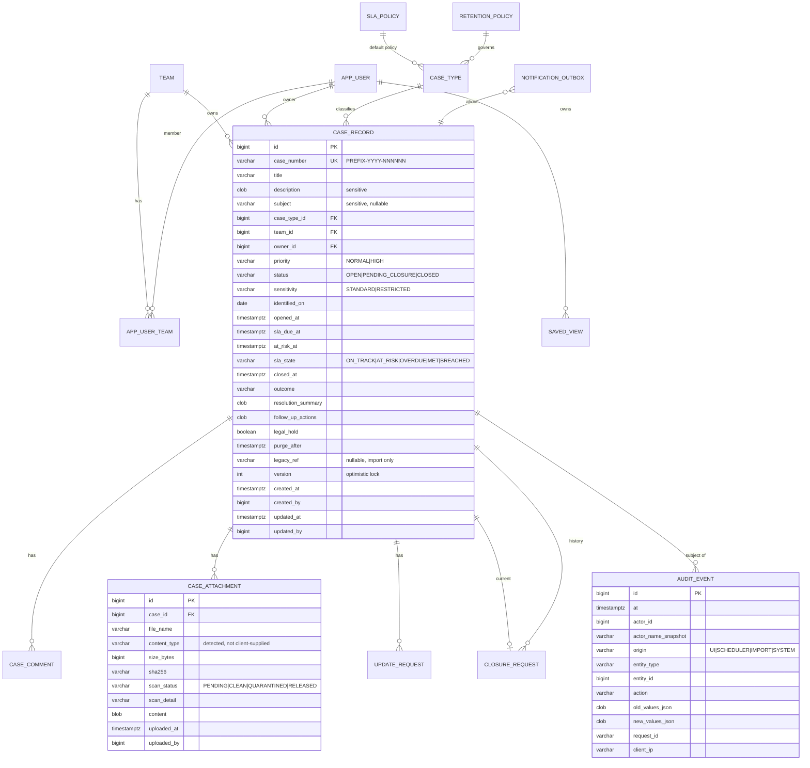
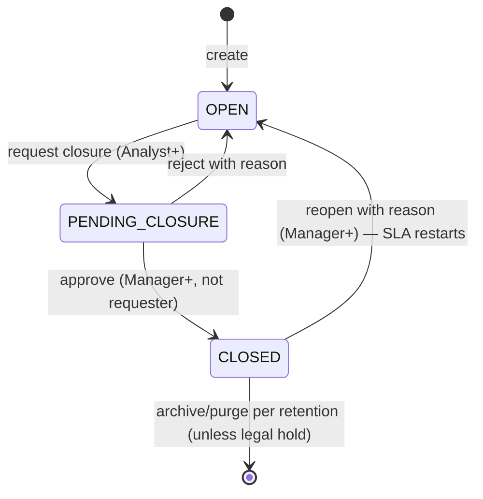
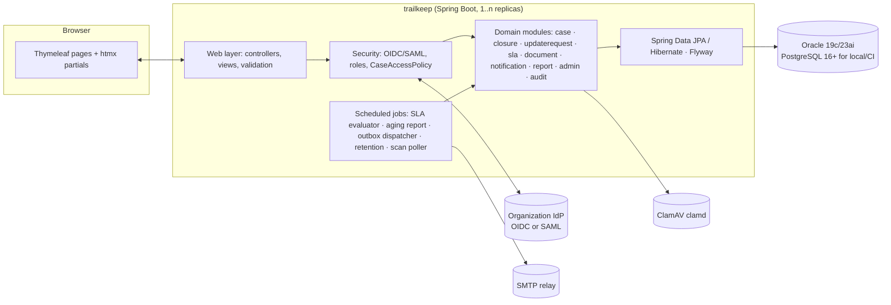

# Trailkeep — Full Build Plan

_Open-source compliance case tracker. Java · Oracle (PostgreSQL for local/CI) · modern server-rendered UI · Section 508 conformant · zero-finding security posture · Apache-2.0._
_Version 0.2 — 2026-11-02 — status: PLAN, no code yet._

---

## 0. One-paragraph summary

Trailkeep is a **small, opinionated compliance case tracker**: a case has an owner, a type, an age, comments, attachments, and exactly one approval moment (closure). It adds the three things the legacy tracker it replaces never had and its users explicitly asked for — **SLA-driven automatic alerts, an automated aging report, and real search** — and it keeps the one thing they actually used: **emailing a person from inside the system** (to request an update, or to ask management to approve closure). Everything else in the original blueprint (configurable workflow engine, multi-step approval chains, parties/entities, document versioning and annotation, drag-and-drop dashboards, integrations hub) is deliberately **out of v1**. It is a Spring Boot modular monolith on Java 21 LTS, JPA/Flyway on Oracle with PostgreSQL parity enforced by tests, Thymeleaf + htmx UI built to **WCAG 2.1 AA / Section 508**, SSO via the deploying organization's identity provider, and a public CI pipeline where SAST, SCA, secrets, container, accessibility and DAST scans are **build-breaking from the first commit**, so "no findings" is a maintained state rather than a cleanup project at the end. The project is **public and Apache-2.0 licensed**; anything organization-specific (data, identity configuration, import mappings) lives outside the repository.

---

## 1. Where the requirements came from, and what changed

### 1.1 Inputs

| Source | What it gave us |
|---|---|
| Original blueprint ("Assumptions & UI Conventions" + 15 click-by-click flows + error states + shortcuts + role visibility + label-mapping table + 7 discovery questions) | A generic, full-featured GRC case-management shape: wizard intake, parties/entities, tasks with blocking flags, documents with versions/annotations, multi-step approvals, SLA ladders, escalations, saved views, custom dashboards, integrations, retention admin. |
| Feedback from a long-time user of the legacy tracker | The legacy tool was **much simpler**. No true workflow. No SLA rules. It tracked the **age of the records** but did **no flagging or alerting**. They used the **email-from-the-system** feature to ask someone for an update and to **email management when requesting closure**; IT would attach the logged comment "and that would be that." They **want**: automatic alerts, an automated **aging report based on SLAs**, and search. |
| Sponsor constraints | Java; Oracle back end with PostgreSQL for local testing; modern UI; simple to use; security and permissions suited to sensitive content; scale back per the user feedback; **Section 508 conformance**; code must pass static **and** dynamic compliance scanning with no findings; **public, fully open-source project**; the legacy tool is not named anywhere in the plan or code. |
| Assumed deployment context (to confirm in Phase 0) | Regulated data (HIPAA-class), FISMA / FedRAMP-aligned hosting, RHEL / OpenShift. |

### 1.2 Scoping decisions — the blueprint vs. v1

| Blueprint capability | v1 decision | Why |
|---|---|---|
| Sign-in via SSO | **Keep** | Non-negotiable in regulated environments; also removes password handling from our attack surface entirely. |
| Dashboard with KPIs, My Cases, Open Cases, New Case button | **Keep, fixed layout** | Fixed, role-aware dashboard. No drag-and-drop widget builder. |
| New Case intake wizard (5 steps) | **Simplify → one page** | One form, sensible defaults, required fields marked. A wizard for ~8 fields adds clicks, not clarity. |
| Parties & Entities step | **Drop** (free-text "Subject / involved parties" field instead) | Legacy had none; a structured party model is a project in itself. Schema leaves room to add later. |
| Case Overview, Edit, Save | **Keep** | |
| Assign Investigator / Team | **Simplify → Owner + Team** | One owner, one team. No team-member lists on the case. |
| Submit for Review / In Review state | **Drop** | Collapses into the single closure approval. |
| Tasks & Workflow (blocking tasks, stage ladder Initial Assessment → Investigation → Remediation → Closure, automations) | **Drop** | Users: "there is not true workflow built into it." Replaced by an optional, non-enforced **checklist** on the case (v1.1 candidate). |
| Advance Stage dropdown | **Drop** | Status is now `Open → Pending Closure → Closed` (+ `Reopened` as an event, not a state). |
| Notes / internal comments, pin/edit/delete | **Keep, simplified** | Comments are append-only (no edit/delete; a correction is a new comment). Pin kept. This is also what makes the comment trail usable as evidence. |
| Documents: upload, virus scan, verified/quarantined badge | **Keep** | Required for sensitive attachments. |
| Documents: annotate, version history, link-to-task | **Drop** | Re-upload is the version. |
| Request Approval with selectable approval workflow, multiple approvers | **Simplify → Request Closure** | Exactly one approval type, one approver (the case's team manager by default, overridable). Approve → Closed; Reject → back to Open with a required reason. This *is* the legacy "email management when requesting closure" flow, done in-app with an email. |
| Escalations: automatic Overdue + manual Escalate with levels | **Keep automatic; drop manual levels** | Automatic At-Risk / Overdue flags and emails are the headline new feature. Manual escalation becomes "Request Update" to any user (the legacy email-someone feature). |
| Search, filters, saved views, bulk actions | **Keep search + filters + saved views; drop bulk update; keep bulk export** | Users asked for search. Bulk status changes bypass the approval model, so they are out. |
| Reports: SLA Compliance, Case Aging, Policy Violations; export PDF/CSV/Excel | **Keep Aging + SLA Compliance + Open-by-Owner; CSV + accessible PDF export; scheduled email of Aging report** | The automated aging report is explicitly requested. "Policy Violations" is undefined, deferred. |
| Custom dashboards (drag widgets, share) | **Drop** | |
| Close Case with blocking-task check, closure modal (Outcome, Resolution Summary, Follow-ups) | **Keep closure modal; no blocking tasks** | Outcome + Resolution Summary are required on the closure request so the approver sees them. |
| Reopen with reason | **Keep** (Manager/Admin) | |
| Subscribe / notification center / email-vs-in-app toggle | **Simplify → email only + in-app "my alerts" list** | Owners and approvers are notified by rule; explicit per-case subscribe is v1.1. |
| Audit & History tab | **Keep, strengthen** | Append-only, every create/update/state change/view-of-restricted-case, with before/after values. |
| Admin: Users & Roles | **Keep, read-mostly** | Roles come from IdP groups; admin screen shows effective roles and allows team assignment and a local disable flag. |
| Admin: Workflows, Case Types & Forms schema editor, Integrations | **Drop Workflows + Forms editor + Integrations; keep Case Types (name, default SLA, active flag)** | |
| Admin: SLA Policies | **Keep, simplified** | SLA = target days + at-risk threshold per case type (optionally per priority). No "ladders." |
| Admin: Retention | **Keep as policy table + scheduled purge job with legal hold** | Compliance requirement. |
| Error states (disabled Save with tooltip, server-side error banner, quarantine with Request Release, concurrent-edit conflict, API timeout toast) | **Keep all** | Cheap and they make the app feel finished. |
| Keyboard shortcuts | **Keep `/` and `N` (single-key shortcuts are user-disableable, per WCAG 2.1.4); drop wizard Alt-arrows** | |
| Role-based visibility | **Keep** | Implemented as a permission matrix (§3), not per-screen conditionals. |

### 1.3 Improvements over both the legacy tool and the blueprint

1. **Age becomes actionable.** Every case shows an SLA clock (`On Track / At Risk / Overdue`), the dashboard groups by it, and the system emails people instead of waiting for someone to look.
2. **Closure is a real, auditable gate** — one click to request, one click to approve, reason required to reject, all logged — while still producing the email management is used to receiving.
3. **"Email someone from the system" survives** as *Request Update*, and the request is tracked on the case (who, when, answered or not), so unanswered requests show up on the aging report.
4. **Restricted cases.** A sensitivity flag hides a case from everyone except its owner, its team's managers, and compliance admins — including from search results and reports — and every view of a restricted case is audited.
5. **Search that works** across case number, title, description, subject, and comments, with filters that persist as saved views.
6. **Evidence-grade history**: append-only comments and audit, immutable attachments, retention with legal hold.
7. **Usable by everyone**: one-page intake, two-click closure, mobile-friendly layout, full keyboard and screen-reader operation, Section 508 conformance report shipped with every release.
8. **Open source**: any regulated organization can deploy, audit, and extend it; the security and accessibility evidence is public.

---

## 2. Goals and non-goals

**Goals (v1):**
- Replace a legacy compliance log for day-to-day tracking with zero loss of history (generic import in scope, §15).
- Ship SLA alerts, the automated aging report, and search.
- Conform to **Section 508 (WCAG 2.1 AA)** and publish an Accessibility Conformance Report with each release.
- Pass SAST, SCA, DAST, secrets, and container scans with **zero open findings** at every release.
- Be operable by a two-person team: one deployable, one database, one scheduled-job runner, standard logs/metrics.
- Be a well-governed public open-source project (Apache-2.0, DCO, security policy, reproducible releases).

**Non-goals (v1):**
- Configurable workflow / BPM engine, forms designer, integrations marketplace.
- Mobile app, offline mode, public API for third parties (an internal REST API exists for the UI and for reports, versioned, but not published).
- Replacing document management (attachments are case evidence, not a DMS).
- Hosting or operating the service for anyone; Trailkeep is software, not a SaaS.

---

## 3. Users, roles, permissions, sensitivity

### 3.1 Roles (mapped from IdP groups; the app never stores passwords)

| Role | Who | Summary |
|---|---|---|
| **Reader** | Auditors, leadership | Read non-restricted cases in their team(s); run reports. |
| **Analyst** | Compliance/IT staff who work cases | Create, edit, comment, attach, request update, request closure on cases in their team(s). |
| **Manager** | Team leads / management | Analyst + approve/reject closure, reopen, reassign, see restricted cases in their team(s), receive escalations and aging report. |
| **Compliance Admin** | Compliance office | Manager across all teams + manage case types, SLA policies, retention, legal hold, release quarantined files. |
| **System Admin** | IT | User/team admin, view system health, no case content by default (separation of duties; may be granted Reader explicitly). |

### 3.2 Permission matrix (enforced server-side with `@PreAuthorize` + a data-scope filter; UI only hides what the server already denies)

| Action | Reader | Analyst | Manager | Compliance Admin | System Admin |
|---|:-:|:-:|:-:|:-:|:-:|
| View standard case (own team) | ✓ | ✓ | ✓ | ✓ | – |
| View restricted case | – | owner only | ✓ (own team) | ✓ | – |
| Create case | – | ✓ | ✓ | ✓ | – |
| Edit case fields (while Open) | – | ✓ | ✓ | ✓ | – |
| Add comment / attachment | – | ✓ | ✓ | ✓ | – |
| Mark case restricted / unrestricted | – | ✓ (restrict only) | ✓ | ✓ | – |
| Request update (email a user) | – | ✓ | ✓ | ✓ | – |
| Request closure | – | ✓ | ✓ | ✓ | – |
| Approve / reject closure | – | – | ✓ | ✓ | – |
| Reopen | – | – | ✓ | ✓ | – |
| Reassign owner / team | – | own cases | ✓ | ✓ | – |
| Download attachment | ✓ | ✓ | ✓ | ✓ | – |
| Release quarantined attachment | – | – | – | ✓ | – |
| Run reports / export | ✓ (own team) | ✓ (own team) | ✓ (own team) | ✓ (all) | – |
| Manage case types, SLA policies, retention, legal hold | – | – | – | ✓ | – |
| Manage users/teams, view audit for all, system health | – | – | – | ✓ (audit) | ✓ |

Rules of thumb: an approver cannot approve their own closure request; the same person cannot be both owner and approver on a case; System Admin has no case data access unless also granted a case role (logged as a deliberate override).

### 3.3 Sensitivity model

- `sensitivity ∈ {STANDARD, RESTRICTED}` on the case; attachments and comments inherit.
- Restricted cases are filtered at the **repository query level** (a mandatory predicate added by a `CaseAccessPolicy` specification), never by post-filtering a list, so search results, counts, exports and reports can never leak them.
- Every read of a restricted case (page view or attachment download) writes an `AUDIT: VIEW_RESTRICTED` event.
- Field-level: the case `subject` and `description` may contain PHI/PII. They are never written to application logs, never included in email bodies (emails carry case number, title, due date and a link; the title is required to be non-sensitive by policy and the intake form says so), and are redacted in CSV exports unless the exporting user is Manager+ and ticks "include details" (audited).

---

## 4. Functional scope — screens and click-by-click flows (v1)

Navigation: left nav **Dashboard · Cases · Reports · Admin** (role-dependent), top bar **Search (`/`) · Alerts · User menu**. Breadcrumbs on detail pages. Skip-to-content link is the first focusable element on every page.

### 4.1 Sign in & landing
1. Open URL → redirected to the organization's IdP (OIDC or SAML) → back to Dashboard.
2. Dashboard: KPI tiles (**Open · At Risk · Overdue · Pending my approval**), "My cases" list, "Needs attention" list (overdue + unanswered update requests), **New Case** button (`N`).

### 4.2 Create a case (one page)
Fields: Case Type\*, Title\* (hint: "no sensitive details in the title"), Priority (Normal/High), Date Identified\*, Team\* (defaulted from user), Owner (defaulted to me), Subject / involved parties, Description\*, Sensitivity (Standard/Restricted), Attachments (optional, drag-drop **or** file-chooser button).
Save disabled until required fields are valid; inline errors tied to fields and summarized at the top; `Ctrl+S` saves. On save: case number assigned (configurable prefix, e.g. `CASE-2026-000123`), SLA due date computed from the case type's policy, toast (also announced to assistive tech), navigate to case page.

### 4.3 Case page
Header: number, title, status chip, **SLA chip** ("12 days left" / "At Risk — 3 days left" / "Overdue 6 days"), owner, team, sensitivity badge. Chips carry icon + text, never color alone.
Primary actions (right): **Edit · Request Update · Request Closure · ⋯ More** (Reassign, Mark Restricted, Reopen [Manager+], Export PDF).
Tabs: **Overview · Comments · Attachments · History** (ARIA tabs pattern, arrow-key navigation).

- **Edit**: fields become editable; Save/Cancel; optimistic-locking conflict → "This case was updated by _name_ at _time_" with **Reload** (Force Save is **not** offered — v1 keeps the simpler, safer rule).
- **Comments**: text box with minimal formatting (bold/italic/lists via Markdown subset, rendered sanitized) → **Post**. Pin via ⋯. No edit/delete.
- **Attachments**: **Upload** → progress (with text percentage) → badge `Scanning…` → `Verified` or `Quarantined` (download disabled; Compliance Admin sees **Release** with reason). Allowed types and max size shown.
- **Request Update**: modal → pick user (accessible combobox) → message → **Send**. Emails the user with a link; case shows "Update requested from _X_ on _date_ — awaiting" until that user posts a comment (auto-resolves) or anyone clicks "Mark answered".
- **Request Closure**: modal → Outcome\* (dropdown per case type: Resolved / No Action Required / Transferred / Duplicate), Resolution Summary\*, Follow-up Actions (optional), Approver (defaulted to team manager; list limited to Managers of the team) → **Send**. Status → `Pending Closure`; approver emailed with summary + link.
- **Approve / Reject** (approver sees buttons on the case and on the dashboard "Pending my approval"): Approve → `Closed`, closure fields locked, retention clock starts. Reject → reason\* → back to `Open`, requester emailed, "Requires Changes" badge until the next comment.
- **Reopen** (Manager+) → reason\* → `Open`; SLA restarts from reopen date.
- **History**: chronological, filterable (field changes old→new, comments, attachments, emails sent, state changes, restricted views), each with who/when/origin (UI / scheduler / import).

### 4.4 Cases list, search, saved views
- Global search box → results across number, title, description, subject, comments (restricted cases excluded unless permitted). Result count announced.
- Filter drawer: Status, SLA state, Case Type, Team, Owner, Priority, Date Identified range, Sensitivity (if permitted), "Has unanswered update request".
- **Save View** → name → appears in the left nav under Cases; **Export CSV** of the current list (details redacted per §3.3).
- Row click (and Enter on the focused row) opens the case; multi-select enables **Export** only. Table has sortable headers with `aria-sort`, a caption, and a non-virtualized fallback at 400 % zoom.

### 4.5 Reports
- **Aging report** (the one that goes out automatically): open cases bucketed `0–30 · 31–60 · 61–90 · 90+ days` and by SLA state, grouped by team and owner, with a list of overdue cases and unanswered update requests. Run on demand; scheduled weekly (configurable) to Managers (own team) and Compliance Admins (all).
- **SLA compliance**: cases closed in period, % within SLA, average age, by type/team.
- **Open by owner**: workload view.
- All: parameters (date range, team, type), table first, then an optional bar chart that is a visual duplicate of the table (the table is the accessible source of truth), **Export CSV / PDF** (PDF is tagged, §10.3).

### 4.6 Admin
- **Case Types**: name, description, default SLA policy, allowed outcomes, active flag.
- **SLA Policies**: name, target days, at-risk threshold (%, default 80), reminder cadence after overdue (days), escalation recipient rule (owner / owner+manager).
- **Teams & Users**: teams (name, manager(s)); users are read from the IdP on login (upsert); admin sets team membership and can disable a user locally.
- **Retention**: per case type: years after closure → archive → purge; **Legal hold** toggle on a case stops the clock. Purge job logs what it removed (metadata only).
- **Email templates**: subject/body with placeholders, preview, "send me a test". Emails are multipart (plain text + simple HTML).
- **System** (System Admin): health, scheduler status, scan engine status, last import run.

### 4.7 Alerts (email + in-app list)
| Trigger | Recipient | Timing |
|---|---|---|
| Case assigned to you | owner | immediate |
| Update requested from you | requested user | immediate; reminder every N days while unanswered |
| At Risk (≥ threshold % of SLA elapsed) | owner | once |
| Overdue | owner + team manager | at breach, then every N days per policy |
| Closure requested | approver | immediate; reminder after 3 days |
| Closure approved / rejected / reopened | owner (+ requester) | immediate |
| Weekly aging report | managers, compliance admins | scheduled |
Emails never contain description/subject text; always a deep link; sending goes through an **outbox table** so every email is recorded and retried.

### 4.8 Error states and edge cases (carried over from the blueprint)
- Save disabled until valid; tooltip and an inline text list of missing fields (not tooltip-only).
- Server-side authorization failure → banner "You don't have permission to _action_; contact your team manager" (no stack traces, generic 403 page for direct URL hits).
- Upload failures → inline error; virus hit → `Quarantined` badge + Compliance Admin **Release** path.
- Concurrent edits → Reload only.
- Session about to expire → warning dialog two minutes before, with **Stay signed in** (WCAG 2.2.1).
- Scheduler outage → System screen shows last-run times; a health check fails if the SLA evaluator has not run in > 2× its interval.

---

## 5. Domain model

### 5.1 Entities (ERD)



Supporting tables: `APP_USER` (external_id from IdP, display name, email, disabled flag, last_login), `APP_USER_TEAM` (user, team, role_in_team ∈ READER/ANALYST/MANAGER), global roles table (`COMPLIANCE_ADMIN`, `SYSTEM_ADMIN`), `CASE_TYPE`, `SLA_POLICY`, `RETENTION_POLICY`, `CASE_COMMENT` (append-only, pinned flag), `UPDATE_REQUEST` (requested_by, requested_from, message, requested_at, answered_at, answered_by), `CLOSURE_REQUEST` (requested_by, approver_id, requested_at, decision ∈ APPROVED/REJECTED, decided_at, reason), `NOTIFICATION_OUTBOX` (to, subject, body_text, body_html, status, attempts, next_attempt_at, sent_at, template_id, case_id), `SAVED_VIEW` (owner, name, filter_json), `EMAIL_TEMPLATE`, `SHEDLOCK` (scheduler lock), `CASE_NUMBER_SEQ` (per-year sequence via table row + `SELECT … FOR UPDATE`, portable across both DBs).

### 5.2 Case state machine



SLA sub-state is **derived**, not stored as truth: `sla_state` is recomputed by the evaluator every 15 minutes from `opened_at`, `sla_due_at`, `at_risk_at`, `status`, and cached on the row for fast filtering; the History tab records each transition.

---

## 6. SLA engine, alerts, aging report — design

- **Policy**: `target_days`, `at_risk_pct` (default 80), `overdue_reminder_days` (default 7), `escalate_to` (OWNER | OWNER_AND_MANAGER), `business_days` (boolean; v1 uses calendar days unless confirmed otherwise — see §18).
- **At creation / reopen**: `sla_due_at = opened_at + target_days`, `at_risk_at = opened_at + target_days × at_risk_pct`.
- **Evaluator job** (every 15 min, ShedLock-guarded so only one replica runs it): for each `OPEN|PENDING_CLOSURE` case, compute state; on transition, write history + enqueue outbox emails per policy; `Pending Closure` does not pause the clock (closure latency is part of age — surfaced on the aging report as "awaiting approval N days").
- **Closure**: `sla_state` finalizes to `MET` or `BREACHED` for compliance reporting.
- **Aging report job** (weekly, configurable cron per team): renders the same report the UI shows, as tagged PDF + CSV, into the outbox for Managers (own team) and Compliance Admins (all). Report content follows the §3.3 redaction rules.
- **Outbox dispatcher** (every minute): sends via SMTP relay with exponential backoff, max 10 attempts, then flags on the System screen. The dispatcher is the **only** component that talks to SMTP.
- **Idempotency**: alert keys (`case_id + alert_type + period`) prevent duplicate emails on restarts.

---

## 7. Architecture and technology

### 7.1 Shape



One deployable. Modular monolith with **ArchUnit-enforced** package boundaries (modules talk through service interfaces and domain events, never through each other's repositories). This keeps the scan surface, the ops surface, and the mental model small; if a module ever needs to be split out, the seams already exist.

### 7.2 Stack (pin exact versions at kickoff to the then-current GA; every dependency must be Apache-2.0-compatible, §11.2)

| Layer | Choice | License | Rationale |
|---|---|---|---|
| Runtime | **Java 21 LTS** (Temurin or Red Hat build of OpenJDK) | GPLv2+CPE | Broad vendor/Oracle JDBC support; virtual threads available. Java 25 LTS acceptable. |
| Framework | **Spring Boot 4.0.x** (Spring Framework 7, Spring Security 7, Hibernate ORM 7) — fall back to **3.5.x** only if a deploying organization's approved list lags | Apache-2.0 (Hibernate ORM 7 is Apache-2.0) | Current supported line; Security 7 defaults are what the scanners expect. |
| Build | **Maven** + wrapper, `maven-enforcer` (banned deps, convergence, Java version), `license-maven-plugin` | Apache-2.0 | Deterministic; license gate built in. |
| Persistence | **Spring Data JPA + Hibernate**, **Flyway** (community), **HikariCP** | Apache-2.0 | Portable across Oracle/PG with the rules in §8. |
| Oracle driver | `com.oracle.database.jdbc:ojdbc17` | Oracle Free Use Terms (build-time dependency only, not redistributed) | Maven Central, Java 17+ build. |
| PG driver | `org.postgresql:postgresql` | BSD-2 | |
| Scheduling | Spring `@Scheduled` + **ShedLock** (JDBC provider) | Apache-2.0 | DB-backed lock works identically on both DBs; no Quartz tables/ops. |
| UI | **Thymeleaf + htmx + Bootstrap 5** (custom theme tokens, WCAG-checked palette), minimal vanilla JS, no bundler | Apache-2.0 / 0BSD / MIT | Server-rendered: smallest attack surface, strict CSP, no npm dependency tree in the SCA report, accessible by default, "modern" feel via htmx partial swaps. See §7.3. |
| Markdown | `commonmark-java` + **OWASP Java HTML Sanitizer** on output | BSD-2 / Apache-2.0 | Comments with safe formatting. |
| File type detection | **Apache Tika** (core only) | Apache-2.0 | Content-type from magic bytes, not from the client. |
| Antivirus | **ClamAV** (`clamd`) via a small TCP client | GPLv2 (separate process over the network; not linked) | Standard, on-prem, no data leaves the network. |
| PDF export | **Apache PDFBox** with tagged-PDF (PDF/UA) structure | Apache-2.0 | Accessible server-side report PDFs; no headless browser. |
| PDF validation | **veraPDF** CLI in CI | MPL-2.0 / GPLv3+ (tool only, not shipped) | Proves PDF/UA conformance of exports. |
| CSV | **Apache Commons CSV** (with formula-injection escaping) | Apache-2.0 | |
| Email | Spring Mail (Jakarta Mail) → SMTP relay; Thymeleaf text + HTML templates | EPL-2.0/GPL-CPE (Jakarta Mail) | |
| Auth | Spring Security **OAuth2 client (OIDC)**, SAML2 module if the IdP requires it | Apache-2.0 | Roles = IdP group claims → app roles mapping table. |
| Observability | Micrometer → Prometheus; JSON logs (Logback + logstash encoder); Actuator on a separate management port | Apache-2.0 / EPL-1.0+LGPL (Logback) | |
| Tests | JUnit 5, AssertJ, Mockito, **Testcontainers** (PostgreSQL + `gvenzl/oracle-free`), **Playwright for Java** + **axe-core**, **ArchUnit**, JaCoCo, optional PIT | EPL-2.0 / Apache-2.0 / MIT / MPL-2.0 (axe-core, test-only) | |
| Container | Red Hat **UBI 9 OpenJDK 21 runtime** image, non-root, read-only FS | UBI EULA (freely redistributable) | Matches RHEL/OpenShift; passes typical container benchmarks. |

### 7.3 UI choice — tradeoffs considered

| Option | Pros | Cons | Verdict |
|---|---|---|---|
| **Thymeleaf + htmx + Bootstrap** | Pure Java build; strict CSP easy; tiny JS; fewest SCA findings; SSR fast on intranet; accessible by default (real HTML, real forms, works without JS for core flows) | Less "app-like" for very dynamic screens; team must learn htmx idioms (small) | **Chosen** |
| React/Angular SPA + REST API | Richest interactivity; familiar to front-end devs | Hundreds of npm transitive deps = constant SCA churn; CSP harder; two build toolchains; CORS/token handling adds DAST surface; accessibility of custom components is on us | Rejected for v1 |
| Vaadin Flow | 100 % Java, polished components with ARIA built in | Heavy client bundle; commercial add-ons for some features; still ships npm deps; harder to CSP; larger container | Viable alternative if the team strongly prefers pure Java components |

### 7.4 Repository layout

```
trailkeep/
├─ pom.xml                      # single module; packages enforce boundaries
├─ src/main/java/.../trailkeep/
│  ├─ TrailkeepApplication.java
│  ├─ shared/        (ids, clock, events, exceptions)
│  ├─ security/      (OIDC config, role mapping, CaseAccessPolicy, headers/CSP)
│  ├─ audit/         (AuditEvent, AuditRecorder, read-only repo)
│  ├─ user/          (AppUser, Team, membership, admin screens)
│  ├─ casefile/      (CaseRecord, numbering, comments, create/edit/search, views)
│  ├─ closure/       (ClosureRequest, approve/reject/reopen)
│  ├─ updaterequest/ (UpdateRequest, nudges)
│  ├─ sla/           (SlaPolicy, evaluator, state transitions)
│  ├─ document/      (Attachment, upload, Tika, ClamAV client, quarantine/release)
│  ├─ notification/  (templates, outbox, dispatcher)
│  ├─ report/        (aging, SLA compliance, workload; CSV / tagged PDF)
│  ├─ retention/     (policies, legal hold, purge job)
│  ├─ importer/      (generic CSV + mapping-file importer, reconciliation)
│  └─ web/           (controllers, htmx fragments, error handling)
├─ src/main/resources/
│  ├─ db/migration/common/        V1__…sql (portable DDL)
│  ├─ db/migration/oracle/        vendor-specific only
│  ├─ db/migration/postgresql/    vendor-specific only
│  ├─ templates/ (Thymeleaf) · static/ (css, htmx.min.js, app.js) · messages.properties
│  └─ application.yml + application-{local,test,oracle-test,prod}.yml
├─ src/test/java/...  (unit, slice, Testcontainers IT, ArchUnit, Playwright E2E + axe)
├─ compose.yaml       (postgres, mailpit, keycloak, clamav; optional oracle-free profile)
├─ deploy/            (OpenShift/Helm or kustomize manifests, NetworkPolicy, SCC)
├─ security/          (threat model, scanner config, suppressions.xml with justifications, SBOM)
├─ accessibility/     (ACR/VPAT, test scripts, manual test logs per release)
├─ .github/           (workflows, CODEOWNERS, issue/PR templates, dependabot.yml, SECURITY.md)
├─ CONTEXT.md · BUILD_PLAN.md · README.md · CONTRIBUTING.md · CODE_OF_CONDUCT.md
├─ LICENSE (Apache-2.0) · NOTICE · THIRD-PARTY.txt (generated) · CHANGELOG.md
```

---

## 8. Oracle + PostgreSQL portability rules (enforced by CI, not by memory)

1. **Every integration test runs on PostgreSQL in every build and on Oracle Free (`gvenzl/oracle-free:23-slim`) nightly and on every release branch.** A schema or query that passes PG and fails Oracle fails the build.
2. **DDL lives in `db/migration/common` using the portable subset**: `VARCHAR(n)`, `TIMESTAMP WITH TIME ZONE`, `NUMBER(1)`-style booleans mapped via a JPA `AttributeConverter` (Oracle 19c has no `BOOLEAN` column type; 23ai does, but we target the older one), `CLOB`/`BLOB` with Hibernate `@Lob`, sequences via `@SequenceGenerator` (`allocationSize` 50, both DBs), no vendor functions in JPQL, no `LIMIT`/`ROWNUM` by hand (use `Pageable`). Flyway placeholders handle the few type-name differences (e.g. `${clob}` → `CLOB` / `TEXT`, `${bytes}` → `BLOB` / `BYTEA`).
3. **Identifier discipline**: ≤ 30 characters, upper-snake, no reserved words (`USER`, `COMMENT`, `DATE`, `SIZE`…) — hence `APP_USER`, `CASE_RECORD`, `CASE_COMMENT`. Checked by a unit test over the Flyway scripts.
4. **Search**: v1 uses indexed `LOWER(column) LIKE` on title/number/subject plus a per-case `search_text` column maintained by the service layer (title + number + subject + last 20 comments, truncated) so there is one predicate and one index on both DBs. If relevance ranking is later needed, Hibernate Search with an embedded Lucene index is the portable upgrade path (no Oracle Text / PG `tsvector` divergence).
5. **Time**: all timestamps stored as `TIMESTAMP WITH TIME ZONE` in UTC; the app renders in the organization's configured zone.
6. **Locking**: `@Version` optimistic locking everywhere a user edits; `SELECT … FOR UPDATE` only in the case-number allocator.
7. **Database users**: `TRAILKEEP_OWNER` (DDL, used only by Flyway at deploy) and `TRAILKEEP_APP` (DML on tables, `INSERT`-only on `AUDIT_EVENT` and `CASE_COMMENT`; no `DELETE` anywhere except the retention job's dedicated `TRAILKEEP_PURGE` user). Grants are migration scripts, so they are reviewed and versioned.
8. **Oracle specifics handled once**: Hikari `connectionInitSql` for session time zone, `oracle.jdbc.fanEnabled=false`, LOB prefetch, TLS (`tcps`) with the wallet or JKS trust store mounted as a secret.

---

## 9. Security design (what makes "sensitive" real)

Mapped loosely to OWASP ASVS 4.0 L2 and NIST 800-53 families; a deploying organization's control catalog should be cross-walked in Phase 0.

| Area | Control |
|---|---|
| **Identity (IA)** | SSO only (OIDC/SAML). No local accounts, no password fields, no "forgot password." Session = Spring Session JDBC (both DBs) so replicas share state; 30-min idle with a 2-minute accessible warning, 8-h absolute, IdP logout propagated. |
| **Authorization (AC)** | Method security on every service entry point; `CaseAccessPolicy` predicate on every case query; object-level checks on attachment download (no IDOR: attachment URL includes case id and is checked against it); separation of duties rules in §3.2; deny-by-default URL rules; admin actions require a fresh IdP auth (`max_age`) for Compliance Admin changes. |
| **Audit (AU)** | Append-only `AUDIT_EVENT` written in the same transaction as the change; DB grants forbid `UPDATE/DELETE` for the app user; restricted-case views logged; audit export for auditors; clock from DB `now()` to avoid skewed app clocks. |
| **Input validation (SI)** | Jakarta Bean Validation on all DTOs; allow-lists for enums; sizes everywhere; Markdown rendered then sanitized (OWASP sanitizer policy: formatting only, no links to javascript:, no images); file uploads: Tika-detected type must be in allow-list (PDF, DOCX/XLSX/PPTX, PNG/JPG, TXT/CSV, EML/MSG), max 25 MB, ClamAV scan before `CLEAN`, served with `Content-Disposition: attachment`, `X-Content-Type-Options: nosniff`, never inline except PNG/JPG re-encoded server-side. CSV export cells starting with `= + - @` are prefixed to defeat formula injection. |
| **Injection** | Only JPA/JPQL/Criteria with bound parameters; a Semgrep rule fails the build on string-concatenated queries or `createNativeQuery` with non-constant SQL; Thymeleaf natural escaping, `th:utext` banned by a custom check. |
| **Browser security** | Strict **CSP** (`default-src 'self'; script-src 'self' 'nonce-…'; object-src 'none'; frame-ancestors 'none'; base-uri 'self'; form-action 'self'`) — htmx configured for nonce-based inline attribute handling (no `hx-on` inline scripts); HSTS; `Referrer-Policy: same-origin`; cookies `Secure; HttpOnly; SameSite=Lax`; CSRF tokens on all state-changing requests including htmx (`hx-headers`); no CORS (same-origin only). |
| **Secrets (SC)** | None in the repo or image. DB credentials, SMTP credentials, OIDC client secret, Oracle wallet mounted from the platform's secret store. `gitleaks` in pre-commit and CI; GitHub secret scanning + push protection on the public repo. |
| **Transport** | TLS everywhere: edge → app (route/ingress), app → Oracle (`tcps`), app → SMTP (STARTTLS required), app → clamd (network policy; mTLS optional). |
| **Data at rest** | Oracle TDE / PG volume encryption (platform responsibility, documented); attachment hashes recorded; backups per organization policy. |
| **Logging** | Structured JSON; never log description/subject/attachment names of restricted cases; user ids not emails; CRLF stripped from any user-supplied value before logging; request id on every line. |
| **Errors** | Generic error pages; `server.error.include-*` all off; exceptions mapped centrally. |
| **Availability** | Rate limit on search and upload per user (Bucket4j); request size limits; DB pool sizing; scheduler lock. |
| **Supply chain** | Enforcer bans known-bad artifacts; Dependabot weekly; **CycloneDX SBOM** published per release; images signed (cosign/Sigstore keyless from GitHub Actions); base image digest pinned; Actions pinned by commit SHA; SLSA build provenance attached to releases. |
| **Separation of duties** | System Admin ≠ case access; approver ≠ requester; purge uses a separate DB user and only runs when no legal hold. |
| **Privacy** | Data-minimizing emails; export redaction; retention with legal hold; a "where is PHI" data map in `security/DATA_MAP.md`. |

A lightweight **threat model** (STRIDE over the §7.1 diagram) is a Phase 1 deliverable and is re-checked at each phase gate.

---

## 10. Accessibility — Section 508 conformance program

Section 508 (36 CFR Part 1194, 2017 Refresh) incorporates **WCAG 2.0 Level A and AA** by reference and adds software requirements (Chapter 5: interoperability with assistive technology, respect for platform accessibility settings) and electronic-document requirements for anything the system produces (reports, emails, PDFs). Trailkeep targets **WCAG 2.1 AA** (a superset, and what the Trusted Tester process evaluates) and checks the WCAG 2.2 AA additions where they apply. Accessibility is a **release gate** with the same standing as security scanning.

### 10.1 Design and engineering rules (applied to every screen)

| Area | Rule |
|---|---|
| Structure | Semantic HTML first; one `h1` per page, headings in order; landmarks (`header`, `nav`, `main`, `footer`); skip-to-content link first in tab order; page `<title>` reflects the case/number. |
| Keyboard | Every action reachable and operable by keyboard; visible focus indicator with ≥ 3:1 contrast; no keyboard traps; logical tab order; single-key shortcuts (`/`, `N`) can be turned off or remapped in user preferences (WCAG 2.1.4). |
| Forms | Every input has a programmatic label; required fields marked in text (not only `*` or color); errors tied to the field with `aria-describedby` and summarized in a focusable error region; `autocomplete` attributes where applicable. |
| Dynamic updates (htmx) | After a partial swap, focus moves to the updated region's heading or a polite `aria-live` region announces the result ("Comment posted", "12 cases found"); loading indicators have text equivalents; no content auto-refreshes under the user's focus. |
| Dialogs | Native `<dialog>` or Bootstrap modal with `aria-modal`, focus trapped, `Esc` closes, focus returns to the invoking control. |
| Color and status | Contrast ≥ 4.5:1 text, ≥ 3:1 UI components and focus rings; status chips are icon + text (+ visually hidden text where needed); SLA state never conveyed by color alone; respects `prefers-reduced-motion`, `prefers-color-scheme`, and Windows High Contrast / forced-colors mode. |
| Tables | `<caption>`, `<th scope>`, sortable headers expose `aria-sort`, pagination and row-selection controls labelled; data tables are the accessible source for any chart. |
| Zoom and reflow | Usable at 200 % zoom and 400 % reflow (320 px CSS width) without horizontal scrolling for primary content (WCAG 1.4.10); text spacing override safe (1.4.12). |
| Time limits | Session-expiry warning with extend (2.2.1); no other time limits. |
| Media and motion | No audio/video in v1; no animation beyond reduced-motion-safe transitions. |
| Target size | Interactive targets ≥ 24 × 24 CSS px (2.2 AA 2.5.8). |
| Language | `lang` on `html`; UI strings externalized (`messages.properties`) so translations keep accessibility semantics. |
| Documents the system produces | Emails are multipart with a plain-text part and simple, linear HTML; CSV is plain data; **PDF exports are tagged (PDF/UA-1, ISO 14289)**: document title, language, heading structure, table structure, no untagged content, verified by veraPDF in CI. If a conformant PDF cannot be produced for a given report, the export is withheld rather than shipped non-conformant, and the accessible HTML/CSV remains available. |

### 10.2 Testing and evidence

| Level | What | When |
|---|---|---|
| Automated | **axe-core** via Playwright on every page and every major UI state (empty, populated, error, dialog open) — **0 violations** of WCAG 2.x A/AA rules; HTML validity (Nu validator); veraPDF on every generated PDF | Every PR (build-breaking) |
| Manual, per sprint | Keyboard-only pass of new screens; screen reader smoke test (NVDA + Firefox) | Definition of done for each story |
| Manual, per phase gate | Full pass with **NVDA + Firefox**, **JAWS + Chrome**, **VoiceOver + Safari (macOS and iOS)**; 200 %/400 % zoom; Windows High Contrast; color-blindness simulation | Phases 2–6 |
| Formal conformance | Test against the **DHS Trusted Tester v5** process (or the deploying organization's equivalent) for every WCAG 2.1 A/AA criterion plus 508 Chapter 5 software criteria | Phase 6, then each major release |
| Report | **Accessibility Conformance Report (ACR)** on the **ITI VPAT 2.5 (508 edition or INT)** template, published in `accessibility/` and in the release evidence pack; open issues labelled `a11y` with a conformance-impact field; any "Partially Supports" has a remediation ticket and date | Each release |
| Governance | Named accessibility owner; `a11y` label blocks release at severity ≥ serious; accessibility acceptance criteria written into every user story; third-party components (Bootstrap, htmx) reviewed against the rules above before adoption | Ongoing |

### 10.3 Known hard spots and how we avoid them
- **Charts** — the table is primary; the chart is decorative-plus-summary (`aria-describedby` to a text summary).
- **Typeahead / combobox** (user picker) — implement the WAI-ARIA APG combobox pattern; test with all three screen readers before adopting any library.
- **Drag-and-drop upload** — always paired with a standard file input button.
- **htmx partials** — a single `swapped` event handler manages focus/announcements centrally so no page forgets.
- **Tagged PDF** — build one `AccessiblePdfWriter` around PDFBox's structure-tree API, used by every report; veraPDF in CI catches regressions.

---

## 11. Open source — licensing and project governance

### 11.1 License
**Apache License 2.0** for all original code and documentation. Rationale: explicit patent grant, universally accepted in enterprise and government procurement, compatible with the entire chosen stack, and permits private forks for organization-specific configuration without obligations beyond attribution. Files: `LICENSE` (verbatim text), `NOTICE` (copyright + third-party notice), SPDX header `// SPDX-License-Identifier: Apache-2.0` in every source file, enforced by `license-maven-plugin` `check` in the build.

### 11.2 Dependency license policy (enforced)
- Allowed in the shipped artifact: Apache-2.0, MIT, BSD-2/3, 0BSD, ISC, EPL-2.0, MPL-2.0 (file-level copyleft, unmodified), CDDL/EPL-with-Classpath-Exception for Jakarta APIs, LGPL only as dynamically linked runtime libraries (currently: Logback; prefer alternatives when equal).
- **Banned** in the shipped artifact: GPL (any), AGPL, SSPL, BUSL, Commons Clause, "source-available" and commercial licenses. `maven-enforcer` + `license-maven-plugin` fail the build on an unknown or banned license; the allow-list lives in `security/licenses-allowed.txt`.
- Build/test-only tools (veraPDF, axe-core, Testcontainers images, ClamAV) are not shipped and are listed as such in `THIRD-PARTY.txt`.
- The Oracle JDBC driver is fetched by Maven at build time under Oracle's Free Use Terms and is never committed or redistributed; the published container image documents this in its labels and `NOTICE`.

### 11.3 Contribution model
- **Developer Certificate of Origin** (`git commit -s`) enforced by a DCO check; no CLA.
- `CONTRIBUTING.md` (how to build, test, scan, write accessible UI, portable SQL), `CODE_OF_CONDUCT.md` (Contributor Covenant 2.1), issue and PR templates with the security/accessibility checklist, `CODEOWNERS`.
- Conventional commits, semantic versioning, `CHANGELOG.md` (Keep a Changelog), signed tags, GitHub Releases with SBOM + provenance + evidence pack attached.
- Branch protection on `main`: PR required, 1 review, all required checks green, linear history, no force-push; Actions pinned by SHA with least-privilege `GITHUB_TOKEN`.

### 11.4 Security policy for a public project
- `SECURITY.md`: report privately via GitHub Private Vulnerability Reporting; acknowledgement in 3 business days, fix target 90 days or coordinated disclosure; CVE requested through GitHub as CNA; security advisories published with each fix release.
- GitHub secret scanning + push protection, Dependabot alerts + weekly updates, **CodeQL** (free for public repos) alongside the §12 toolchain, **OpenSSF Scorecard** workflow with badge, and the **OpenSSF Best Practices** badge targeted at "passing" by v1.0.

### 11.5 What "public" means for content
- No organization data, hostnames, stakeholder names, or identity-provider details ever enter the repository, issues, or discussions. Seed data is synthetic.
- Organization-specific pieces are **configuration**, not code: IdP client settings, role-group mapping, SMTP relay, case types/SLA policies (seedable via YAML), and the **legacy import mapping file** (§15). Each deploying organization keeps these in its own private configuration repository.
- Trademark: "Trailkeep" was chosen after a clearance search found no conflicting software or trademark use; the name is used as a project name and no registration is claimed in `NOTICE`. A deploying organization may rename the UI via `app.branding.*` properties.

---

## 12. Compliance scanning — the zero-findings strategy

**Principle:** scanners are quality gates that *break the build* from the very first commit, not a report run before release. Findings are either fixed or formally suppressed with a written justification that a maintainer with the security role approves; the suppression file is itself reviewed in PRs and suppressions expire. "Zero findings" is then a property we maintain, not a milestone we chase. Because the repository is public, the evidence is public too.

### 12.1 Toolchain (free for public repositories; a deploying organization's scanner-of-record runs the same artifacts)

| Stage | Tool | Gate |
|---|---|---|
| Pre-commit | `gitleaks`, `spotless` (formatting), `checkstyle`, SPDX header check | Block commit |
| Compile | `-Xlint:all -Werror`, Error Prone | 0 warnings |
| SAST | **CodeQL** (Java, security-extended queries), **SpotBugs + FindSecBugs**, **Semgrep** (Java + Spring + custom rules), **SonarCloud** with Security Hotspots review required | 0 High/Critical; 0 unreviewed hotspots; Sonar quality gate A on security/reliability; coverage ≥ 80 % |
| SCA | **OWASP Dependency-Check** (NVD + OSS Index), `maven-enforcer` bans, **CycloneDX** SBOM, **Trivy** on the SBOM, Dependabot | 0 CVSS ≥ 7 unsuppressed; medium requires a dated justification; suppressions expire in 90 days |
| License | `license-maven-plugin` against `security/licenses-allowed.txt` | 0 unknown/banned |
| Container | **Trivy** / Grype on the final image; Dockle for config (non-root, read-only FS) | 0 High/Critical |
| IaC | `kube-linter` / Checkov on `deploy/` | 0 High |
| Accessibility | **axe-core** (Playwright) on every page state; Nu HTML validator; **veraPDF** on generated PDFs | 0 WCAG A/AA violations; 0 PDF/UA errors |
| DAST | **OWASP ZAP** — baseline on every PR against an ephemeral stack; **authenticated full scan + API scan** nightly and on release branches (Playwright logs in and hands the session to ZAP) | 0 Medium+ |
| E2E security tests | Playwright suites that assert CSP headers, CSRF rejection, 403 on cross-team access, no restricted leak in search/export, upload rejection of disguised executables | Must pass |
| Project hygiene | **OpenSSF Scorecard** | Score ≥ 8 by v1.0; no regression on PRs |
| Deploying organization's scanner-of-record (e.g. Fortify / Checkmarx / Veracode / Prisma) | Run on the released artifacts in that organization's pipeline | Phase 0 obtains its policy so it can be mirrored locally |

### 12.2 Practices that prevent the common findings in the first place
- Spring Security defaults left **on** (CSRF, headers, session fixation); any `.disable()` fails a Semgrep rule.
- No reflection-based serialization of user input (no Jackson polymorphic typing, no Java serialization, no XML parsing from users).
- No `Runtime.exec`, no `ScriptEngine`, no dynamic class loading.
- All dependencies declared with versions in `<dependencyManagement>`; transitive conflicts resolved explicitly; `maven-enforcer` `requireUpperBoundDeps`.
- Logback config without JNDI features; Log4j excluded entirely by enforcer.
- Actuator on a separate port, only `health`/`info`/`prometheus`, bound to the pod network.
- Test credentials only in `compose.yaml` and clearly fake (Keycloak dev realm).
- PR template checklist: scrub, authz test added, audit event added, migration portable, accessibility criteria met, SPDX header present.

### 12.3 Release evidence pack (generated by CI, attached to each GitHub Release)
SBOM (CycloneDX JSON) · SAST/SCA/DAST reports (HTML + SARIF) · suppressions with justifications · license report (`THIRD-PARTY.txt`) · test and coverage report · Oracle + PG integration test results · **Accessibility Conformance Report (VPAT 2.5)** + axe/veraPDF results · image digest + Sigstore signature + SLSA provenance · Flyway schema version.

---

## 13. Testing strategy

| Level | What | Tooling |
|---|---|---|
| Unit | Domain rules: SLA math, state transitions, permission matrix, redaction, CSV escaping, identifier-length check over migrations | JUnit 5, AssertJ |
| Architecture | Module boundaries, no controller → repository, no `th:utext`, no raw SQL | ArchUnit, Semgrep |
| Slice | Controllers with MockMvc (authz per role × action matrix auto-generated from §3.2), JPA repositories with Testcontainers PG | Spring Boot test slices |
| Integration | Full app + PG (every build) and + Oracle Free (nightly/release): migrations, queries, scheduler, outbox, ClamAV stub, Keycloak | Testcontainers |
| E2E | Golden paths: create → request update → request closure → approve; reject path; reopen; restricted-case invisibility across users; export redaction; upload quarantine | Playwright for Java |
| Accessibility | axe-core on every page/state; keyboard-only scripted journeys; veraPDF on exports; manual AT passes per §10.2 | Playwright + axe-core, veraPDF, manual |
| Security E2E | §12.1 row | Playwright + ZAP |
| Performance | 50k cases / 500k comments seeded; list/search p95 < 500 ms; aging report < 30 s | k6 or Gatling against the ephemeral stack |
| Import | Dry-run harness: sample export → staging → reconcile counts/checksums → report | Importer module + fixtures |
| Mutation (optional) | Domain packages only | PIT |

Coverage gate 80 % line / 70 % branch overall, 90 % in `sla`, `closure`, `security`.

---

## 14. Local development

```
./mvnw verify                          # unit + PG integration + scans (fast profile)
docker compose up -d                   # postgres:16, mailpit, keycloak (dev realm), clamav
./mvnw spring-boot:run -Dspring-boot.run.profiles=local
# Oracle parity locally when needed:
docker compose --profile oracle up -d  # gvenzl/oracle-free:23-slim
./mvnw verify -Poracle-it
```
- Mailpit shows every email the app would send; no real SMTP in dev.
- Keycloak dev realm ships five users, one per role, plus a second team.
- `make seed` loads 2,000 synthetic cases (Faker, no real data) with varied ages so SLA states and the aging report are visible on day one.
- Nothing in this repository ever contains production data or credentials.

---

## 15. Importing records from an existing tracker

Trailkeep ships a **generic importer**; the organization-specific mapping stays private.

1. **Mechanism**: CSV extract(s) → staging tables → idempotent importer (transactional service with a run id) driven by a YAML **mapping file** (source column → target field, value translations, date formats, default case type/team/owner rules, attachment folder layout) → reconciliation report (counts, min/max dates, checksum of concatenated titles) → sign-off → cut-over freeze window.
2. **Rules**: preserve the original identifier in `legacy_ref`; closed items import as `CLOSED` with `sla_state = NOT_APPLICABLE`; open items get an SLA from their type's policy computed from the **original** open date, so the first aging report is honest (expect a wave of Overdue — brief management first). Comments import append-only with their original author snapshot and timestamp; attachments are scanned on import and quarantined if infected; every imported row writes an `AUDIT_EVENT(origin=IMPORT)`.
3. **Dry runs**: at least two against a production-like copy before go-live; reconciliation results go in the release evidence pack of the deploying organization (not in this repository).
4. The mapping file, sample extracts, and reconciliation outputs for any real organization live in that organization's private configuration repository.

---

## 16. Deployment and operations

- **Reference target**: OpenShift (RHEL) — one `Deployment` (2 replicas), `Route` with edge/re-encrypt TLS, `NetworkPolicy` allowing only IdP, Oracle, SMTP, clamd egress; ClamAV as a sidecar or a shared `Service`; secrets via platform store; `readOnlyRootFilesystem`, non-root UID, restricted SCC. Plain Kubernetes manifests and a Helm chart are provided; a WAR packaging profile exists for Tomcat if an organization requires it.
- **Config**: 12-factor via env/ConfigMap; `prod` profile forbids `ddl-auto`, H2, the dev realm, and fails fast if any required secret is missing.
- **Migrations**: Flyway run as a pre-deploy `Job` with the `TRAILKEEP_OWNER` credential; app starts with `validate` only.
- **Observability**: Prometheus metrics (cases by SLA state, outbox backlog, evaluator lag, scan queue), JSON logs to the platform stack, alert rules: evaluator not run in 30 min, outbox failures > 0 for 1 h, clamd down, DB pool exhaustion.
- **Backups/DR**: database owned by the organization's DBAs per policy; attachments are in the DB, so one backup covers everything; restore drill in Phase 6.
- **Runbook** (`docs/RUNBOOK.md`): deploy, rollback (previous image + forward-only Flyway with repeatable-safe scripts), rotate secrets, release a quarantined file, re-send outbox, re-run aging report.

---

## 17. Delivery plan

Assumes a core team of **2 Java developers + 1 part-time UX/accessibility/QA + security reviewer on call**, two-week sprints. Durations are planning estimates, not commitments; Phase 0 re-baselines them.

| Phase | Weeks | Deliverables | Exit criteria |
|---|---|---|---|
| **0 — Discovery & decisions** | 1–2 | Answers to §18; confirmed Oracle version, IdP, SMTP relay, scanner-of-record and its policy, hosting; legacy export sample (held privately); threat model v0; ADRs for stack choices; public repo bootstrapped with LICENSE/NOTICE/CONTRIBUTING/SECURITY/CoC; this plan re-baselined | Sponsors sign scope table §1.2; environments requested |
| **1 — Foundation (walking skeleton)** | 2 | CI with **all scanners, license check, axe and Scorecard green on an empty app**; Spring Boot skeleton; Flyway + Testcontainers PG & Oracle; SSO login with role mapping; audit framework; accessible UI shell (landmarks, skip link, focus management, CSP); Playwright + axe smoke; UBI container; deploy to DEV | Pipeline is the definition of done; login works against a real IdP in DEV; first ACR draft (shell only) |
| **2 — Cases** | 3 | Create/edit/view case; numbering; comments; attachments with Tika + ClamAV + quarantine/release; owner/team; restricted-case policy; search + filters + saved views; cases list; History tab | E2E golden path 1; restricted-leak tests pass; p95 list < 500 ms on 50k seed; manual AT pass on all new screens |
| **3 — Closure & email** | 2 | Request Update; Request Closure / Approve / Reject / Reopen; outbox + dispatcher + multipart templates; alerts list; dashboard tiles | E2E golden paths 2–4; emails visible in Mailpit; SoD rules tested; AT pass |
| **4 — SLA & aging** | 2 | SLA policies admin; evaluator; At Risk/Overdue transitions + emails; aging report (UI + tagged PDF/CSV + scheduled); SLA compliance report; metrics | Evaluator idempotent across restarts; report matches a hand-computed fixture; veraPDF clean |
| **5 — Admin, retention, importer, polish** | 2 | Case types, teams/users, email templates, retention + legal hold + purge job, System screen, generic importer + mapping file, exports, keyboard shortcuts + preferences, error states | axe 0 violations; all §4.8 states demonstrated; importer dry-run on synthetic extract |
| **6 — Hardening, conformance, migration** | 2 | Authenticated ZAP full scan clean; CodeQL/Sonar/Dependency-Check clean; performance test; restore drill; **Trusted Tester conformance pass + ACR v1.0**; migration dry runs ×2 (deploying organization, privately); UAT; runbook; evidence pack; v1.0.0 release | 0 open findings anywhere; ACR has no "Does Not Support"; UAT sign-off; reconciliation 100 % |
| **7 — Go-live & hypercare** | 1 | Cut-over, legacy read-only, first automated aging report sent, two weeks of hypercare | First weekly report delivered; no Sev-1 |

Total ≈ **15–16 weeks** to a 1.0 release and first production deployment. A reduced "pilot" (Phases 0–4, one team, manual import of open items only) is possible at ≈ 10 weeks.

**v1.1 candidates (post go-live, by demand):** optional checklist on cases; per-case subscribe; business-day SLA calendars; structured parties; Hibernate Search relevance ranking; chat/webhook notifications; bulk reassign for managers; REST API publication for reporting tools; additional UI languages.

---

## 18. Risks and mitigations

| Risk | Impact | Mitigation |
|---|---|---|
| Oracle version older than assumed (no `BOOLEAN`, 30-char limits) | Rework | §8 rules assume 19c; nightly Oracle Free tests catch divergence early; confirm version in Phase 0 |
| IdP is SAML-only or group claims unavailable | Login/roles blocked | Spring Security SAML2 module ready; fallback role mapping by admin-maintained table |
| Deploying organization's scanner has rules we didn't mirror | Late findings | Phase 0 obtains the policy; run it in Phase 1 on the skeleton |
| "Simple" scope creeps back toward the blueprint | Schedule | §1.2 table is the contract; changes go through a one-line ADR and a re-estimate |
| Tagged-PDF generation proves harder than expected | Export gap | HTML/CSV remain the primary accessible outputs; PDF export is withheld until veraPDF passes rather than shipped non-conformant |
| Accessibility regressions from third-party UI components | Conformance | Components vetted before adoption; axe on every PR; AT pass per phase |
| First aging report embarrasses people | Adoption | Brief managers before go-live; initial report sent to Compliance Admins only for one cycle |
| ClamAV not permitted / no egress for signature updates | Uploads blocked | Offline signature mirror; or route to an existing AV gateway via ICAP (adapter interface isolates this) |
| Approved-software list lags Spring Boot 4 | Downgrade | Code written against APIs common to 3.5 and 4.0; `spring-boot.version` is a single property |
| PHI in titles/emails despite policy | Breach | Intake hint + a lightweight regex heuristic (SSN/MRN/DOB patterns) that warns before save; emails never carry free text |
| Public-repo leakage of organization specifics | Exposure | §11.5 content rules; gitleaks + push protection; PR template scrub item; synthetic seed data only |
| Name conflict discovered later | Rename cost | UI branding is a property; package/repo rename is a mechanical refactor; clearance search recorded in `NOTICE` |

---

## 19. Open questions for Phase 0

1. **Oracle**: exact version/edition, TDE in place, who owns schemas/grants, TLS wallet availability; is PostgreSQL acceptable for anything beyond local/CI?
2. **Identity**: IdP product, protocol (OIDC vs SAML), are group claims available for role mapping, MFA/step-up policy?
3. **Hosting**: OpenShift namespace vs. VM with Tomcat; ingress TLS termination; secret store.
4. **Email**: SMTP relay details, sender address, is link-only email body acceptable (no case details), any DLP rules on outbound mail?
5. **Scanning**: which SAST/SCA/DAST products are the scanners of record, their policies, and whether a pipeline integration or a manual upload is required.
6. **SLA definitions**: case types and target days; calendar or business days; who receives escalations; weekly report day/time and recipients.
7. **Existing data**: can IT export the current tracker (format, fields, attachments, email history)? Volume? Which items are still open?
8. **Teams & roles**: which teams exist, who are the managers, does the Compliance office want cross-team visibility by default?
9. **Sensitivity**: does the data include PHI? Any records that must be invisible even to Compliance Admins (would require a "need-to-know" list — out of v1 unless required)?
10. **Retention**: years after closure per case type; legal hold process owner.
11. **Accessibility**: which ACR edition the organization wants (508, WCAG, or INT) and whether it requires Trusted Tester certification of the testers.
12. **Project hosting**: GitHub repository location/organization for the public project; who the maintainers with the security role are.

---

## Appendix A — Initial migration sketch (`V1__core.sql`, portable subset)

```sql
CREATE TABLE APP_USER (
  ID            BIGINT         NOT NULL,
  EXTERNAL_ID   VARCHAR(255)   NOT NULL,
  DISPLAY_NAME  VARCHAR(200)   NOT NULL,
  EMAIL         VARCHAR(320)   NOT NULL,
  DISABLED      ${bool}        DEFAULT ${false} NOT NULL,
  LAST_LOGIN_AT TIMESTAMP WITH TIME ZONE,
  CREATED_AT    TIMESTAMP WITH TIME ZONE NOT NULL,
  CONSTRAINT PK_APP_USER PRIMARY KEY (ID),
  CONSTRAINT UK_APP_USER_EXT UNIQUE (EXTERNAL_ID)
);

CREATE TABLE TEAM (
  ID    BIGINT       NOT NULL,
  NAME  VARCHAR(120) NOT NULL,
  ACTIVE ${bool}     DEFAULT ${true} NOT NULL,
  CONSTRAINT PK_TEAM PRIMARY KEY (ID),
  CONSTRAINT UK_TEAM_NAME UNIQUE (NAME)
);

CREATE TABLE SLA_POLICY (
  ID                     BIGINT       NOT NULL,
  NAME                   VARCHAR(120) NOT NULL,
  TARGET_DAYS            INTEGER      NOT NULL,
  AT_RISK_PCT            INTEGER      DEFAULT 80 NOT NULL,
  OVERDUE_REMINDER_DAYS  INTEGER      DEFAULT 7 NOT NULL,
  ESCALATE_TO            VARCHAR(30)  DEFAULT 'OWNER_AND_MANAGER' NOT NULL,
  CONSTRAINT PK_SLA_POLICY PRIMARY KEY (ID)
);

CREATE TABLE CASE_TYPE (
  ID             BIGINT       NOT NULL,
  NAME           VARCHAR(120) NOT NULL,
  SLA_POLICY_ID  BIGINT       NOT NULL,
  RETENTION_YEARS INTEGER     DEFAULT 7 NOT NULL,
  ACTIVE         ${bool}      DEFAULT ${true} NOT NULL,
  CONSTRAINT PK_CASE_TYPE PRIMARY KEY (ID),
  CONSTRAINT FK_CASE_TYPE_SLA FOREIGN KEY (SLA_POLICY_ID) REFERENCES SLA_POLICY (ID)
);

CREATE TABLE CASE_RECORD (
  ID                  BIGINT        NOT NULL,
  CASE_NUMBER         VARCHAR(24)   NOT NULL,
  TITLE               VARCHAR(200)  NOT NULL,
  DESCRIPTION         ${clob}       NOT NULL,
  SUBJECT_TEXT        VARCHAR(1000),
  CASE_TYPE_ID        BIGINT        NOT NULL,
  TEAM_ID             BIGINT        NOT NULL,
  OWNER_ID            BIGINT        NOT NULL,
  PRIORITY            VARCHAR(10)   DEFAULT 'NORMAL' NOT NULL,
  STATUS              VARCHAR(20)   DEFAULT 'OPEN' NOT NULL,
  SENSITIVITY         VARCHAR(12)   DEFAULT 'STANDARD' NOT NULL,
  IDENTIFIED_ON       DATE          NOT NULL,
  OPENED_AT           TIMESTAMP WITH TIME ZONE NOT NULL,
  SLA_DUE_AT          TIMESTAMP WITH TIME ZONE NOT NULL,
  AT_RISK_AT          TIMESTAMP WITH TIME ZONE NOT NULL,
  SLA_STATE           VARCHAR(16)   DEFAULT 'ON_TRACK' NOT NULL,
  CLOSED_AT           TIMESTAMP WITH TIME ZONE,
  OUTCOME             VARCHAR(40),
  RESOLUTION_SUMMARY  ${clob},
  FOLLOW_UP_ACTIONS   ${clob},
  LEGAL_HOLD          ${bool}       DEFAULT ${false} NOT NULL,
  PURGE_AFTER         TIMESTAMP WITH TIME ZONE,
  LEGACY_REF          VARCHAR(100),
  SEARCH_TEXT         VARCHAR(4000),
  VERSION             INTEGER       DEFAULT 0 NOT NULL,
  CREATED_AT          TIMESTAMP WITH TIME ZONE NOT NULL,
  CREATED_BY          BIGINT        NOT NULL,
  UPDATED_AT          TIMESTAMP WITH TIME ZONE NOT NULL,
  UPDATED_BY          BIGINT        NOT NULL,
  CONSTRAINT PK_CASE_RECORD PRIMARY KEY (ID),
  CONSTRAINT UK_CASE_NUMBER UNIQUE (CASE_NUMBER),
  CONSTRAINT FK_CASE_TYPE FOREIGN KEY (CASE_TYPE_ID) REFERENCES CASE_TYPE (ID),
  CONSTRAINT FK_CASE_TEAM FOREIGN KEY (TEAM_ID) REFERENCES TEAM (ID),
  CONSTRAINT FK_CASE_OWNER FOREIGN KEY (OWNER_ID) REFERENCES APP_USER (ID),
  CONSTRAINT CK_CASE_STATUS CHECK (STATUS IN ('OPEN','PENDING_CLOSURE','CLOSED')),
  CONSTRAINT CK_CASE_SENS CHECK (SENSITIVITY IN ('STANDARD','RESTRICTED'))
);
CREATE INDEX IX_CASE_TEAM_STATUS ON CASE_RECORD (TEAM_ID, STATUS, SLA_STATE);
CREATE INDEX IX_CASE_OWNER_STATUS ON CASE_RECORD (OWNER_ID, STATUS);
CREATE INDEX IX_CASE_DUE ON CASE_RECORD (STATUS, SLA_DUE_AT);

CREATE TABLE AUDIT_EVENT (
  ID                  BIGINT        NOT NULL,
  AT_TS               TIMESTAMP WITH TIME ZONE NOT NULL,
  ACTOR_ID            BIGINT,
  ACTOR_NAME_SNAPSHOT VARCHAR(200),
  ORIGIN              VARCHAR(12)   NOT NULL,
  ENTITY_TYPE         VARCHAR(40)   NOT NULL,
  ENTITY_ID           BIGINT        NOT NULL,
  ACTION              VARCHAR(40)   NOT NULL,
  OLD_VALUES_JSON     ${clob},
  NEW_VALUES_JSON     ${clob},
  REQUEST_ID          VARCHAR(64),
  CLIENT_IP           VARCHAR(45),
  CONSTRAINT PK_AUDIT_EVENT PRIMARY KEY (ID)
);
CREATE INDEX IX_AUDIT_ENTITY ON AUDIT_EVENT (ENTITY_TYPE, ENTITY_ID, AT_TS);

CREATE SEQUENCE SEQ_APP_USER     START WITH 1 INCREMENT BY 50;
CREATE SEQUENCE SEQ_TEAM         START WITH 1 INCREMENT BY 50;
CREATE SEQUENCE SEQ_SLA_POLICY   START WITH 1 INCREMENT BY 50;
CREATE SEQUENCE SEQ_CASE_TYPE    START WITH 1 INCREMENT BY 50;
CREATE SEQUENCE SEQ_CASE_RECORD  START WITH 1 INCREMENT BY 50;
CREATE SEQUENCE SEQ_AUDIT_EVENT  START WITH 1 INCREMENT BY 50;
-- Flyway placeholders: oracle  → ${bool}=NUMBER(1) ${true}=1 ${false}=0 ${clob}=CLOB ${bytes}=BLOB
--                     postgres → ${bool}=BOOLEAN   ${true}=TRUE ${false}=FALSE ${clob}=TEXT ${bytes}=BYTEA
```

## Appendix B — CI pipeline sketch (GitHub Actions, all stages free for public repositories)

```
lint        : spotless:check · checkstyle · gitleaks · SPDX header check
build       : mvn -B -Werror compile · errorprone
unit        : mvn test (JaCoCo)
sast        : codeql (java, security-extended) · spotbugs+findsecbugs · semgrep ci · sonarcloud (quality gate wait)
sca         : dependency-check (fail CVSS≥7) · cyclonedx:makeAggregateBom · trivy sbom · license-maven-plugin check
it-postgres : mvn verify -Pit (Testcontainers PG, Keycloak, ClamAV stub, Mailpit)
e2e         : Playwright (golden paths, authz matrix) · axe-core (0 violations) · Nu HTML validator · veraPDF on exports
image       : buildah on UBI9 · trivy image · dockle · cosign sign (keyless) · slsa provenance
iac         : kube-linter deploy/
dast-base   : deploy ephemeral → zap-baseline (every PR)
scorecard   : ossf/scorecard-action (weekly + on push to main)
--- nightly / release branches ---
it-oracle   : mvn verify -Poracle-it (gvenzl/oracle-free)
dast-full   : zap-full-scan authenticated + zap-api-scan
perf        : k6 against ephemeral with 50k seed
evidence    : collect SARIF/HTML/SBOM/coverage/ACR → attach to GitHub Release
```

## Appendix C — Glossary
**Case** — one tracked compliance item. **SLA** — target age in days per case type. **At Risk** — ≥ threshold % of SLA elapsed. **Overdue** — past due and still not closed. **Request Update** — the in-app "email someone" action, tracked until answered. **Request Closure** — the single approval gate. **Restricted** — visible only to owner, team managers, compliance admins. **Outbox** — table of emails to send; the only path to SMTP. **ACR** — Accessibility Conformance Report (filled-in VPAT). **Trusted Tester** — the DHS Section 508 conformance test process. **Evidence pack** — CI-generated bundle of scan/test/accessibility artifacts per release. **Mapping file** — the private YAML that adapts the generic importer to one organization's legacy extract.
