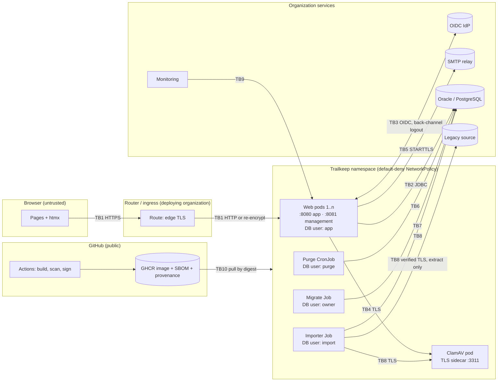

<!-- SPDX-License-Identifier: Apache-2.0 -->
# Threat model

A lightweight STRIDE model of Trailkeep over the architecture of `BUILD_PLAN.md` §7.1, as §9 promises: a Phase 1
deliverable, re-checked at each phase gate. It covers the application, its reference deployment (`deploy/`) and the
way it is built and released.

For each element or flow it lists:
- the threat, by STRIDE letter: **S**poofing, **T**ampering, **R**epudiation, **I**nformation disclosure, **D**enial
  of service, **E**levation of privilege;
- the control that mitigates it;
- what verifies that control: a section of [`security/TEST_MAP.md`](TEST_MAP.md) and the test or scanner named there;
- the residual risk, which points to the [register](#residual-risks) where it needs action from someone.

Where personal or restricted data lives, who reads it and when it goes is in [`security/DATA_MAP.md`](DATA_MAP.md).
The importer has its own, more detailed analysis in [`docs/design/importer.md`](../docs/design/importer.md) §10; this
page links to it rather than repeating it.

"None" in the verification column means no test in the repository verifies the control. The control may still
exist (for example as framework behaviour); the gap is then a residual risk.

## Assumptions

1. **The deploying organization runs Trailkeep behind its own router or ingress**, which terminates TLS for the
   browser, and sets `APP_PROXY_PATTERN` to that router's pod addresses only (`deploy/README.md`, step 2).
2. **The identity provider is trusted.** Whoever controls it, or the group memberships it asserts, controls who signs
   in and who holds Compliance Admin or System Admin (`TrailkeepOidcUserService` maps groups to global roles). Team
   roles are granted in Trailkeep.
3. **The platform is trusted**: cluster administrators, the database administrators and the secret store. `SECURITY.md`
   puts attacks that need a compromised provider, database administrator or cluster administrator out of scope.
4. **The platform enforces NetworkPolicy.** The manifests rely on it for every boundary below. A cluster whose network
   plugin ignores it has none of those boundaries.
5. **Platform responsibilities are carried out**: encryption at rest, backups, log storage, NTP, secret rotation, and
   replacing the placeholder addresses in the overlays (BUILD_PLAN §9 "Data at rest"; TEST_MAP [Data at rest]).
6. **Case titles are not sensitive.** Policy says so and the intake form says so (BUILD_PLAN §3.3); titles appear in
   mail, alerts, reports and exports, and stay after a purge. `TitleWarning` warns about likely identifiers before a
   save but cannot enforce the policy.
7. **The SMTP relay, ClamAV and the IdP are operated by the deploying organization.** Their own security is theirs
   (`SECURITY.md`, "Scope").

## Elements, flows and trust boundaries

The §7.1 diagram, with the workloads of §16 and `deploy/` and the trust boundaries (TB) drawn in. Every pod of the
same image runs with a read-only root file system, as a non-root user, with all capabilities dropped and no service
account token (`deploy/base/deployment.yaml`, `deploy/base/purge-cronjob.yaml`, the Job manifests).

| Boundary | Between | Credential that crosses it | Network control |
|---|---|---|---|
| TB1 | Browser ↔ router ↔ web pods | the `SESSION` cookie; CSRF token | the route (`deploy/base/route.yaml`); `trailkeep-web-ingress` admits port 8080 only from the router's namespace (`deploy/base/networkpolicy.yaml`) |
| TB2 | Web pods ↔ database | `TRAILKEEP_APP` from Secret `trailkeep-web` | `trailkeep-egress`, database address and port only |
| TB3 | Web pods ↔ IdP | the OIDC client secret (`trailkeep-web`); ID and logout tokens | `trailkeep-egress` to the IdP on 443; the back-channel logout POST arrives through TB1, and its replay goes to the pod's own loopback address, which no policy governs (BUILD_PLAN §16) |
| TB4 | Web pods ↔ clamd | none: server-authenticated TLS with the `clamav-ca` bundle (ADR-0012) | `trailkeep-egress` to the ClamAV pods on 3311; the ClamAV policy admits only Trailkeep pods (`deploy/base/clamav.yaml`) |
| TB5 | Web pods ↔ SMTP relay | the SMTP password (`trailkeep-web`), if the relay needs one | `trailkeep-egress` to the relay on 587 |
| TB6 | Purge CronJob ↔ database | `TRAILKEEP_PURGE` from Secret `trailkeep-purge`, mounted by nothing else | `trailkeep-purge`: DNS and the database only, no ingress (`deploy/base/purge-networkpolicy.yaml`) |
| TB7 | Migrate Job ↔ database | `TRAILKEEP_OWNER` (DDL) from Secret `trailkeep-migrate`, mounted by nothing else | `trailkeep-migrate`: DNS and the database only, no ingress (`deploy/jobs/migrate/networkpolicy.yaml`) |
| TB8 | Importer Job ↔ database, clamd, legacy source | `TRAILKEEP_IMPORT` (`trailkeep-import`), `import.hash-key`, `app.audit.hmac-key`, and the source password only for `validate-mapping` and `extract` | `trailkeep-importer`: DNS, database, clamd; source egress only with the `source-access` component (`deploy/jobs/importer/networkpolicy.yaml`) |
| TB9 | Monitoring and kubelet ↔ management port 8081 | none: the port is anonymous by design | not in the Service or the route; `trailkeep-web-ingress` admits 8081 only from the monitoring namespace |
| TB10 | CI/CD and supply chain ↔ the running image | GitHub's job token and OIDC identity, at release only | GitHub; the deployer pins the image by digest after `cosign verify` (`deploy/README.md`, step 1) |

**Assets:**
- restricted and personal case content, attachments and people's data (see `security/DATA_MAP.md`);
- the integrity of the audit trail;
- live sessions;
- the credentials and keys: the four database users, the OIDC client secret, the SMTP password, `app.audit.hmac-key`,
  `import.hash-key` and the source password;
- the published image and its signature.

## STRIDE by element and flow

The links in the verification column go to the TEST_MAP section that names the check and where it runs:
[IA], [AC], [AU], [SI], [Injection], [Browser], [SC], [Transport], [Data at rest], [Logging], [Errors],
[Availability], [Supply chain], [SoD], [Privacy], [DAST], [Gaps].

### TB1: browser ↔ router/ingress ↔ web pods

| # | Threat | Control | Verified by | Residual |
|---|---|---|---|---|
| 1.1 | S: someone signs in as another person or without an account | SSO only, no local accounts or passwords; disabled users refused at login; anonymous requests sent to the IdP | [IA]: `KeycloakLoginIT`, `TrailkeepOidcUserServiceTest`, `SecurityDefaultsIT`; [AC]: `DenyByDefaultIT` | Real-provider login untested ([RR-4](#residual-risks)) |
| 1.2 | S: a stolen or left-open session is reused | `SESSION` cookie `Secure; HttpOnly; SameSite=Lax`; 30-minute idle and 8-hour absolute limits; disabling a user ends their sessions everywhere; RP-initiated logout | [IA]: `SessionHardeningIT`, `SessionPermissionsFilterTest`, `SharedSessionsIT`, `UserAdminServiceIT`, `KeycloakLoginIT` | A stolen cookie works until a limit expires; no step-up re-authentication for admin actions (TEST_MAP [Gaps] 3) |
| 1.3 | S: a forged `X-Forwarded-For` or `X-Forwarded-Proto` fakes the client address in the audit trail or the scheme | forwarded headers trusted only from `APP_PROXY_PATTERN`; the app does not start without it | [Transport]: `ForwardedHeadersTrustedProxyIT`, `ForwardedHeadersSpoofIT`, `ForwardedHeadersPrivatePeerIT` | A pattern wider than the router lets other pods forge the audited address ([RR-12](#residual-risks)) |
| 1.4 | T: cross-site request forgery | CSRF token on every state-changing request, htmx included; `SameSite=Lax`; no CORS | [Browser]: `SecurityDefaultsIT`, `RouteSweepIT`, `NoCorsIT` | None known |
| 1.5 | T: stored or reflected script (comments, descriptions, names) | Markdown rendered then sanitized; Thymeleaf escaping, `th:utext` banned, `tk:safe` only for sanitizer output; exact CSP with a per-request nonce; htmx `allowEval=false`, inline htmx handlers banned; stored reports re-sanitized | [SI]: `MarkdownRendererTest`, `StoredReportSanitizerTest`; [Injection]: `semgrep:thymeleaf-unescaped-output`, `SafeHtmlDialectTest`; [Browser]: `WebShellIT`, `CspCrawlIT`, `semgrep:htmx-inline-script`; [DAST] | None known |
| 1.6 | T: SQL injection | JPA with bound parameters; native SQL only in `*JdbcDao` classes; allow-listed sort and filter values | [Injection]: `semgrep:jpa-dynamic-query-string`, `RuntimeUserIT`; [AC]: `CaseListQueryTest`; [DAST] | None known |
| 1.7 | T: a malicious upload (malware, a disguised type, an oversized file, a hostile name) | type detected from the bytes against an allow-list with an extension cross-check; synchronous ClamAV scan before anything is stored, fail-closed; infected files quarantined and never served; size limits; `Content-Disposition: attachment`, `nosniff` | [SI]: `AttachmentTypesTest`, `UploadIntakeTest`, `ClamdClientIT`, `CaseAttachmentUploadIT`, `UploadAbuseBrowserIT`, `OversizedUploadIT`, `AttachmentDispositionTest` | With `external` scanning, files are stored `NOT_SCANNED`; signatures are only as fresh as the ClamAV image ([RR-11](#residual-risks)) |
| 1.8 | T: a CSV export cell runs as a formula in a spreadsheet | cells starting with `= + - @` are prefixed | [SI]: `CsvFormatTest` | None known |
| 1.9 | R: a person denies a change, a restricted view or a download | the audit event is written in the change's transaction with the actor, request id and client address; restricted views and downloads write `VIEW_RESTRICTED`; the runtime user cannot update or delete audit rows | [AU]: `AuditRecorderIT`, `RestrictedViewAuditIT`, `PostgresDatabaseGrantsIT`, `OracleDatabaseGrantsIT` | The trail is not tamper-evident to the schema owner or a DBA, and no screen exports it ([RR-8](#residual-risks)) |
| 1.10 | I: enumeration of restricted or other-team cases by number | `CaseScope` on every case-rooted query; an unreadable case answers 404 like an absent one | [AC]: `CaseScopeTest`, `CaseRootedInvisibilityIT`, `CaseScopeMatrixIT`, `RouteSweepIT`, `ArchitectureRulesTest` | None known |
| 1.11 | I: restricted text reaches a person who may not read it (lists, search, exports, reports) | scope on search candidates, exports and reports; export details only for a Manager of the case's team or a Compliance Admin who asks | [Privacy]: `RestrictedLeakCrawlIT`, `CaseExportControllerIT`, `CaseExportIT` | A title that holds personal data despite the policy is shown to every case reader ([RR-9](#residual-risks)) |
| 1.12 | I: an attachment of another case fetched by id (IDOR) | attachment URLs scoped by case number and checked through the scope | [AC]: `CaseAttachmentDownloadIT`, `CaseAttachmentReleaseIT` | None known |
| 1.13 | I: error pages leak input, stack traces or server details | generic error pages; every `spring.web.error.include-*` off; Tomcat's error page without server information | [Errors]: `ErrorPropertiesTest`, `MalformedParametersIT`, `MalformedMultipartIT`, `TomcatErrorPageHeadersIT` | None known |
| 1.14 | I: case text kept by the browser or a shared cache | `Cache-Control: no-store` on pages, downloads and exports; htmx keeps no history snapshots; `Referrer-Policy: same-origin` | [Browser]: `SecurityDefaultsIT`, `WebShellIT`; `CaseAttachmentDownloadIT`, `CaseExportControllerIT` | Search text in URLs reaches the router's access log ([RR-10](#residual-risks)) |
| 1.15 | I: interception between the browser and the pod | edge TLS with an HTTP redirect; HSTS | [Transport]: configured only (`deploy/base/route.yaml`); [Browser]: `SessionHardeningIT` (HSTS) | The router-to-pod hop is plain HTTP unless the overlay re-encrypts ([RR-12](#residual-risks)) |
| 1.16 | I: clickjacking | `frame-ancestors 'none'` and frame options | [Browser]: `SecurityDefaultsIT`, `WebShellIT` | None known |
| 1.17 | D: floods of searches, uploads or downloads | per-person rate limits on search (export included) and upload with 429 and `Retry-After`; request size limits; bounded concurrent downloads | [Availability]: `RateLimitIT`, `TokenBucketsTest`, `MultipartLimitsTest`, `OversizedUploadIT`, `ConcurrentDownloadHeapIT` | Buckets are per replica; other routes are not rate-limited ([RR-3](#residual-risks)) |
| 1.18 | E: a person acts beyond their role (horizontal or vertical) | `CasePermissionService` implements BUILD_PLAN §3.2 from one CSV; permissions rebuilt from the database on every request, never from the session; System Admin holds no case access and no team role; deny-by-default URL rules | [AC]: `PermissionMatrixTest`, `CasePermissionServiceTest`, `DenyByDefaultIT`, the `web` controller ITs; [IA]: `SessionPermissionsFilterTest`; [SoD]: `PermissionMatrixTest`, `ClosureRequestIT` | Global roles follow IdP groups (assumption 2) |
| 1.19 | E: malformed input reaches a code path that was not written for it | control characters refused on every route; Bean Validation; malformed requests answer 400 | [SI]: `ControlCharacterSweepIT`, `MalformedParametersIT`, `MalformedMultipartIT`, `WebShellIT` | Bean Validation is checked per form, not by a rule (TEST_MAP [SI], "Configured only") |

### TB2: web pods ↔ database

| # | Threat | Control | Verified by | Residual |
|---|---|---|---|---|
| 2.1 | S: a workload connects as another workload's database user | four users (app, purge, import, owner), each in its own Secret mounted only by its workload | [SC]: `WebDeploymentManifestTest`, `PurgeCronJobManifestTest`, `ImporterJobManifestTest`, `MigrateJobManifestTest` | Secret-store access is the platform's ([RR-2](#residual-risks)) |
| 2.2 | T: the application rewrites history (audit, comments, attachment content) | grants: the app user may not update or delete `AUDIT_EVENT`, `CASE_COMMENT`, `CASE_ATTACHMENT_CHUNK`, `ALERT_LEDGER` or `CASE_IMPORTED_EVENT`, and may update only the release columns of `CASE_ATTACHMENT` | [AU], [SoD]: `PostgresDatabaseGrantsIT`, `OracleDatabaseGrantsIT` (against `GrantsMatrix`) | The owner and DBAs can change anything ([RR-8](#residual-risks)) |
| 2.3 | E: the runtime user changes the schema | runtime users own no table and hold no DDL right; Flyway is off in the web pods | `MigrationJobIT`; [Injection]: `RuntimeUserIT` | None known |
| 2.4 | I: a compromised web pod or app credential reads every case | `CaseScope` limits what the application shows; the database grants the app user `SELECT` on all case tables, because row-level scoping lives in the application | [AC] (application scoping only) | Everything the schema holds is exposed to whoever holds the app credential ([RR-6](#residual-risks)) |
| 2.5 | I: session theft from the database | session ids in `SPRING_SESSION` are bearer secrets; only the app user can read them | [AU]: `PostgresDatabaseGrantsIT` (grants) | Read access to that table is session hijack until expiry ([RR-7](#residual-risks)) |
| 2.6 | I/T: interception between pod and database | Oracle `tcps` through the deployment's JDBC URL; PostgreSQL TLS is the deployer's URL too | [Transport]: configured only; TEST_MAP [Gaps] 9 | [RR-12](#residual-risks) |
| 2.7 | I: data read from disks, snapshots or backups | Oracle TDE or volume encryption; backups by organization policy | [Data at rest]: platform; TEST_MAP [Gaps] 10 | [RR-1](#residual-risks) |
| 2.8 | D: the connection pool is exhausted | pool sizing; exports and downloads bounded (`app.export.max-rows`, `app.attachments.max-concurrent-downloads`); the TrailkeepDbPoolExhausted alert (`deploy/components/prometheus-rules`) | [Availability]: `ConcurrentDownloadHeapIT`; pool sizing configured only | None beyond capacity planning |

### TB3: web pods ↔ identity provider

| # | Threat | Control | Verified by | Residual |
|---|---|---|---|---|
| 3.1 | S: a forged or replayed login response | Spring Security's OIDC authorization-code login: `state` and `nonce`, ID token signature checked against the provider's keys | [IA]: `KeycloakLoginIT` (Keycloak dev realm) | Tested against the dev realm only ([RR-4](#residual-risks)) |
| 3.2 | S: an unknown or unmapped group grants a role; a provider claim adds System Admin to someone with team roles | only mapped groups become global roles; System Admin is withheld from a user who holds team roles, and the conflict is audited and listed | [IA]: `TrailkeepOidcUserServiceTest`; `UserSignInServiceIT`, `RoleConflictsIT` | Group administration at the IdP is trusted (assumption 2) |
| 3.3 | S/D: a forged back-channel logout token ends sessions | the endpoint is public by design and served by Spring Security's back-channel logout support, which validates the logout token; the custom registry finds sessions by `sid` or `sub` | [IA]: `JdbcOidcSessionRegistryIT`, `OracleJdbcOidcSessionRegistryIT`, `BackChannelLogoutUriIT`; [AC]: `DenyByDefaultIT` (public list) | Token validation is unverified here: no repository test sends a forged or valid logout token end to end ([RR-4](#residual-risks)) |
| 3.4 | I: the ID token and its claims (email, name) kept by the application | stored inside the session's JSON attributes (needed for RP-initiated logout), never JDK-serialized; no authorities stored | [IA]: `SessionJsonTest`, `SessionPermissionsFilterTest` | Personal data in the session table ([RR-7](#residual-risks)) |
| 3.5 | D: the IdP is down | no new sign-ins; signed-in people keep working until their session ends | none | Availability depends on the IdP |
| 3.6 | I: the OIDC client secret leaks | a Secret file of `trailkeep-web`, never in the image or repository | [SC]: `WebDeploymentManifestTest`, gitleaks | [RR-2](#residual-risks) |

### TB4: web pods ↔ clamd

| # | Threat | Control | Verified by | Residual |
|---|---|---|---|---|
| 4.1 | S/T: a rogue scanner, or a tampered verdict on the wire | server-authenticated TLS to the ghostunnel sidecar, trusted through the `clamd` SSL bundle; clamd itself binds `127.0.0.1` only | [Transport]: `ClamdClientIT` (real clamd behind TLS) | No client authentication: any pod admitted by the ClamAV policy may use the scanner (ADR-0012: mTLS optional) ([RR-11](#residual-risks)) |
| 4.2 | D: the scanner is unreachable or slow | fail-closed: uploads refused, nothing stored unscanned; the TrailkeepScannerDown alert | [SI]: `ClamdClientTest`, `CaseAttachmentUploadIT` | Uploads stop while clamd is down (by design) |
| 4.3 | T: new malware is not detected | the ClamAV image ships its signatures; no `freshclam` in the base | none | [RR-11](#residual-risks) |
| 4.4 | E: a crafted file exploits clamd | clamd runs in its own pod with no egress and ingress from Trailkeep pods only | none (manifest only, `deploy/base/clamav.yaml`) | Contained to the ClamAV pod |

### TB5: web pods ↔ SMTP relay, and the mail it carries

| # | Threat | Control | Verified by | Residual |
|---|---|---|---|---|
| 5.1 | S/I: a fake relay, or mail read on the wire | STARTTLS required in `prod`; the server's identity is checked by Angus Mail's default (`mail.smtp.ssl.checkserveridentity`, true in 2.0.5) | [Transport]: `MailStartTlsTest` (STARTTLS); none for the identity check | The identity check is a library default, not pinned by a test ([RR-18](#residual-risks)) |
| 5.2 | I: mail carries case content to a mailbox outside Trailkeep | mails carry the case number, title, due date, names and a link only; never a description, subject, comment, message or closure summary | [Injection]: `MailTemplatesTest`; [Privacy]: `ClosureRequestIT`, `NotificationServiceIT`; [Logging]: `LoggingRulesIT` | Titles go out ([RR-9](#residual-risks)) |
| 5.3 | T: a link in a mail sends people elsewhere (phishing through the template) | links only into the application; values escaped | [Privacy]: `NotificationServiceIT`; [Injection]: `MailTemplatesTest` | None known |
| 5.4 | D: the relay is down | the outbox queues and retries; alerts TrailkeepMailNotSending, TrailkeepMailBacklog and TrailkeepMailFailed | none | Delayed mail, not lost |

### TB6: the purge CronJob

| # | Threat | Control | Verified by | Residual |
|---|---|---|---|---|
| 6.1 | E/S: the web pods use the purge credential | `trailkeep-purge` is mounted by the CronJob only, and the web Deployment never mounts it | [SoD], [SC]: `PurgeCronJobManifestTest`, `WebDeploymentManifestTest` | [RR-2](#residual-risks) |
| 6.2 | T: purge deletes a case under legal hold or not yet due | each chunk re-read `FOR UPDATE` with every condition, so a hold placed meanwhile wins; grants allow only the tombstone `UPDATE` of four `CASE_RECORD` columns and deletes of case content | [SoD]: `PurgeIT`, `LegalHoldIT`, `PostgresDatabaseGrantsIT`; [Privacy]: `ArchiveJobIT` | None known |
| 6.3 | R: what a purge removed is unknown | one `CASE_PURGED` audit row per case with the counts of what went | [SoD]: `PurgeIT` | None known |
| 6.4 | I/E: the purge pod reaches more than it needs | `purge` profile starts no web application, registers no OIDC client, sends no mail; egress to DNS and the database only | [SoD]: `PurgeProfileIT`, `PurgeCronJobManifestTest` | It keeps the `clamav-ca` mount (TEST_MAP [SoD]) |
| 6.5 | D: retention is never enforced | the CronJob ships suspended until retention is enabled; its last success is in `JOB_RUN` and on the System screen | none | No alert when the purge stops running ([RR-14](#residual-risks)) |

### TB7: the migration Job

| # | Threat | Control | Verified by | Residual |
|---|---|---|---|---|
| 7.1 | E: the DDL credential reaches a long-running pod | `TRAILKEEP_OWNER` only in `trailkeep-migrate`, mounted by the Job alone, which runs and exits before a rollout | [SC]: `MigrateJobManifestTest` | The credential's lifetime between releases is the deployer's ([RR-2](#residual-risks)) |
| 7.2 | T: a changed or out-of-order migration | Flyway validates checksums, naming and order before every migrate; Hibernate validates the migrated schema; `R__grants.sql` is re-applied | `MigrationJobIT`, `OracleMigrationJobIT` | A malicious image runs with schema-owner rights during migration ([RR-15](#residual-risks)) |
| 7.3 | I/E: the Job reaches anything but the database | egress to DNS and the database only, no ingress; no OIDC client, no audit key | [SC]: `MigrateJobManifestTest` | None known |

### TB8: the importer Job

The full analysis is [`docs/design/importer.md`](../docs/design/importer.md) §10 (least privilege at the source, TLS,
no SQL injection surface, placeholders that cannot exfiltrate, PHI minimization, sign-off, network and secrets). The
rows below only connect it to the rest of the model.

| # | Threat | Control | Verified by | Residual |
|---|---|---|---|---|
| 8.1 | S/I: the source connection is intercepted | verified TLS per vendor, refused otherwise | [Transport]: `SourceUrlTest`, `PostgresSourceTlsIT` | None known |
| 8.2 | T/E: a mapping file injects SQL or reads secrets | queries parsed and restricted, run read-only through one DAO; `${…}` resolved only in two keys from `import.source.*` | `SourceQueryValidatorTest`, `MappingValidatorTest` | None known |
| 8.3 | T: a legacy path escapes its root; a legacy file carries malware | every path resolved under its root; files go through the upload intake and scan | `AttachmentFilesTest`; [SI]: `ClamdClientIT` | As 1.7 |
| 8.4 | E: the import credential is misused | its own Secret, user and NetworkPolicy; grants split sign-off (app user) from run moves (import user) | [SC]: `ImporterJobManifestTest`, `ImporterStagingTtlManifestTest`; [SoD]: `PostgresDatabaseGrantsIT`; `ImportRunSignOffIT` | Whoever holds `TRAILKEEP_IMPORT` can write domain rows directly; sign-off guards against mistakes, not a malicious operator (design N-j) ([RR-13](#residual-risks)) |
| 8.5 | I: legacy content lingers in staging | staging readable by the import user only; purged by `purge-staging` and the staging TTL, which every importer command and a daily CronJob apply (#275) | `ImporterProfileIT`, `ImporterStagingTtlManifestTest` | Staging outlives its expiry by up to one interval of the schedule, and longer if the CronJob is deleted while staging remains ([RR-13](#residual-risks)) |
| 8.6 | R: imported records pass as decisions made in Trailkeep | two disabled import principals; `IMPORTED` closures; `AUDIT_EVENT(origin=IMPORT)`; the ledger | `LoadIT`, `ClosureImportIT`, `ReconcileIT` | None known |

### TB9: the management port (8081)

| # | Threat | Control | Verified by | Residual |
|---|---|---|---|---|
| 9.1 | I: actuator endpoints leak configuration or data | only health, liveness, readiness, info and Prometheus are served there; the port is anonymous by design | [AC], [Availability]: `ManagementEndpointsIT` | Metrics carry no personal tags (route, outcome, state); checked by reading the code, not by a test |
| 9.2 | I/D: the port is reached from outside | not in the Service or the route; NetworkPolicy admits 8081 only from the monitoring namespace | [AC]: `ManagementEndpointsIT` (what is served); none for the policy | A wrong monitoring label in the overlay, or no policy enforcement, opens it to the cluster ([RR-19](#residual-risks)) |

### TB10: CI/CD and the supply chain

| # | Threat | Control | Verified by | Residual |
|---|---|---|---|---|
| 10.1 | S: a forged or swapped image | keyless cosign signature bound to `release.yml` on the tag, CycloneDX attestation, SLSA provenance; verified after publishing; the deployer pins by digest | [Supply chain]: `.github/workflows/release.yml`, `.github/workflows/verify-image.yml` (TEST_MAP [Gaps] 22) | No admission policy ships; the deployer must verify ([RR-15](#residual-risks)) |
| 10.2 | T: a vulnerable or malicious dependency | enforcer bans and convergence; licence allow-list; Dependabot; Trivy on the SBOM and the image | [Supply chain]: `enforcer:bannedDependencies`, `enforcer:dependencyConvergence`, `.github/workflows/main.yml#trivy-sbom`, `.github/workflows/main.yml#image` | Dependency-Check and SonarCloud are skipped until their secrets are set (TEST_MAP [Gaps] 18, 19; #30) |
| 10.3 | T: a malicious pull request abuses CI | workflows default to `permissions: {}` with read-only jobs; only the tag-triggered release jobs get `packages: write` and `id-token: write`; Actions pinned by commit SHA | [Supply chain]: `.github/workflows/ci.yml#actionlint` and review | Checked by reading the workflows; branch protection is a repository setting |
| 10.4 | I: a secret committed to the public repository | gitleaks on every PR and push; GitHub secret scanning and push protection | [SC]: gitleaks; TEST_MAP [Gaps] 16 (settings) | Repository settings are not visible in the repository |
| 10.5 | E: a compromised maintainer account or release tag | signing proves which workflow built the image, not that the change was intended | none | [RR-15](#residual-risks) |

## Residual risks

Owner: **project** (this repository can change it), **deployer** (the deploying organization's configuration or
process) or **platform** (the database, cluster, storage or secret store).

| # | Risk | Owner | Status |
|---|---|---|---|
| RR-1 | Encryption at rest (Oracle TDE or volume encryption) and backups are not provided or tested here. Backups also keep purged content until they expire. | platform | Position: TEST_MAP [Gaps] 10 |
| RR-2 | Secret-store hygiene: who can read the namespace's Secrets, rotation, and keeping `TRAILKEEP_OWNER` and `TRAILKEEP_IMPORT` locked when no migration or import runs (`deploy/README.md` asks this for the import user only). `app.audit.hmac-key` is one key with no rotation procedure: a new key makes older redacted values incomparable, and a leaked key makes short redacted values testable by dictionary. | platform, deployer | Open |
| RR-3 | Rate limits are per replica, in memory (built in #263): a multi-replica deployment needs a limit at the route or ingress as well. Only search, export and upload are limited. | deployer | Position: TEST_MAP [Availability] |
| RR-4 | The IdP is tested only against the Keycloak dev realm: real-provider login, group claims and back-channel logout are unverified (#30), and no repository test sends a forged or valid logout token end to end (validation is Spring Security's). | project, deployer | Tracked: #30 |
| RR-5 | No human assistive-technology pass yet (#92); automated axe and Nu checks gate every PR. A conformance risk rather than a STRIDE threat, recorded here because BUILD_PLAN §10 makes conformance a release condition. | project | Tracked: #92 |
| RR-6 | Case-level access is enforced in the application, not the database: the app user reads every row, restricted cases included. | project (by design), deployer | Accepted: BUILD_PLAN §3.3, ADR-0005 |
| RR-7 | `SPRING_SESSION` holds bearer session ids, and `SPRING_SESSION_ATTRIBUTES` the ID token's claims (email, name). Database read access means session hijack until expiry. | platform | Open |
| RR-8 | The audit trail is append-only for the app, purge and import users but not tamper-evident to the schema owner or a DBA (no hash chain or external copy). The Compliance Admin audit export of BUILD_PLAN §9 is not built: no screen reaches events without a case (sign-ins, admin changes, exports). | project, platform | Open |
| RR-9 | Titles may hold personal data despite the policy; they go into mail, alerts, reports and exports and stay after a purge. `TitleWarning` warns (`TitleWarningTest`). | deployer (policy) | Accepted: BUILD_PLAN §18 |
| RR-10 | Free-text search terms are not treated as sensitive: they travel in URLs (router access logs), `SAVED_VIEW.QUERY` and the `CASES_EXPORTED` audit row's query, unredacted. | project, deployer | Open |
| RR-11 | ClamAV signatures are as fresh as the image; clamd accepts any admitted pod (no mTLS); `external` mode stores files `NOT_SCANNED` and relies on the organization's own scanner. | deployer | Position: ADR-0012, ADR-0013 |
| RR-12 | Transport beyond the edge depends on the deployment: router-to-pod is plain HTTP unless re-encrypted; database TLS is the JDBC URL (TEST_MAP [Gaps] 9); `APP_PROXY_PATTERN` must match the router only. | deployer | Position: TEST_MAP [Gaps] 9 |
| RR-13 | The import credential can write domain rows directly and read every mapped table; staging outlives its TTL by up to one schedule interval, or indefinitely if the TTL CronJob is deleted early; the content claim must be encrypted at rest; the importer's plain SHA-256 mapping hash awaits review (TEST_MAP [Gaps] 23). | deployer, project | Position: importer design §10, N-j |
| RR-14 | The purge CronJob ships suspended and no alert fires when it stops succeeding; the System screen shows it as unchecked. | deployer, project | Open |
| RR-15 | Supply chain: SonarCloud and Dependency-Check skipped (#30); no admission policy ships, so the deployer must verify the signature and pin the digest; a compromised maintainer account or tag yields a validly signed image, which then runs with schema-owner rights in the migration Job. | project, deployer | Tracked: #30 |
| RR-16 | Personal data is not erasable on request: users are disabled, never deleted; name snapshots stay in the audit trail; mail rows stay unless their case is purged or their report run expires. | deployer (privacy policy) | Open |
| RR-17 | Application and router logs are stored and retained by the platform. | platform | Position: BUILD_PLAN §9 |
| RR-18 | The SMTP server identity check relies on the mail library's default, which no test pins. | project | Open |
| RR-19 | The management port relies on the overlay's monitoring namespace label and on NetworkPolicy enforcement. | deployer | Open |

## Re-check cadence

Re-check this model and `security/DATA_MAP.md` at each phase gate (BUILD_PLAN §9, §17), and also when a change:
- adds a workload, a credential, an egress target or a port;
- adds a table or column that holds personal or case data;
- changes how data leaves the system (mail, export, report, log);
- closes or opens a TEST_MAP gap.

A re-check walks every boundary above, confirms each verification still names a test that exists (TEST_MAP is checked
by `SecurityTestMapTest`), and updates the residual risks.

| Date | Phase | Commit | Change |
|---|---|---|---|
| 2026-11-21 | Phase 5 (before the Phase 6 gate) | `b3f418b` | First version (#248) |

[IA]: TEST_MAP.md#identity-ia
[AC]: TEST_MAP.md#authorization-ac
[AU]: TEST_MAP.md#audit-au
[SI]: TEST_MAP.md#input-validation-si
[Injection]: TEST_MAP.md#injection
[Browser]: TEST_MAP.md#browser-security
[SC]: TEST_MAP.md#secrets-sc
[Transport]: TEST_MAP.md#transport
[Data at rest]: TEST_MAP.md#data-at-rest
[Logging]: TEST_MAP.md#logging
[Errors]: TEST_MAP.md#errors
[Availability]: TEST_MAP.md#availability
[Supply chain]: TEST_MAP.md#supply-chain
[SoD]: TEST_MAP.md#separation-of-duties
[Privacy]: TEST_MAP.md#privacy
[DAST]: TEST_MAP.md#dast-the-zap-plan
[Gaps]: TEST_MAP.md#gaps
